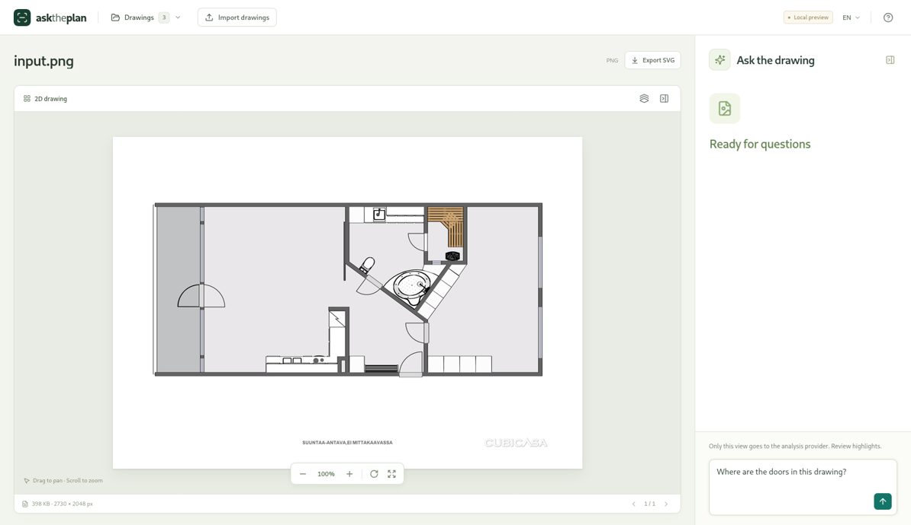
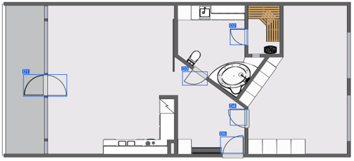
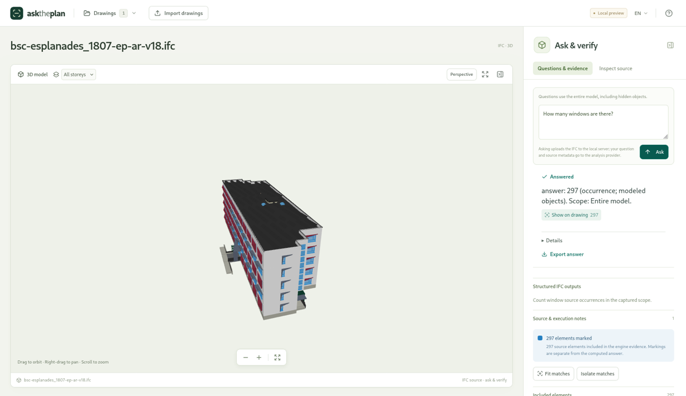

# Ask the Plan

**Ask a construction drawing a question. See the source behind the answer.**

Built by a team of four at our first hackathon, for Stoa's **Make Blueprints Talk** challenge at Junction 2026. Ask the Plan combines a drawing and BIM viewer, vision models, and a local IFC query engine in one workbench.

[Submitted pitch deck](Ask-the-Plan-Pitch.pptx) · [Tech stack and architecture](docs/TECH_STACK.md) · [250-question evaluation](experiments/review_250/RESULTS.md)

## Screenshots

### Floor Plan Analysis

Ask questions about construction drawings and explore the results in the interactive workbench.

<p align="center">
  <a href="screenshots/floorplan1.png">
    
  </a>
  <a href="screenshots/floorplan2.png">
    
  </a>
</p>

### IFC Model Viewer

Explore building information models in an interactive 3D viewer and query their properties using natural language.

<p align="center">
  <a href="screenshots/ifcscreenshot.png">
    
  </a>
</p>

*Click any screenshot to view it in full resolution.*


## What you can do

- **Import a drawing or model.** Open PNG/JPEG and other images, PDFs, DXF layouts, or IFC models.
- **Ask in natural language.** Locate depicted objects and get qualified visual counts, inspect model properties and quantities, or request supported calculations.
- **Inspect the evidence.** Jump to drawing regions or IFC objects, see the calculation inputs, and export the full answer and source evidence.

Drawing questions use the selected image, PDF page, or DXF layout. IFC questions use the entire imported model, with any room/floor filters in the question. The interface supports English and Finnish, and source labels and identifiers keep their original language.

## How it works

| Input | Processing | Evidence |
| --- | --- | --- |
| Images and drawing pages | Gemini inspects drawing panels and overlapping detail crops. Optional routing selects Hydrogen or Carbon. | Candidate regions, literal labels, source hashes, and explicit estimated/partial outcomes. |
| PDFs | PDF.js supplies the preview and native text/schedule tools, with bounded model planning. Visual questions can use the same detailed scan as images. | Page-bound text spans, table cells, or drawing regions. |
| IFC building models | IfcOpenShell extracts the source. Supported questions compile locally or use a model-proposed plan, then the CPU engine executes it. | Original object IDs, properties, quantities, included/excluded objects, and calculations. |
| DXF layouts | ezdxf renders the selected layout, which enters the drawing question flow. | Layout identity, rendering warnings, and source-bound regions. |

Answers keep missing information, ambiguous membership, estimates, and zero distinct. Complete coverage of the supplied question families is still being evaluated. The [current capabilities and limits](docs/NATURAL_LANGUAGE_ANSWERS.md) describe the implemented paths.

## Tech stack at a glance

| Layer | Main tools | Role |
| --- | --- | --- |
| Workbench | React 19, TypeScript, Vite 7 | Local imports, chat, answer review, and exports |
| Drawing and BIM viewers | PDF.js, Three.js, That Open Components/Fragments, web-ifc | Page rendering and interactive IFC inspection |
| Backend | Python, FastAPI, Uvicorn, Pydantic | Source sessions, shared contracts, request budgets, and evidence |
| Source execution | IfcOpenShell, ezdxf, Pillow, NumPy, Shapely | IFC queries, DXF previews, raster preparation, and geometry |
| Inference | Native Gemini transport; Nemotron through Verda | Drawing interpretation, IFC query planning, and native PDF tool planning |

Credentials stay in the backend. The IFC executor, arithmetic, and answer wording run locally. See the [stack guide](docs/TECH_STACK.md) for component boundaries and dependency versions.

## Evaluation

**15 November 2026 — 250 real questions completed, with zero HTTP/import errors.** This seeded, category-balanced development sample covers 83 question families and 207 source files on production revision `7904dbd`.

| Category | Questions | Numeric agreement | Answered | Partial | Non-answer |
| --- | ---: | ---: | ---: | ---: | ---: |
| CubiCasa PNG plans | 75 | 55/75 | 0 | 66 | 9 |
| Swiss PDF plans | 75 | 51/75 | 1 | 59 | 15 |
| IFC-derived PDF plans | 25 | 3/25 | 2 | 10 | 13 |
| Opening Design sheets | 25 | 2/14 | 11 | 4 | 10 |
| IFC counts and quantities | 25 | 24/25 | 25 | 0 | 0 |
| IFC-Bench | 25 | Text review pending | 6 | 1 | 18 |
| **Total** | **250** | **135/214 (63.1%)** | **45** | **140** | **65** |

Numeric agreement includes qualified estimates and partial outputs. **19/214** additionally passed the strict checks for exact answered values and evidence structure. The **36 text questions remain ungraded**. Outcome columns show application statuses, and source localization still requires review.

The run used live Gemini and Nemotron providers. At 218 saved outcomes, the remaining drawings moved from three to eight workers. Three interrupted attempts were retained with unknown prior usage and retried. The [full report and per-case results](experiments/review_250/RESULTS.md) include sampling, grading, timing, usage, and reproduction details. Earlier runs remain in [experiments](experiments/README.md).

## Quick start

Requires **Node.js 22.12+** and **Python 3.10+** with a compatible IfcOpenShell wheel. Use the [setup guide](docs/SETUP.md) for dependency installation and backend credentials. The drawing workbench uses the Gemini provider for Detailed scan; IFC planning has its own provider setting.

Start the backend and frontend in separate terminals from the repository root. The IFC engine is included in the backend process and is also available as a CLI.

<details>
<summary>Windows PowerShell</summary>

Backend terminal:

```powershell
.\.venv\Scripts\python.exe -m uvicorn image_api.app:app --host 127.0.0.1 --port 8000
```

Frontend terminal:

```powershell
npm.cmd run dev
```

</details>

<details>
<summary>Linux</summary>

Backend terminal:

```sh
.venv/bin/python -m uvicorn image_api.app:app --host 127.0.0.1 --port 8000
```

Frontend terminal:

```sh
npm run dev
```

</details>

Open **<http://127.0.0.1:5173/>**. Backend API docs are at <http://127.0.0.1:8000/docs>. Imports last until refresh. The dataset is downloaded separately using the links in the [challenge brief](dataset/task.md).

## Find your way around

| Directory | Contents |
| --- | --- |
| `frontend/` | React workbench and local viewers |
| `answer_api/`, `document_engine/` | Common answer coordination, temporary sources, and native PDF tools |
| `ifc_engine/`, `ifc_api/` | CPU query execution, source discovery, and natural-language planning |
| `image_api/`, `drawing_preprocessor/`, `dxf_api/` | Detailed drawing scans, raster preparation, and DXF previews |
| `gemini/`, `nemotron/` | Backend provider transports |
| `contracts/` | Python wire models and generated schemas/types |
| `experiments/`, `tests/` | Reproducible evaluations and regression checks |
| `docs/`, `dataset/` | Component guides, challenge materials, and local dataset inputs |

## Checks and generated contracts

Install the `test` extra first, as described in [setup](docs/SETUP.md). From the root on Windows:

```powershell
npm.cmd run test:frontend
npm.cmd run build
.\.venv\Scripts\python.exe -m unittest discover -s tests -q
.\.venv\Scripts\python.exe -m contracts.export --check
.\.venv\Scripts\python.exe scripts/check_docs.py
```

On Linux, use `npm` and `.venv/bin/python`. After editing Python contracts, regenerate JSON Schemas with `python -m contracts.export` and frontend types with `npm.cmd --prefix frontend run generate:contracts`, using the configured environment.

The [verification record](docs/VERIFICATION.md) records platforms, executed checks, and their limits. Tests using mocked providers are reported separately from live question evaluations.

Drawing assets retain their original licenses and attribution. See [repository instructions](AGENTS.md) and [project scope](docs/PROJECT_SCOPE.md) when contributing.
