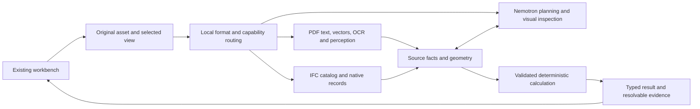

# Ask the Plan implementation master plan

14 November 2026 · Stoa’s **Make Blueprints Talk** challenge at Junction · [`TASE-junkkari26/ask-the-plan` main at `d2f0611`](https://github.com/TASE-junkkari26/ask-the-plan/commit/d2f06111dbd98c46975dda18689d230a50b8f3ca)

[Priorities](#1-what-to-build) · [Repository](#2-repository-starting-point) · [Team assignments](#3-ownership-and-first-work-packages) · [Interfaces and evidence](#4-runtime-tool-execution-and-evidence-contracts) · [Verda training](#5-verda-model-plan) · [Tool catalogue](#6-math-geometry-and-source-tool-catalogue) · [Quantity recipes](#7-implementation-recipes-for-the-organizers-examples) · [IFC](#8-ifc-execution-and-provided-set-coverage) · [Evaluation](#9-validation-evaluation-and-release-gates) · [Milestones](#10-milestones-and-release-ownership) · [Fallbacks](#11-failure-modes-and-rollback) · [Security and cost](#12-security-data-rights-and-cost-controls) · [Kickoff decisions](#13-choices-to-settle-at-kickoff)

## 1. What to build

Ship an import-to-answer workflow for a previously unseen PDF or image and for an IFC model. A judge selects a drawing, view, or model storey, asks a question, gets a quantity with its basis and units, and can click through to the objects, geometry, schedule cells, or source values that produced it. A partial result states what was verified and what remains unresolved. Repeat the workflow on the supplied examples and report both results.

On 14 November, Eino from Stoa confirmed that the final evaluation uses **unreleased drawings** and that performance on the provided set is also considered. The organizer’s examples were floor areas for different regions, linear metres of baseboards, door and window counts, and slab areas by thickness and reinforcement bars. Piping-plan understanding was offered as a way to impress the judges. The follow-up explicitly welcomed partial solutions on the harder examples. These are examples of what could be evaluated. The question mix, formats, measurement conventions, and scoring tolerances for the hidden set are unspecified. [Evaluation split](https://discord.com/channels/1268184974784336004/1564622781994508369/1571155986037612586) · [Quantity examples](https://discord.com/channels/1268184974784336004/1564622781994508369/1571158186851958884) · [Partial solutions](https://discord.com/channels/1268184974784336004/1564622781994508369/1571158741607391233)

The organizer also confirmed a numerical emphasis in the challenge discussion. Keep text, labels, and property lookup as evidence-producing tools and preserve supplied IFC-Bench text and compound queries. The brief weighs answer accuracy, verifiability, creativity, and low inference cost at 25% each. Track cold ingestion and warm answers because Stoa indicated that expensive ingestion also matters. [Question format](https://discord.com/channels/1268184974784336004/1564622781994508369/1571101902870024225) · [Cost discussion](https://discord.com/channels/1268184974784336004/1564622781994508369/1571073957598077000) · [Challenge brief](https://github.com/TASE-junkkari26/ask-the-plan/blob/d2f06111dbd98c46975dda18689d230a50b8f3ca/dataset/task.md)

| Priority | Deliverable | Minimum demonstrable behavior |
|---|---|---|
| P0 | One real answer flow across the workbench | Upload original source, ask within the selected scope, return a validated result, focus evidence, and handle missing data. Prove this first with a PDF label or schedule and a stored IFC quantity, with model weights disabled. |
| P0 | Floor areas and architectural opening counts | Measure or read the area of a named room or region, sum a scoped set, count logical doors and windows, and show the included set and exclusions. Exercise PDF and raster paths. |
| P0 | Baseboards | Measure one or more eligible inside wall-face runs, deduct supported openings and finish exclusions once, and show included and deducted segments in metres. Support a bounded, evidence-backed partial result on difficult sheets. |
| P0 | Slabs | Group net plan area by stated thickness and bar specification on one structural view. Show zone-to-callout links and report unclassified area separately. Also cover stored IFC quantities where the basis and grouping fields are available. |
| P0 | Provided set regressions | Preserve CubiCasa counting rules, Swiss literal labels and model-independent PDF path, Opening Design schedules, and the existing IFC count, scope, quantity and ranking paths. Triage the remaining IFC-Bench families with an outcome per family. |
| P1 | General drawing investigation | Identify plan, section, elevation, schedule, legend and detail regions. Use localized OCR and high-resolution inspection for archival or unusual drawings. Answer a source-backed quantity or return a specific partial or missing-information result. |
| P2 | Piping demo | Trace one legible, scoped system on a plan, associate its legend and diameter labels, and report connected components and whichever length is defensible. Add native IFC connectivity if the model has explicit connections. |

Ship one shared door and window detector across styles wherever the labels support it. Treat room/wall segmentation as a second, task-specific model behind the same adapter and ship it only if it improves answers. Samuel owns the universal agent and integration. Eetos leads document ingestion and 2D geometry. Daniel leads IFC and system topology. Eetos and Daniel jointly own the two tracks’ measurement policy, evidence contracts, and cross-source fixtures. The Verda owner owns training and model release. The operating choices and thresholds below are team proposals.

## 2. Repository starting point

The baseline is the inspected `main` commit above. Paths in this plan refer to that repository. Proposed modules, endpoints and behavior are identified as work items. The latest organizer clarification supersedes the working assumption in the repository’s scope docs that the supplied families define the full evaluation. On the first implementation PR, have Samuel update this assumption in the README, `AGENTS.md`, `docs/PROJECT_SCOPE.md` and any active roadmap or acceptance gate that repeats it. Preserve the current-view default, explicit whole-model requests, source-license controls, existing behavioral contracts, and dated audit findings. [Repository instructions](https://github.com/TASE-junkkari26/ask-the-plan/blob/d2f06111dbd98c46975dda18689d230a50b8f3ca/AGENTS.md) · [Current scope guide](https://github.com/TASE-junkkari26/ask-the-plan/blob/d2f06111dbd98c46975dda18689d230a50b8f3ca/docs/PROJECT_SCOPE.md) · [Roadmap](https://github.com/TASE-junkkari26/ask-the-plan/blob/d2f06111dbd98c46975dda18689d230a50b8f3ca/docs/ROADMAP.md)

| Area | Verified on `main` | Implementation landing point |
|---|---|---|
| Shared schema | `contracts/models.py`, `validation.py`, and `export.py` define and validate request, knowledge, plan, result, evidence, calibration, coverage, candidate, and raster-preparation data. Generated JSON Schema and TypeScript already exist. | Reuse the models and validators. Samuel lands any shared wire change first and regenerates consumers. Start by expressing geometry results as facts, traces, and anchors. |
| Raster and OCR | `drawing_preprocessor/core.py`, `ocr.py`, and `tools.py` prepare canonical rasters, overviews, crops, source transforms and optional local Tesseract spans. Layout regions are candidates. `execute_inspection_tool` already accepts a host-resolved manifest. | Keep this source inspection path. Add a registry and adapters for PDF spans/vectors, schedule extraction, and calibration. |
| Candidate API | `image_api/app.py`, `service.py`, and `preprocessing.py` serve `POST /api/v1/candidates`. Multipart takes `image` and `question`. Default `original` preserves the input to inference after raster normalization. Optional `overview` is a reduced whole image. Output is an `ImageCandidateResponse`. | Retain the candidate API for review and fallback. Add a sibling final-answer route and asset/evidence access. The current raster route need not parse original PDFs or IFC. |
| Nemotron | `nemotron/client.py` exposes synchronous and asynchronous `ask`, `ask_json`, and `chat` with optional images. `ask_json` validates locally. The client can carry tool definitions and responses. | Use `AsyncNemotronClient` and a small typed host dispatcher. Verify tool-call behavior on the actual Verda deployment. Structured JSON actions provide a fallback when tool calling is unavailable. |
| IFC | `ifc_engine/engine.py`, `ingest.py`, `catalog.py`, `units.py`, and the CLI handle native records, scope, class/type/relationship selection, scalar properties and QTOs, counts, aggregation, ranking, caching and evidence. `IfcQueryEngine.open`, `inspect`, `plan`, and `execute` are in use. | Expose the trusted engine through the agent and HTTP layer. Extend carefully for hosted openings, slab quantities and reinforcement, and MEP topology where needed. |
| Existing workbench | `frontend/src/App.tsx` uses `lib/importSource.ts` and `lib/importDocument.ts` to import locally. PDF.js previews PDFs. `CandidateLayer` and `CandidatePanel` display candidate responses. `IfcWorkbench.tsx` and `ifc/adapter.ts` use a local viewer, including partial preview recovery. | Keep current import and navigation behavior. Submit original bytes on analysis, keep source/view identity stable, render typed claims and provenance, and add result-to-GUID focusing. |
| Research and QA | `dataset/` contains challenge brief and audits. `docs/QUESTION_CLASSIFICATION.md` and `docs/COMPUTATIONAL_CAPABILITIES.md` already inventory families and capabilities. `experiments/door_labeling/RESULTS.md` records one reviewed Verda/Nemotron example with five correctly located doors and a misclassified subtype. | Build the benchmark matrix from these files. Use the door run as an annotation-proposal baseline and retain class, localization and scope failure cases. |

Repository references. [Schema and validation](https://github.com/TASE-junkkari26/ask-the-plan/blob/d2f06111dbd98c46975dda18689d230a50b8f3ca/docs/SCHEMA.md) · [Raster preprocessing](https://github.com/TASE-junkkari26/ask-the-plan/blob/d2f06111dbd98c46975dda18689d230a50b8f3ca/docs/DRAWING_PREPROCESSOR.md) · [Candidate API](https://github.com/TASE-junkkari26/ask-the-plan/blob/d2f06111dbd98c46975dda18689d230a50b8f3ca/image_api/README.md) · [Nemotron](https://github.com/TASE-junkkari26/ask-the-plan/blob/d2f06111dbd98c46975dda18689d230a50b8f3ca/docs/nvidia_info.md) · [IFC engine](https://github.com/TASE-junkkari26/ask-the-plan/blob/d2f06111dbd98c46975dda18689d230a50b8f3ca/docs/IFC_ENGINE.md) · [Workbench](https://github.com/TASE-junkkari26/ask-the-plan/blob/d2f06111dbd98c46975dda18689d230a50b8f3ca/frontend/README.md) · [Door-label experiment](https://github.com/TASE-junkkari26/ask-the-plan/blob/d2f06111dbd98c46975dda18689d230a50b8f3ca/experiments/door_labeling/RESULTS.md)

The repo’s dated Linux merge verification records 221 passing Python tests with inference mocked, 13 passing frontend test files, a production build, and an initial server-render smoke check. Use that as the regression baseline. Re-run the checks in the implementation checkout and verify live browser and provider behavior separately. This plan uses the repository’s audited dataset findings and source inspection. [Repository verification record](https://github.com/TASE-junkkari26/ask-the-plan/blob/d2f06111dbd98c46975dda18689d230a50b8f3ca/docs/VERIFICATION.md)

### Data and format implications

| Source | What to carry into implementation |
|---|---|
| CubiCasa, supplied | 4,787 PNGs and 85,514 question rows. The challenge archive gives aggregate QA and no upstream instance SVGs. Only 3,519 plans have door-count questions and 1,462 have balcony questions. A missing question carries unknown coverage. An explicit zero is a reference for that question’s counting policy and must still be checked before use as an exhaustively labeled detector image. |
| CubiCasa5K, upstream | Obtain the authorized release with original SVG annotations. Identify matches with supplied assets before splitting. Organizer clearance for CubiCasa use was reported in the team discussion. Record the applicable release terms alongside annotation provenance. |
| Swiss Dwellings, supplied | 1,040 PDF/DXF/PNG triplets and 37,584 question rows. Questions refer to PDFs, with no Swiss DXF question entry. Start with PDF-native text/vectors and use the exact PDF render as the model input. Companion CAD is a possible source of reviewed training labels or explicit linked evidence, subject to rules, identity and registration. No companion is needed for the core runtime. |
| IFC models and IFC-Bench | The two audited groups have 3,062 and 820 rows respectively. Cover unique models/projects and task families including the rare ones. Eight identical model pairs cross source folders. ResBIM’s 500 paired models have no explicit `IfcSpace`. A whole-model question can refer to a single floor PDF. |
| Opening Design | 61 of 64 questions are schedule-driven. Preserve headers, row identity, units, declared `Count`, assembly multipliers and view boundaries. This is a quick deterministic vertical slice plus a regression for unseen schedules. |
| Finna, Europeana, HABS, Wikimedia | The full audit found assets with no supplied QA rows. Use a licensed, independently annotated sample to test novelty and active inspection. Some are modern enough for a model, others need OCR, crops and visual investigation. Choose by view content and evidence availability. |

The full audit covers 127,044 QA rows. CubiCasa and Swiss account for 96.89% of the rows, with translations and repeated templates. Use those sources for regression throughput and balance the proxy hidden set by domain, project, and question family. The Stoa Swiss triplets, original Swiss Dwellings, and Modified Swiss Dwellings (MSD) are distinct data releases for provenance and deduplication purposes. The previous discussion raised photos and CAD as auxiliary material. A photo has its own view and cannot supply a plan measurement without registration. Treat standalone DXF as a future import capability if time and evidence warrant it. Default acceptance inputs are original PDF, supported raster/SVG, and IFC. Maintain current preview formats. [Full audit](https://github.com/TASE-junkkari26/ask-the-plan/blob/d2f06111dbd98c46975dda18689d230a50b8f3ca/dataset/FULL_DATASET_FINDINGS.md) · [Preview audit](https://github.com/TASE-junkkari26/ask-the-plan/blob/d2f06111dbd98c46975dda18689d230a50b8f3ca/dataset/DATASET_FINDINGS.md) · [Template and family audit](https://github.com/TASE-junkkari26/ask-the-plan/blob/d2f06111dbd98c46975dda18689d230a50b8f3ca/docs/DATASET_RESEARCH.md) · [Earlier discussion](chatgpt-conversation://6af868f1-42a8-83ed-bdae-563172e1ec45) · [Swiss Dwellings release](https://zenodo.org/records/7215005) · [MSD project](https://caspervanengelenburg.github.io/msd-eccv24-page/)

## 3. Ownership and first work packages

The branch names and hour estimates are proposals. Each lead keeps a small PR with a reproducible fixture, an acceptance check, and any feature flag needed to merge safely. Start from the current team integration base after checking for newer changes. Land an independently usable slice before adding a full family.

| Owner | Start in the first hour | First handoff | Branch and likely paths |
|---|---|---|---|
| You, Verda training | Freeze grouped splits. Acquire authorized upstream CubiCasa SVG/PNG, overlay sample conversions, and build a door/window completeness matrix. Benchmark a tiny single-GPU smoke run once exported samples pass QA. | Model adapter signature and a synthetic prediction fixture to Samuel/Eetos immediately. Later, a pinned checkpoint, model card, per-source failure report, and offline inference command. | `feat/verda-perception` · proposed `perception/` and `experiments/perception/`, isolated GPU dependencies and ignored runs. |
| Samuel, universal agent and integration | Pin shared request/result examples, add a same-origin answer-route stub, wire the workbench answer panel and source/view identity, and build the router + validated tool loop. Reuse the Nemotron client and raster inspection adapter. | At least one real question from upload to click-to-evidence, plus a fake-provider mode for integration testing. Own browser smoke, runtime budgets, Gemini experiment, archival path, scope doc update and merge order. | `feat/answer-integration` · `image_api/`, `frontend/`, proposed `answer_agent/`, and shared schema changes via a small early PR. |
| Eetos, document and 2D lead | Run a five-PDF source spike across Swiss and Openings plus a scanned page. Record text/vector availability, rotated/cropped page mapping, label association, and usable scale. Produce a room polygon with a hole and a baseboard run fixture. | One PDF-native literal-label or schedule answer with clickable original-page evidence, then calibrated area, baseboards, and 2D slab zones. Pair with the Verda owner on Swiss DXF registration. | `feat/document-geometry` · proposed `document_engine/`, shared optional 2D measurement code, PDF and raster fixtures. |
| Daniel, IFC and systems lead | Exercise `IfcQueryEngine` on Esplanades and `ac20_arc`. Provide a small catalog and a model/storey count or area request/result/evidence fixture. Map audited IFC-Bench gaps onto existing operations. | A callable IFC adapter and validated 3D evidence. Then implement slab type/quantity extraction, eligible spatial extensions and a port-based piping graph. | `feat/ifc-quantities` · `ifc_engine/`, `tests/test_ifc_engine.py` and new IFC fixtures where existing tests lack coverage. |

**Eetos and Daniel’s shared work.** Agree on SI quantity bases, unit conversion, geometry validity, tolerances, stable IDs, completeness, and exclusion semantics at kickoff. Eetos maintains 2D polygon/line operations and the PDF-to-page transform. Daniel maintains IFC placement, native quantity resolution, and physical 3D coordinates. Use the same group-key, quantity, qualification, and trace conventions for structural slabs and pipes. Daniel writes or reviews slab/rebar grouping fixtures for Eetos’s structural sheet path. Eetos writes or reviews the plan-coordinate evidence and manual traces for Daniel’s piping path. Each reviews the other’s measurement PR. Samuel owns the merge of common contracts and publishes fixtures and capability names so both branches can integrate independently.

**Parallel merge order.** Land the shared examples, scoped asset identity, and Pydantic-derived types first. Then land the answer-route shell and read-only evidence panel, text/schedule adapter, and existing IFC adapter in independent slices. Merge baseboard and slab rules after the cross-source fixtures run. Merge inference skills, detector and segmenter behind component flags after calibration and promotion checks. Keep parser packaging changes small and coordinated in `pyproject.toml`. Use connector or CLI smoke checks on the eventual PRs to make sure the previous candidate route, IFC viewer, and offline fixtures remain usable.

**First handoff payloads.** Each track supplies a resolved `Scope`, a `KnowledgeBundle` or owned contribution to one, the adapter’s `CapabilityManifest`, and one valid result or intentionally typed failure. Attach a tiny source asset, expected quantity or membership, the anchor that proves it, and the exact local command. A fixture may be synthetic and should be labeled as such. The first real source-backed slice must also run in the browser. No branch depends on an overnight training result to satisfy these handoffs.

## 4. Runtime, tool execution, and evidence contracts



### Request and routing

1. Register original bytes in a session-owned asset registry keyed by SHA-256 and a stable asset ID. Capture exact PDF page index or selected view, raster orientation, and IFC model revision/storey. Keep the original PDF and its render as separate assets with a verified transform. Discover available companions only through explicit, authorized asset links. Expose names for display and IDs for execution.
2. Resolve intent and scope. For a 2D drawing, default to the selected view, or the active page when there is one unambiguous target view. For IFC, use the selected storey when the question is about the displayed floor and a whole-model scope when requested explicitly or when the displayed scope is the whole model and the question refers to it. If a page has multiple plausible views, ask the user to select one or offer named options. A detail, legend, schedule, second storey view, or another revision cannot silently enlarge a counted set. Explicitly linked notes or schedules may support facts about included entities when their provenance identifies a safe join. `QueryPlan` has one shared scope. For a question with truly different scopes, run separate plans and present their separate claims or ask for clarification in the first release.
3. Route with format, detected content and available capabilities. Use native IFC for model requests, native PDF text or schedule cells for literal labels and stated quantities, calibrated vectors for geometry, and OCR for scanned text. Invoke the detector for visual openings/fixtures and the optional segmenter for boundaries. Use active visual investigation for poorly extracted scans, unusual symbols, elevations, structural callouts and fallback verification. Capabilities describe operations actually available for this asset and source, including failure and partial-coverage conditions.
4. Use a small typed catalog so Nemotron can propose target, scope, count or measurement basis, tool arguments, and verification needs. Try deterministic parsing for unambiguous schedule/label requests and common quantity prompts. The optional Gemini Decision router is a role implemented with a Gemini structured classification call, behind a backend flag. Start with the local router and Nemotron. If testing Gemini, use an allowlisted enum for intent and the next route, default to metadata/text only where sharing is authorized, and measure marginal accuracy, latency, and cost on the same cases. Low confidence, excess budget, provider outage or missing credentials reverts to local routing. [Gemini structured output](https://ai.google.dev/gemini-api/docs/structured-output)
5. Validate actions against Pydantic argument schemas, available capabilities, selected source scope, and request budgets. The host resolves real IDs from the catalog, resolves artifact bytes, and runs allowlisted functions. Start with a bounded JSON action loop using `AsyncNemotronClient.ask_json` for deployment compatibility. Use native tool calling through `chat` only after a live smoke case proves the protocol works. Allow one repair of an invalid action within budget, then return a typed outcome. Reject unknown keys, unregistered operations, code strings, unresolved IDs, physical conversions without basis, and out-of-scope tool references.
6. Execute typed plans and validate `KnowledgeBundle`, `QueryPlan`, and `QueryResult`. Selection, cardinality, readings, grouping, subtraction, and rounding come from code. The final UI text uses typed values and localized templates or an evidence-bound rendering of the result. Preserve literal source IDs (`121.A`, `7.16`) and labels. Never let a paraphrase change numbers, units, precision, scope or qualification.

### Proposed HTTP and in-process interfaces

| Interface | Contract and behavior | Lead |
|---|---|---|
| `POST /api/v1/assets` | Multipart source registration with a streamed body limit, format sniffing and per-session authorization. Return server asset/document IDs, original hash, format and available page/view metadata. An identical upload can reuse the session-owned registration. Parse the selected PDF page or IFC lazily. | Samuel, with Eetos/Daniel adapters |
| `POST /api/v1/answers` | JSON using `QuestionRequest` for question and attachment asset/view IDs, within a small wrapper for explicit active-view selection when needed. Return a `QueryResult` and an envelope of safe source/evidence refs and request/source binding. Put the result, plan when present, and the authoritative evidence subset behind same-session references. Completed unsupported/partial outcomes travel as typed results. Use HTTP errors for transport, authorization, file-size and malformed input failures. Start with a cancellable bounded request. | Samuel |
| `GET /api/v1/answers/{id}/evidence` | Resolve referenced facts, anchors, geometry, calibration, set membership and plan resources for this answer. Page large sets or serve bounded immutable resources with hash and count checks. Keep exact asset/view IDs, revision and frame tags in the projection. | Samuel |
| Existing `POST /api/v1/candidates` | Retain the raster proposal route, bounded cache, current response and Vite proxy. Candidate boxes support review and visual investigations. Use final-answer execution and coverage checks before a candidate can contribute to a verified count. | Samuel |
| `document_engine` adapter, proposed | `describe(asset_id)`, `extract_view(view_id, profile)`, and `execute(plan, bundle)`. A domain recipe should emit facts, plan and result through these interfaces. Accept resolved local artifacts and return source text spans, view/geometry IDs, quantity facts, coverage and limitations. Reuse `drawing_preprocessor.tools.execute_inspection_tool` through a verified manifest lookup. | Eetos |
| `ifc_engine` adapter | `IfcQueryEngine.open` on a validated stored file, `inspect()` for scoped catalog, then `plan()` for supported shortcuts or compile a `QueryPlan` for compound requests and call `execute()`. Resolve IFC targets and property names using the catalog. Return the original result and evidence plus viewer mapping data. New geometry/system actions only appear after shipping their executors and tests. | Daniel |
| `perception` adapter, proposed | `describe()` gives checkpoint SHA, class/coverage metadata and supported tasks. `predict(prepared_view_id, concept_ids, region_ids, budget)` returns versioned proposals in the original source frame, with optional mask, class, score, tile/transform, proposal provenance and warnings. Unknown classes, unprocessed tiles or out-of-domain views degrade coverage. | You |

Use the existing `image_api.app:app` service and Vite `/api` forwarding for the first integration. The candidate API’s body middleware has a default 22 MiB limit. Scope limits by route and parse originals with format-aware streaming and a bounded IFC worker. A larger browser IFC preview cap alone grants no backend capacity. Keep candidate readiness separate from local answer readiness, so native answers work without a Verda key and health checks spend zero provider calls. Preserve route-specific cancellation, temp-file cleanup, timeouts and safe error envelopes. Implementation choices such as asynchronous jobs for large models wait until measured limits require them. [Candidate API implementation](https://github.com/TASE-junkkari26/ask-the-plan/blob/d2f06111dbd98c46975dda18689d230a50b8f3ca/image_api/app.py) · [Candidate settings](https://github.com/TASE-junkkari26/ask-the-plan/blob/d2f06111dbd98c46975dda18689d230a50b8f3ca/image_api/config.py)

`QuestionRequest` already carries attachment IDs. The server resolves `Scope.project_id`, `document_ids`, `view_ids`, optional IFC entity roots and `universe`. Use `depicted_objects` for a drawing inventory, `schedule_entries` for table rows, and `modeled_objects` for native IFC quantities. `source_records` is appropriate when the question asks about the records themselves. Scope restrictions intersect. The current IFC executor rejects nonempty `view_ids`, so translate an unambiguous selected storey into its native entity root and retain the display association in the response. For a linked floor PDF and explicit whole-model query, bind to the verified model revision and show the different scope in the answer. If the corresponding model is absent, return `missing_source`.

The first HTTP fixture can send this JSON inside the answer wrapper. All IDs below are illustrative. The registry binds the active view to the authenticated session and exact asset revision before execution.

```json
{
  "request": {
    "schema_version": "0.1.0",
    "id": "request:net-area-7.16",
    "question": {"text": "What is the net floor area of room 7.16?", "language": "en"},
    "attachment_asset_ids": ["asset:pdf-a"],
    "attachment_view_ids": ["view:pdf-a:p0:floor"]
  },
  "active_view_id": "view:pdf-a:p0:floor"
}
```

For a geometry-based result, the adapter selects the room, resolves its metric polygon and emits `measure.area` if that executor is enabled. A validated alternative is to materialize the measured value with its calculation provenance, then execute the supported fact lookup or singleton aggregation. The root binding for `net_area` resolves to the resulting quantity and its calculation. Supporting links resolve to the room label, exact region and holes, and per-view calibration. The answer envelope binds the result to `asset:pdf-a`, the actual asset hash and `view:pdf-a:p0:floor` so the client can discard stale responses. Convert a reported scalar from a compatible source value or apply the deterministic recipe, then use the same trace to render the number and highlight.

### Evidence rules

| Existing type | Use |
|---|---|
| `Asset`, `View`, `CoordinateFrame`, `Transform`, `Geometry`, `Calibration` | Exact revision, PDF zero-based page, semantic view, named coordinates, and geometry with shells and holes. Compose a documented column-vector transform from source to display and a separately evidenced map from view to physical metres. |
| `NativeSelector`, `EvidenceAnchor`, `SourceFeature` | PDF span or table cell with position and literal quote, image region with source bounds, SVG or DXF native ID where available, or IFC GUID/STEP ID and original property path. Source features back geometry and semantic assertions. |
| `Entity`, `Representation`, `Fact`, `Relation` | One canonical entity with multiple supporting depictions or tile proposals. Keep geometry, relation paths, type inheritance and raw quantity strings. Preserve explicit null and ambiguity. Link equivalent representations only after registration. |
| `CountPolicy`, `Coverage`, `EntitySet` | Versioned counting grain and hierarchy, complete/partial coverage for the exact source scope, and unique included/excluded sets with membership and anchors. An observation from a detector is evidence of a candidate, with a separate coverage decision. |
| `CalculationNode`, `Claim`, `EvidenceBinding` | DAG of source facts, measured inputs, unit conversions, filters, sums and exclusions. Bind the claim root and material table cells to nodes, evidence and sets. Each claim has its own basis and qualification. |

Use the shape codes that already exist. Curves can be preserved analytically as adapter facts or approximated with an error-bounded polyline projection. A domain recipe such as baseboard measurement can materialize in-scope run entities, interval/length facts and simple select/aggregate steps with anchored calculations. Add an operation to the common contract only when existing types cannot express a real requirement. `MeasureOperation`, `ArithmeticOperation`, spatial predicates and partial aggregations already have schema representations. The current IFC executor rejects these extensions. The capability manifest and engine must be rolled out together. For geometry steps, the current `validate_plan` conservatively examines candidate entities and requires explicit physical geometry or a compatible registered calibration. Materialize the bounded selection first or use supported sourced facts when conservative candidates lack usable geometry. [Models](https://github.com/TASE-junkkari26/ask-the-plan/blob/d2f06111dbd98c46975dda18689d230a50b8f3ca/contracts/models.py) · [Validators](https://github.com/TASE-junkkari26/ask-the-plan/blob/d2f06111dbd98c46975dda18689d230a50b8f3ca/contracts/validation.py)

**Result states.** A complete numeric claim requires matching coverage for its scope, concepts, fields, and count policy. Exact zero needs a proven empty set within that coverage. `partial` carries a valid plan, at least one supported claim, and an issue describing the gap. Use `lower_bound` only for a verified, deduplicated subset of eligible objects, length or area that cannot exceed the intended total. Use `estimated` for qualified inferences and report the method and uncertainty. When no part is defensible, use the specific non-answer state such as `insufficient_calibration`, `needs_clarification`, `missing_source`, `missing_information`, `incomplete_coverage` or `conflicting_evidence`. A missing classification can use an unavailable table cell or an independently scoped known subset. A non-answer can still highlight a relevant ambiguous boundary, omitted scale, or unreadable note through issue anchors. Source completeness is a domain decision made from extraction/review. The validator confirms structural consistency and refuses unsupported exact claims.

**Viewer behavior.** Show the value first, its basis and scope, then an expandable calculation trail and included, excluded, and unresolved marks. Clicking a room or slab row focuses the polygon and available calibration/legend evidence. Clicking a baseboard row shows the retained wall face and the deducted opening intervals. Clicking an IFC claim maps its GUID to the current verified model’s local viewer selection and highlights or lists members. STEP IDs are model-local and require the same asset/revision. If geometry cannot render, show the native record and property trail with a viewer warning. Discard stale requests after a page/model switch, including delayed evidence fetches. Recheck source hash and view ID before applying overlays. Measure verification time on a real browser instead of inferring it from response schemas. [Evidence requirements](https://github.com/TASE-junkkari26/ask-the-plan/blob/d2f06111dbd98c46975dda18689d230a50b8f3ca/docs/FRONTEND_EVIDENCE_REQUIREMENTS.md) · [IFC viewer](https://github.com/TASE-junkkari26/ask-the-plan/blob/d2f06111dbd98c46975dda18689d230a50b8f3ca/docs/IFC_VIEWER.md)

## 5. Verda model plan

### One shared model now, two task specialists when earned

| Option | Role in the plan | Decision gate |
|---|---|---|
| One small multi-source detector | **First production checkpoint.** Use stock YOLO11 detection with `door_fitted_opening` and `window_unit` as the first candidate shared classes. Add only classes with verified equivalent grain and full annotation on the eligible image set. PDF/OCR and IFC cover areas and semantic room names independently. | Compare CubiCasa-only and compatible pooled models on the same untouched per-domain and novelty tests, using identical tiling and post-processing. Ship pooled if both modern domains retain quality and transfer improves where expected. Otherwise use the stronger eligible checkpoint and route unsupported classes/styles to extraction or verification. |
| Detector plus a room/wall segmenter | **Preferred full architecture.** Train a second checkpoint for enclosed room regions and optionally wall boundaries if it improves the calibrated-area/baseboard pipeline. Use whole-view context. The runtime model interface stays unified and may invoke both on the same plan. | Ship once it improves downstream area accuracy or measured coverage on the same reviewed cases without introducing unflagged topology errors. If it misses the gate, keep PDF/vector polygons, sourced area values, or a reviewed boundary fallback. |
| One joint instance-segmentation model | Optional experiment after a sound baseline. It needs consistent mask annotation for every active thing class in an image, and sufficient resolution for both thin symbols and large regions. Assess conversion fidelity for holes and multipart geometry. | Adopt only if quantity answers and source overlays match or exceed the two-task path on fixed holdouts and simplify inference within budget. |
| Separate CubiCasa and Swiss models | Diagnostic baselines for domain shift or short-lived compatible specialist checkpoints behind class availability. Maintain one shared adapter. | Use a second style-specific detector only with a clear holdout gain, reliable input gating and enough examples for its own release checks. Avoid style routing by folder name, especially on unseen sheets. |

### Why incomplete labels matter

Ultralytics detection labels contain positive instances for that image. The standard pipeline can treat an image without object labels as an empty target. In the detection loss, unmatched locations and classes receive zero classification targets. A Swiss tile can have correctly labeled windows and a visible but unlabeled sauna bench. If `sauna_bench` is an active class on the pooled dataset, the unassigned bench has no positive supervision and its prediction can incur negative classification loss. A CubiCasa apartment without an apartment polygon introduces the corresponding problem in a joint instance head. In a semantic mask, assigning pixels of unannotated target classes to ordinary background also teaches the wrong label. A second checkpoint gives each task a clean label space and still requires that task’s supervision to be complete or explicitly masked. Stock YOLO label files have no per-image class coverage field. [Ultralytics detection data format](https://docs.ultralytics.com/datasets/detect/) · [Detection loss](https://docs.ultralytics.com/reference/utils/loss/) · [Segmentation data format](https://docs.ultralytics.com/datasets/segment/)

**Encode coverage before exporting.** Track by original source revision, eligible view or tile, and target class/grain, with `complete`, `partial`, `unannotated`, or `ambiguous` coverage. Record annotation provenance as a separate dimension, for example `native`, `derived_reviewed`, `derived_unreviewed`, `human_complete` or `model_proposal`. An `absent_verified` class is a complete search with zero instances. A derived class may qualify as complete after checking geometry and omissions for that view. Audit positive and negative examples, including symbols near crop edges. The dataset exporter fails closed if a training image would expose an unknown class to stock supervised loss.

| Coverage example | Stock YOLO decision |
|---|---|
| A Swiss tile was exhaustively checked for doors and windows. One window is present and no doors are visible. | Eligible for the two-class run with one window label and a verified door negative. |
| An image has complete window positives and uncertain door coverage. | Exclude it from the two-class run until doors are completed, or use it in a window-only run or in a verified crop where both classes have complete coverage. |
| Swiss bench supervision is unknown, or CubiCasa apartment supervision is unknown. | Keep the class out of the shared head. Admit an independently supervised optional head or a reviewed subset only when coverage is adequate. Keep occurrences available to the agent as source-backed text/geometry observations where possible. |
| A pseudo-label run suggests ten objects. | Treat these as proposals. A reviewer corrects class, extents and duplicates and independently searches for misses before the image enters an exhaustive set. |
| A mask has ignored regions, occluded edges, or complex holes and multiple components. | Keep an authoritative mask and geometry reference. Use only a verified representation for a stock run. For semantic training, use explicit ignore pixels or exclude the sample. Preserve holes and multipart regions in the model-to-geometry adapter. |

**Future partial supervision.** If completing labels blocks a valuable class and time permits, implement in a separate experiment with a version-pinned loader and loss. Carry class-level coverage and optional ignore regions through augmentations, target assignment and loss. Mask unknown class/location negatives, preserve known positives and verified negatives, exclude unknown instances and ignore regions from box/DFL/mask supervision, and normalize by supervised support. A semantic model must preserve `ignore_index` through resize/augment and loss. Disable mix/mosaic until coverage metadata composes correctly. Unit-test zero gradient for ignored targets, positive and negative gradients on supervised locations, behavior in overlapping classes, and parity with stock training when all classes are known. Promote only with downstream gains over annotation completion. Keep custom loss off the critical path.

### Taxonomy and conversion

1. **Define count policies before mapping classes.** Version the logical fitted door, window unit, toilet bowl, sink fixture, shower enclosure and bath classes. Preserve leafless opening as a distinct concept and add it to training only if complete. Count paired leaves as one fitted opening and a double bowl as one fixture when those conventions apply. Retain shower and bathtub separately where validated so CubiCasa’s combined query can sum them and Swiss can ask separately. Keep `sauna` room, `sauna_bench` fixture, toilet bowl, washroom and separate WC room distinct. Use text and geometry for room naming, storey and unit relationships. Keep living room/bedroom hierarchies and balcony/terrace/loggia labels in the data manifest as candidate concepts, with verified scope and granularity before promotion. Test queries with differing count conventions as recipes over the same observations.
2. **CubiCasa exporter.** Pair upstream high-resolution raster and SVG by original plan IDs and dimensions. Walk nested `viewBox`/transform groups and group physical instances by logical parent. Inspect raw class tokens for doors, windows, spaces, walls, and fixtures in the actual release. Convert the compatible boxes or masks and write an overlay including negative samples and count-policy notes. Fail on unmapped active classes, degenerate/self-intersecting rings, out-of-image coordinates and suspiciously empty exports. Use Stoa QA counts offline to surface discrepancies, with aggregate labels kept separate from localization truth. [Upstream CubiCasa5K](https://github.com/CubiCasa/CubiCasa5k) · [Upstream SVG loader](https://github.com/CubiCasa/CubiCasa5k/blob/master/floortrans/loaders/svg_utils.py)
3. **Swiss exporter.** Eetos and the Verda owner inspect 5–10 source triplets across buildings, layouts and languages first. Audit layers, styles, blocks/INSERT transforms, coordinate units, visible layouts, cutouts, and class completeness. Render the associated PDF page deterministically and fit a CAD-to-PDF transform with independent well-spread landmarks, including orientation/reflection and margins. Check rotated views, per-view scale, revision/title-block identity, residual and random overlay points across the sheet plus small symbols. Start with a review gate of residual under two pixels at the annotation render and under 10% of the narrow dimension of the smallest promoted symbols, and require visual agreement wherever that residual misses systematic drift. Keep a reproducible per-view mapping and rejection reasons. After a good pilot, expand with sampled review across each source profile. If alignment or rights are uncertain, use an authorized manually labeled subset of PDF renders or an independently rendered vector set for training and only evaluate transfer on real PDFs. No PDF case depends on a DXF at answer time. [Swiss triplet audit](https://github.com/TASE-junkkari26/ask-the-plan/blob/d2f06111dbd98c46975dda18689d230a50b8f3ca/dataset/FULL_DATASET_FINDINGS.md)
4. **Split by drawing and project before export.** Group all language variants, tiles, alternate PDFs/DXFs/PNGs, revisions and near-duplicates. Start with 70/15/15 grouped train/development/test and record how the grouping changes those percentages. Use building/site/plan IDs for Swiss where available, stable source IDs and image hashes or reviewed visual near-duplicates for CubiCasa, and project/hash clusters for the supplied IFC folders. Compare upstream CubiCasa/MSD/Swiss releases with challenge assets before freezing held-out groups. Keep real novelty cases and supplied per-domain test groups untouched by augmentation, pseudo-labeling, reviewer tuning and thresholds. Save manifests with split hashes, licenses, canonical concepts, `source_id`, source/annotation hashes, view, frame, transforms, per-class coverage, instance IDs and rejection reasons.

### Training and release sequence

1. Use a pinned Ultralytics/container/runtime version and a compatible pretrained YOLO11 small detector. Isolate Torch/GPU dependencies from the CPU backend. Train a reviewed smoke set first, for example 30–50 source plans and a held-aside review batch, with 1–3 epochs. Visualize the converted labels and actual augmented batches. Validate train, resume, export, and predict round trips. Use the same preprocessing and resize/letterbox inverse code in evaluation and serving. [YOLO11 model documentation](https://docs.ultralytics.com/models/yolo11/) · [Ultralytics licensing](https://www.ultralytics.com/license)
2. Start with one fitting GPU and a benchmarked small-batch run at 1024 pixels with AMP if the hardware/runtime is stable. Measure the memory/throughput slope before changing GPUs or model size. Use roughly 20–40 epochs with early stopping and persistent checkpoints as a planned first run, with the stop governed by the event schedule, the approved budget and the validation curve. Run native whole views for context and controlled overlapping tiles for small objects. Start with 20% overlap and allow margin around crowded openings. Define eligibility at image and tile level. Review object clipping and source annotation fidelity near edges. Prefer realistic effects such as grayscale, thin lines, rasterization, scan noise and mild rotation. Keep augmentation probabilities and seeds in the run config. Review heavy crops, rotation and mosaic for domain and labeling errors.
3. After predicting, map boxes and masks to original page coordinates by composing crop offsets, letterbox inverse and PDF/display transforms. Merge overlapping predictions deterministically by class and source position, using opening/host structure where available. Review close distinct windows, double doors and objects cut across seams. Run common thresholds tuned on development only, or use justified per-class thresholds with fixed holdout configuration. Keep high-uncertainty candidates separate from verified members and report unevaluated tiles. High detector confidence alone never establishes count completeness.
4. Compare single-source and pooled checkpoints with equal inputs, post-processing and review. Select candidate checkpoints, thresholds and route policy on grouped development data, then use the frozen test for a preregistered release comparison. If a candidate fails, keep the baseline or disable it. Reserve fresh independent cases for any subsequent tuned attempt. Report per-class AP50–95, precision/recall, count bias/MAE and exact count rate by source/style and grain, seam/false-merge errors, and latency. For segmenters record IoU, boundary quality, usable closed regions, room splits/merges, holes, and downstream area/baseboard error on calibrated views. Tiny labels and unrepresented classes stay visible in the report. A preliminary promotion rule is at least 0.90 precision and 0.85 recall for each released core class on reviewed modern holdouts where there is adequate support, alongside no material degradation in per-source exact-count rate or false confident counts. Track small denominators and treat a thin slice as provisional. Compare against current OCR/vector and Nemotron candidates, and prefer the justified route by family.
5. Ship the checkpoint and optional ONNX export only after validating parity and performance on the intended host. Handoff includes artifact hash, compatible preprocessing, class map, thresholds, calibration/limits, training split and weights provenance, exact command and sample inputs, run metrics, dependency lock and model card. Keep separate development and release artifacts and ensure the runtime starts with the adapter disabled or missing. Retain only authorized assets in team-accessible storage. Stop GPU spend at the pre-agreed cap, export accepted checkpoints, and verify instance/volume billing and retention at teardown. [Verda pricing](https://verda.com/pricing) · [Verda shutdown and deletion](https://docs.verda.com/cpu-and-gpu-instances/shutdown-hibernate-and-delete/)

## 6. Math, geometry, and source tool catalogue

The names below are proposed dispatcher or internal recipe names. `select`, `traverse`, `project`, `rank`, and `aggregate.*` use existing plan vocabulary where supported. Publish bounded high-level actions to Nemotron. Let each recipe invoke its low-level operations deterministically, so a model never has to call one tool per line segment or implement geometry in a prompt. Apply a versioned `rule_key` to each domain recipe and record its prerequisite facts, parameters, and evidence IDs in the trace. Maintain a mapping to the repo’s E/Q/T capability inventory. [Computational capabilities](https://github.com/TASE-junkkari26/ask-the-plan/blob/d2f06111dbd98c46975dda18689d230a50b8f3ca/docs/COMPUTATIONAL_CAPABILITIES.md)

### Source and plan actions

| Action | Inputs and semantics | Return and proof |
|---|---|---|
| `get_view_catalog`, `get_overview` | Resolve registered asset/view IDs within this request. Enumerate page/region role, dimensions, source languages and available extraction. A heuristic role remains a proposal until supported. | View IDs, role clues, original/overview transforms and a bounded artifact. |
| `inspect_region`, `ocr_region` | Validate view-local bounds or use an existing derived crop ID. Recover original detail with the stored transform. OCR mode with language hints is targeted to a bounded region. | Inspect artifact, source transform, word boxes, literal strings, confidence/warnings and exact region. A visually proposed transcription remains qualified until resolved. |
| `find_text`, `read_table` | Search native spans first, OCR on failed regions. For a literal room label, normalize Unicode, case and whitespace as allowed by the question, retain diacritics and original text and exclude legend/title-block matches. Exact schedule ID match first. Resolve table rows/headers and continuation links before counting. | Position-anchored hits or typed cells with row, header, unit, quote and any ambiguity. The counting input is the mapped rooms or eligible rows. |
| `extract_vectors`, `propose_objects` | Extract visible paths within a registered view, or run a released model for eligible concepts and mapped regions. Bound vector and prediction counts. | Source primitives or candidates with source geometry/IDs, scope, coverage limits and model/extractor version. |
| `describe_ifc`, `execute_ifc` | Inspect one authorized revision and compile against that catalog. Apply storey/class/property/set policies and only the enabled operations. | Native IFC plans/results and property/GUID/STEP anchors. |
| `select`, `project`, `traverse` | Start from authorized, known scope. Use typed fields and compare/presence/relationship predicates. Missing comparisons use three-valued logic. Each list of IDs is a union within its restriction family, intersecting other scope constraints. Follow an allowed relation, explicit direction and capped depth. Projection produces a rowset. | Stable included, excluded, and unresolved sets. Direct facts, relationship records and resolved field definitions. |
| `count_entities` | Count distinct canonical IDs at the specified grain after filtering and hierarchy. Count schedule rows only when asked for rows. Declared installation quantities come from cells and aggregation. | `CountValue`, `CountPolicy`, set trace and coverage. Exact 0 requires complete coverage plus a materialized empty set. |

### Measurement and numerical operations

| Operation and priority | Exact semantics and guard | Proof/output |
|---|---|---|
| `convert_units`, P0 | Use typed quantities and dimensional exponents. Preserve raw lexical units and `QuantityValue.basis`. Parse explicit mm/m, m², m³, decimal comma, and supported imperial fractions. Use exact scale factors such as `1 in = 0.0254 m`. Power conversions apply to the unit of the stated area/volume. IFC quantity-specific units precede project defaults for the matching dimension. | Source/result units and conversion node. `1200 mm = 1.2 m` and `1,000,000 mm² = 1 m²`. An ambiguous comma, missing unit or incompatible basis becomes an issue. |
| `transform_geometry`, P0 | Compose versioned, finite, dimensionally compatible source, crop, viewport and physical transforms. Register axes, orientation, PDF CropBox and rotation. Reject singular maps and unsupported inverse operations. Use 3D world placements for IFC and separate view projections. | Source and target frames, matrices, provenance, and round-trip residual on fixtures. |
| `calibrate_view`, P0 | Resolve an evidenced metric map for one view. Prefer scoped native physical coordinates, then explicit dimension endpoints or a scale bar. Accept a labeled scale ratio only with known original paper geometry and supporting checks. Fit a uniform scale when justified and test other distributed and more than one direction where possible. A single documented reference yields a qualified scale if cross-checks are unavailable. Multiple inconsistent references or obvious scan distortion prompt clarification or a locally qualified region. | Calibration ID, reference geometry and text, residual/region limits and method. A raster’s DPI and PDF points describe the page. Physical length uses drawing evidence. |
| `polygonize`, P0 | Node intersections, snap endpoints only within a justified tolerance, and construct closed shell/void rings with valid topology. Select the intended region using a seed, label, or explicit boundary. Preserve columns/shafts, disconnected components and which side of a wall is being measured. When repair changes eligibility or material area, return ambiguity unless supported by source review. | Valid polygons/multipolygons, remaining dangling edges, repair deltas and source segments. |
| `area`, `polygon_union`, `polygon_intersection`, `polygon_difference`, P0 | In a common metric plane, area is shell area minus holes. Use union for the area of a single physical region covered by overlapping representations. Explicit exclusions require covered overlap only, using difference against their union. Boundary-only contact has zero area. Sum disjoint floor/level or element scopes according to the question’s basis. | Result geometry, source set, overlaps/exclusions, `m²`, metric frame, calibration IDs and basis. |
| `line_length`, `perimeter`, `offset_curve`, P0/P1 | Sum Euclidean segment lengths along a named path, plus analytic arc lengths where available. Polyline approximation has a recorded maximum chord error and an aggregate length-error check. State whether perimeter includes holes. Choose the wall’s documented inside face or apply an evidenced signed offset where justified, with explicit join and curve semantics. | Paths and walls/segments, endpoint markers, precision and unresolved edges. Curved/offset faces can ship after straight runs if needed. |
| `clip_line_intervals`, P0 | Project a validated cutout onto a specific wall run’s arclength. Clamp interval endpoints to that run under tolerance, union overlaps, subtract once and preserve remaining disjoint intervals. Parallel or non-hosted features require an explicit association or review. | Included and deducted subsegments with lengths, opening/finish anchors and numerical subtotal. |
| `relate_geometry`, P1 | Use one physical plane or registered 3D frame. Distinguish strict interior from boundary-inclusive coverage, touching from crossing, and interval overlap from coincident geometry. Use an explicit tolerance for near results. A common wall or touching endpoints alone do not establish traversable adjacency. | Matched IDs, geometry contact or separation evidence, frame/tolerance and relation basis. |
| `distance`, `elevation_difference`, `angle`, P1 | State reference geometry, planar versus 3D distance and metric. Nearest means minimum separation of the chosen feature boundaries or surfaces unless specific reference points were requested. Elevation uses a common datum. Angle uses sourced lines/vectors, with unsigned `0–180°` unless direction/sign is requested. Degenerate vectors fail. | Chosen points or segments, datum, units and computation. Path distance uses the graph operation below. |
| `aggregate`, `group_by`, `rank`, P0 | Normalize dimensions and align measurement bases before sum/mean/min/max. Group on resolved typed keys, including normalized thickness and canonical bar signatures. Keep unavailable keys or values visible in a partial result. Stable tie ordering by native/canonical ID. Return ties or explain truncation at the cutoff. A sum of an explicitly closed empty eligible set may be zero with known units and basis. Empty mean/min/max/rank winner is unavailable. | Typed scalar/table, exact included sets and rows, per-cell trace and stable sorted order. |
| `arithmetic`, `ratio`, P0/P1 | Add/subtract compatible quantities with the same relevant basis and scope or an explicit documented relationship. Derive dimensions for products and quotients. `net/gross` is valid only when both area definitions and scope are compatible. Reject zero denominators and propagate uncertainty or bounds only when the operation supports them. Apply waste factors only when requested or evidenced. | Nodes with operand values/units, source facts, formula, conversion and output quality. |
| `build_graph`, `connected_components`, `shortest_path`, P2 for pipe plans, P1 for extended IFC | Use explicit connections or reviewed joins with tolerance. Use BFS for connectivity and nonnegative lengths for physical shortest paths. Select a graph by system, layer or explicit scope. Track direction only if evidenced and distinguish graph hops from length. Unresolved branches or participating edges suppress exact connectivity/completeness claims. | Node/edge IDs, traced path, joins, unresolved crossings, units/basis and source anchors. |
| `volume`, `surface_area`, `material_takeoff`, P1 | Use requested native quantities where supported. Otherwise use a valid solid or justified constant extrusion, net/gross opening policy and correct material-layer attribution. Surface area uses named faces with stated opening rules. Count parts or an assembly consistently. Approximate multiplication by thickness requires reason and works only for the stated projection/extrusion conditions. | Matched quantity/property/representation, inclusions, opening/layer evidence, basis and uncertainty. |
| `check_rule`, P1 | Evaluate a specific typed predicate supplied by the question or an attached, cited rule with resolved scope and threshold. Return pass/fail/unknown for that condition. | Source rule and measured quantity with units, compared threshold and closest relevant evidence. |

### Numerical and topology conventions

- Canonical arithmetic uses SI dimensions and decimal magnitudes for conversions, parsed values and totals. Geometry libraries use bounded finite floating-point coordinates in a local frame. Translate large world origins before planar operations and log that transform. Round once for presentation with disclosed precision and retain the original source precision. Quantities with basis `net_room_floor_area`, `net_slab_plan_area`, `gross_slab_plan_area`, `baseboard_inside_face`, and `pipe_centerline` have distinct meaning even when their dimensions match. A documented cross-basis comparison is an explicit recipe.
- Register snap, join, deduplication, and numeric tolerances separately. Derive 2D snap tolerance from stroke width/render resolution and calibration, keep it below half the smallest meaningful gap, and test sensitivity. If a segment with known physical length `d` spans `p` source units, the uniform scale is `s = d / p`. Length scales by `s`, area by `s²`. For a justified nonuniform affine transform, map vertices and measure in the metric frame. As a starting review rule, compare a second independent dimension against the proposed map within the larger of 1% of that dimension or the physical distance represented by two source pixels. Preserve the discrepancy and reject significant conflicts. A test shows how tolerance changes output and coverage. Include scale/registration and boundary uncertainty where measurable and round to source-appropriate precision.
- PDF extraction preserves primitive geometry and text in its library coordinate frame and gives PDF.js its own explicit presentation transform. Normalize CropBox/MediaBox, page rotation, axis direction, extra transform and render size into a verified canonical page transform. Use four-corner and landmark round trips. Inspect actual visibility, since hidden text, hatches, repeated symbols and page overlays can otherwise contaminate counts. Mixed-scale views and NTS details can still provide literal dimensions or printed quantities. [PyMuPDF Page API](https://pymupdf.readthedocs.io/en/latest/page.html)
- Use small, version-pinned optional packages and review their distribution terms. Geometry validity is checked before and after clipping. If using GEOS/Shapely, retain original boundaries and allow repair only when the retained topology is justified by evidence. Track source IDs through buffering, line snapping and polygon operations. If repair yields multiple plausible objects or a non-area geometry, send it to review and qualify the result. [Shapely validity repair](https://shapely.readthedocs.io/en/stable/reference/shapely.make_valid.html)

## 7. Implementation recipes for the organizer’s examples

### PDF-native extraction and general visual investigation

Eetos starts with original bytes and one scoped page. Extract positioned text spans, paths, dashed/continuous stroke information, layer or group data if available, and schedule candidates. Partition plan regions, rotated details, title blocks, scales and legends using view extents and visible cues. Set transform and source trace before implementing semantic associations. Run `get_text` and `get_drawings` on the pilot PDFs if using PyMuPDF, then overlay extracted text and vectors on the exact PDF.js render. Record which sheets have selectable text, outlined text, vector or raster backgrounds and reliably parsed area labels. Use local Tesseract on only the necessary view/regions and keep the original page and page-level context accessible. For ambiguity, localized visual reads may propose the correct text and relevant boundary, with source anchor review.

Samuel handles low-confidence view recognition and unusual questions. Use a full-resolution-reference crop after the agent identifies candidate regions in the overview. Limit the search to the active view or a referenced detail and retain all original anchors. Printed area schedules, dimensions in a section, or counted columns in an elevation can support quantitative answers even when modern floor-plan perception has little coverage. A historical annotation or an unexpected symbol can still become an anchored text fact. For a document-wide inventory of an unfamiliar class, use explicit region/coverage accounting or give a verified count of an eligible subset with clear bounds. A single model guess with no interpretable anchors yields a specific missing or incomplete outcome.

### Floor area and unit aggregation

1. Resolve the room, apartment/unit, region, label, or floor. Attach labels by supported containment, label leader or matching schedule entry. Use exact IDs to break ties. For Swiss literal queries, deduplicate repeated labels on the same room and exclude decorations, room names in the legend and stray OCR. Do not treat a common corridor as part of an apartment unless its membership is indicated. Keep `Zimmer` and its translations distinct from a specific bedroom label unless the question explicitly asks a semantic category and the mapping supports it.
2. Use an explicit same-entity/net-or-gross printed or stored quantity when the user asks for the stated value or when it matches the physical definition requested. Otherwise prefer calibrated native boundaries, then reviewed/inferred polygons with estimated quality. Surface meaningful disagreement between alternatives with both anchors. A labelled `m²` value with clear semantics needs no raster scale. A polygon measurement needs an evidenced physical frame.
3. For calculated net area, use eligible inner floor-face boundaries, remove shaft/void/column footprints only when the requested convention includes those exclusions and the geometry represents them, and avoid subtracting a hole twice. For the Swiss numbered indoor-room sum, exclude outdoor spaces, shafts, and voids and show which rooms contribute. For an individual balcony area, apply the requested area of that balcony. When exact finish and net boundaries differ, show the elected basis. Net and gross areas of a region are explicit options when both are genuinely plausible. Sum unique printed room values if they describe disjoint eligible spaces. Use union within one level for duplicate or overlapping geometry and separate sums over explicitly distinct levels.
4. Return a labelled polygon with holes, source value/spans or the calibration, and visible inclusion/exclusion marks. Synthetic reference fixture `4 m × 3 m` with one `1 m × 0.5 m` floor void gives `11.50 m²` net. Including a duplicate polygon for the same room leaves the result unchanged. Unverified geometry with no stated area yields `insufficient_calibration` or `incomplete_coverage`, depending on the missing prerequisite.

### Doors and windows

1. First determine which universe the user means. Use plan marks for depicted occurrences, an IFC class at the specified grain for modeled occurrences, or schedule rows/declared quantities when the question asks what is scheduled. Confirm the target floor, view and installation status from the sheet. Separate scheduled, existing, demolished and proposed items when the document marks them. Exclude legend details, blown-up repeat views and repeated tiles of the same opening.
2. Use visible native symbols or semantic vector records, then model candidates on eligible views. Associate a fitted door with a host opening and leaf or an explicit door tag. Count double leaves as one door/opening by default for the fitted-opening rule. Exclude leafless openings for that rule. Honor explicit requests to count leaves. For windows, count individual window units as evidenced by host openings, tags or assembly definitions. A multi-light symbol or mullion alone does not identify multiple window units. Pair nearby or overlapping candidates in original coordinates, then merge only where host geometry, tags or consistent symbol topology support one occurrence. Preserve close distinct marks and retain disputed pairs for review.
3. Count the unique eligible entity set, including a stable ID and optional ordinal per object. Report the selected view, counting policy, exclusions, and stylized evidence for ambiguous marks. If three verified doors and one unresolved mark exist, three is a lower bound only if each confirmed door is distinct, in-scope and satisfies the rule. An empty detector result on a scanned sheet is an extraction gap. For Opening Design schedules, preserve row/cell evidence for `121.A`, sum `Count` cells where prescribed and multiply only when an evidenced N-wide assembly definition specifies window units per assembly. [Source counting and schedule examples](https://github.com/TASE-junkkari26/ask-the-plan/blob/d2f06111dbd98c46975dda18689d230a50b8f3ca/docs/DATASET_RESEARCH.md)

### Baseboard linear metres

1. Resolve rooms and the relevant finish schedule/detail. Version one default for an unspecified room takeoff: measure eligible inside finished wall faces of the selected room, omit fitted and leafless passage gaps at floor level, and omit lengths with source-supported finish exclusions. Treat special details, columns, cabinetry, transitions, and similar finishes as eligible or excluded according to their stated configuration. Where evidence is absent, show the base assumption or a qualified subtotal. Windows generally leave a base below a sill. Deduct verified floor-level openings or explicit finish exclusions, including relevant full-height glazing. Keep opposite finished faces of a shared wall as separate physical runs if both are eligible in their respective rooms.
2. Use a calibrated face/run with explicit endpoints and arcs. Where a room boundary spans a door gap, use the original hosted opening projection on the arclength coordinate as a deduction. If extraction already cuts the face at the gap, deduct only the intersection with the original eligible modeled run, which is empty for that gap. Deduct overlaps via interval union. A modeled centerline may support an estimate if the inside face can be justified by wall thickness/offset. Keep virtual adjacency closures and courtyard/shaft edges out of the run set until their finish eligibility is evidenced.
3. Compute `L = sum(length(eligible_run minus union(deductions on that run)))` by canonical run ID in metres. Do not subtract the door swing arc or use a door box width without a validated association with the threshold endpoints. Return a per-room table, perimeter or eligible starting length, each deducted interval and exact included segments. Synthetic fixture has `14.00 m` eligible run, a `0.90 m` doorway, a `1.20 m` excluded finish interval and `0.20 m` overlap, yielding `12.10 m`. If the unknown opening could reduce a perimeter, the perimeter itself is only a gross quantity, and a lower bound needs independently verified finished segments. Show unresolved spans. Never present the whole perimeter as an exact procurement quantity.

### Slab area by thickness and rebar

1. Scope to a structural plan, level and revision. Identify slab regions and referenced section/detail/legend notes. Eetos builds a constrained join from text or OCR callout to a region via leader endpoints, hatch boundaries, or an explicit region ID. A structural plan without a closed region or associated annotation yields unresolved area or attributes. Parse thickness and reinforcing notation into typed facts and retain the literal callout, for example thickness `200 mm` and a bottom-layer designation `Ø12 @ 200 mm`. Keep top/bottom, diameter, spacing, orientation, mesh/type/grade when the question or record distinguishes them. Normalize equivalent numeric units, sorting complete reinforcement entries deterministically. Treat local extra bars, multiple layers, and span direction labels as applicable only where drawn or stated. Keep an unknown field unknown.
2. Adopt **net horizontal plan area per selected region/type** as the proposed default for a normal in-plane floor slab, with **gross plan area** as an explicit option. Gross uses the envelope before documented cutouts. Net subtracts through-openings/voids once per scope with area difference. Recesses, sloping surfaces, different physical slabs at the same XY or replacement details require explicit bases and scope. Structural zones can have overlays within the same slab. Split physical area into disjoint regions with evidenced precedence, or report unresolved overlapping classifications. Independent slabs on different levels sum by separate scopes. Keep the metric basis explicit and attach outlines and cutout geometry.
3. Daniel starts with verified IFC `IfcSlab` occurrences and original quantity/property sources. `Qto_SlabBaseQuantities` uses `Width` for thickness in the standard quantity set. Check schema and exporter conventions and resolve thickness from a supported property, prismatic representation or layer evidence when applicable. Choose `NetArea` or `GrossArea` only when stated meaning matches the question and geometry context. Use explicit rebar associations, designation or schedule mapping. `IfcReinforcingBar` records near a slab do not by themselves assign a bar pattern to that slab. Keep missing rebar or thickness in an unresolved group with known area where possible. Derive a slab’s planar footprint from native placement/profile/voids only once supported and validated. Preserve IFC quantity paths and GUIDs. [buildingSMART slab quantities](https://standards.buildingsmart.org/IFC/RELEASE/IFC4/FINAL/HTML/schema/ifcsharedbldgelements/qset/qto_slabbasequantities.htm)
4. Output a table with thickness, normalized bar spec, basis, area, included zones and issues. Example fixture has a `24 m²` zone with `2 m²` of overlapping/duplicated void coverage after union, giving `22 m²` for a verified bar/thickness group. A second disjoint `8 m²` zone with known thickness and unreadable bars can contribute to the known scoped area subtotal and appear as `8 m² unclassified by reinforcement`. Show the verified grouped total and unresolved track explicitly. A joined group cell references the region, cutouts, thickness/rebar evidence and aggregate trace. Keep view labels and source texts clickable. Do not infer bar quantity or structural compliance from grouped area.

### Piping as the bonus

Limit the first demo to one legible plan view/system with a readable legend and at least one verifiable branch. Extract vector polylines or reviewed centerlines, join across annotations only when supported and explicitly mark unresolved end points. Parse system/diameter tags with units and distinguish nominal labels such as DN from a measured diameter. Model endpoints, fittings, junctions and segments as graph nodes/edges. A drawn crossing connects only with a junction symbol, continuous known topology or confirmed native connection. A dashed overlay, bridge line or crossing can represent two systems. Keep every hypothesized join visible. For IFC, use distribution port connections and ownership (`IfcRelConnectsPorts`, port-to-element or nesting relations as supported), native lengths, and system assignments. System assignment is scope metadata, while port relations establish connectedness. Handle cycles and disconnected components with deterministic traversal. [IFC port connection](https://standards.buildingsmart.org/IFC/RELEASE/IFC2x3/FINAL/HTML/ifcproductextension/lexical/ifcrelconnectsports.htm) · [IfcOpenShell examples](https://docs.ifcopenshell.org/ifcopenshell-python/code_examples.html)

For a metric plan, count each eligible centerline run once, draw the measured path, show branch coverage and group by known system/DN. Use source or model data for vertical runs and separately qualify unmeasured risers. State whether fitting allowance is included. On a schematic or an uncalibrated plan, provide verified topology and stated lengths if available. Example demo fallback shows one connected component and two unverified crossings, with metric length reported only for the calibrated, verified subset. The general agent can show the relevant legend and distinct anchored candidates even when no graph passes the gate.

## 8. IFC execution and provided-set coverage

Daniel exposes the current engine first, then grows it by the following sequence. Samuel owns the question compiler and integration. Daniel owns catalog resolution, eligible operation support and source correctness. Eetos and Daniel run the same examples for unit, scope, grouping, calibration and reported quality across 2D and IFC.

| Sequence | Work | Acceptance and fallback |
|---|---|---|
| 1. Inventory and scalar QTO | Model/storey/entity resolution, class/subtype, occurrence/property data, count, rank, sum, mean/min/max where exposed. Prefer occurrence values, including explicit null, over inherited duplicate type values. Bind dimensions and measure basis to the original native fields. Preserve model schema and property provenance. | Esplanades 211 model doors / 42 fourth-storey doors, Molio 15 topmost stairs / 579 raw `IfcStair` occurrences, and `ac20_arc` stored space-net-area ranking and sum. Validate GUID focus and properties in the browser. Keep schema results source-based, including Ettenheim `IFC2X3` even where the reference differs. |
| 2. Floor/room/type lookup and compound plans | Resolve multilingual concept aliases while keeping literal IFC names/tags. Use the existing `related_to` predicates and named paths after resolution. Combine typed outputs in a single scope. Use occurrences and their inherited evidence for storey-scoped type/material values. | Use the model catalog for ambiguous names, source properties for a selected room’s net area, and scope-specific fixtures for ranked door widths and quantities. A room name collision returns choices. A ResBIM lacking spaces returns a modeled-coverage result for room questions. |
| 3. Slabs, materials and system inventory | Extend supported facts for slab type/rebar and scoped native area. Add explicit layer/set traversal and system membership where fixtures require it. Choose quantity and material semantics per occurrence and model independently. | Net/gross and inconsistent/unavailable rebar cases. Report known grouped area with unresolved areal coverage. Inventory a mechanical/electrical model without assuming architectural inventory. |
| 4. Connectivity, placed geometry and compound calculations | Add ports, joins and native centerlines, then occupancy/adjacency, physical distance/geometry and bounded arithmetic only with verified prerequisites. Profile native geometry worker time, memory and recoverability before enabling on large models. | Test one real mechanical model and one controlled graph fixture including cycles, disconnected ports and unknown joins. Compare plan length versus model centerline only where scopes, vertical runs and fitting assumptions match. Town geometry or egress uses a sourced closed boundary or traversable path. Without those inputs use a qualified estimate or a specific missing-information outcome. |
| 5. Rare/sourced-rule cases | Register benchmarks for layer quantities, estimates, sourced factors and user-defined rule checks. Triage each representative failure to a reusable fact, executor gap, missing source prerequisite or disputed reference. | Show a support/partial/unavailable matrix. An explicit user-supplied ratio or factor can be computed and cited. Accessibility, carbon or egress conclusions require the relevant rule, factors and geometry. |

Run standalone IFC tests with supported IFC2X3, IFC4 and IFC4X3_ADD2 examples. Use worker isolation for native geometry failures. Keep scalar extraction and record evidence usable when a native mesh cannot be produced. Preserve the viewer’s current partial recovery behavior. The IFC query engine appends `Coverage` to its bundle during execution, so serialize access for a model or instantiate a request-local working bundle from an immutable extraction cache. Keep native record IDs in responses, redact backend paths, and allow tools only against the registered revision. For same-revision IFC-derived SVG, parse class attributes as token lists and only link shapes by exact GUID mapping plus verified asset linkage. Keep true IFC quantities separate from derived SVG drawing coordinates. [Existing IFC entry points](https://github.com/TASE-junkkari26/ask-the-plan/blob/d2f06111dbd98c46975dda18689d230a50b8f3ca/ifc_engine/engine.py) · [Dataset edge cases](https://github.com/TASE-junkkari26/ask-the-plan/blob/d2f06111dbd98c46975dda18689d230a50b8f3ca/dataset/FULL_DATASET_FINDINGS.md)

This is an existing local entry point for the first IFC fixture. Replace the path with a registered fixture path in the integration checkout. The request ID comes from the host. The known model/storey quantities are documented in the repository. [IFC engine commands and sampled results](https://github.com/TASE-junkkari26/ask-the-plan/blob/d2f06111dbd98c46975dda18689d230a50b8f3ca/docs/IFC_ENGINE.md)

```python
from ifc_engine.engine import IfcQueryEngine

engine = IfcQueryEngine.open("path/to/bsc-esplanades_1807-ep-ar-v18.ifc")
plan = engine.plan("door", storey="4.korrus", operation="count",
                   request_id="request:demo-doors")
result = engine.execute(plan)
```

Keep the benchmark for the provided materials at meaningful family level. Use the audited twelve CubiCasa and twelve Swiss templates plus the reported IFC-model, IFC-Bench and Opening Design families. CubiCasa tests must cover counts of doors, windows, toilets, sinks, combined showers/baths, bedrooms, kitchens, washrooms, separate WCs, saunas, balconies and depicted floors. Swiss tests must cover literal label counts, room/unit/floor net areas, apartment count and the six door/window/fixture categories. Test explicit model-wide requests and known archive limitations independently. As gaps surface, reuse the registered tool catalogue and record supported and unavailable sources per family. [Question family inventory](https://github.com/TASE-junkkari26/ask-the-plan/blob/d2f06111dbd98c46975dda18689d230a50b8f3ca/docs/QUESTION_CLASSIFICATION.md)

## 9. Validation, evaluation, and release gates

### Build three independent lanes

| Lane | Selection and use | Output |
|---|---|---|
| Deterministic fixtures | Hand-computed and approved small examples. Each verifies a stable scope, inputs, expected outputs and clickable evidence. Add tests only where an existing one does not cover the behavior. | Fast CI without keys/weights. Include schema and semantic validation, errors, standalone imports and stale-response cancellation. |
| Provided set | Group by building/project/plan and duplicates or alternate exports before selection. Keep alternate questions and translations in one partition. Cover all core templates and rare domains with a small manual adjudication sample. Run a larger batch offline where parsers support it. | Coverage, deterministic accuracy, scoped discrepancies and duration per source/family. Publish denominators and report labels that were unavailable or disputed. |
| Proxy hidden set | Freeze a curated, licensed set of independent project/document families before tuning. Include modern residential and non-residential, multi-view architectural, photographed/scanned or archival, structural slab and piping, plus at least one deliberately incomplete case. For core tasks include matched variants in native PDF and degraded raster where valid, with all variants in the same holdout group. | Accuracy, answer coverage, evidence verification time, operating cost and failure breakdown by family/style. Treat these as proxy results. The real hidden drawings are controlled by Stoa. |

Start with a **36-case hand-checked suite**, including 18 supplied cases (six CubiCasa, six Swiss, four IFC/IFC-Bench and two Opening Design) and 18 independent proxy cases (four floor area, four baseboard, four door/window, four slab and two piping). Include difficult modern or archival imagery inside these groups. Validate positive and negative paths through separately runnable fixtures. Expand the suite with each newly supported family. Keep a development lane for repeated rehearsal and an independent proxy test for release scoring. Retain translated question pairs and alternate-render tests as paired consistency checks. Use `BenchmarkCase` leakage groups and review/adjudication fields. Store source IDs, citations, split hashes, actual scoped values and evidence expectations in offline benchmark files.

### Tests by layer

| Layer | Required cases |
|---|---|
| Geometry, units and registration | Polygon with holes and disconnected parts, duplicate/overlap union, invalid bow-tie, tangent rings, dimensional mismatch, decimal comma, fractional inches, scaled area, rotated/cropped PDF to browser round trip, NTS detail, conflicting scale anchors, orthographic distortion, nonfinite/degenerate paths, cumulative curve tolerance and scale-error propagation. |
| Domain geometry | Literal repeated room label, terrace exclusion only when required, resolved nonresidential region, mixed view scales, distinct adjoining openings, double door vs leafless opening, shared wall opposite faces, overlapping deductions and pre-cut gaps, slab voids, overlapping zones and unknown reinforcement, pipe crossing with and without a junction, disconnected/unmeasured branch. |
| Perception/export | Missing label and verified zero remain different, no default negative for unknown class, nested registration transform, ambiguous symbol/grain disallowed, source-to-tile mapping, seam duplicate, legitimate close distinct openings, boundary hole preservation, export parity, fixed validation thresholds and no overlap between source-group split hashes. |
| IFC and schedules | Original scalar/CLI suite, native authoring unit override, occurrence versus type null/override, requested storey vs model, topmost assembly vs parts, model-linked SVG floor, no `IfcSpace`, incomplete geometry recovery, invalid IFC file, port ownership, revision-hash mismatch, schedule rows vs declared `Count`, merged headers, fractional widths and weighted assembly sums. |
| API, planner and evidence | Existing candidate route responds with same contract. Verify valid and invalid plans, asset authorization, resolved IDs, cross-source anchoring, capability rejection, unsupported operations, root output and per-cell bound evidence, timeout/cancel/outage, partial vs exact-zero statuses, failed provider returning invalid JSON, untrusted embedded instructions, large uploads, bounded scan/render workers and denied remote URLs. |
| Browser workflow | Import actual local files, snapshot proof of active scope, submit original asset, display quantity and confidence/coverage, click every tested answer category, compare 2D overlays at zoom/rotation and IFC property/GUID selection, cancel stale results on switching, and make deterministic answers available without hosted inference. Use an updated version of the retained server smoke separately from browser testing. |

From the integration checkout, preserve these repo commands and add new tests to the actual entry points. Run with the configured Python environment. GPU work has its own environment. Respect the frontend lockfile and publish a startup matrix for Windows and Linux. [Repository run and check commands](https://github.com/TASE-junkkari26/ask-the-plan/blob/d2f06111dbd98c46975dda18689d230a50b8f3ca/AGENTS.md)

```text
python -m unittest discover -s tests -v
python -m contracts.export --check
python scripts/check_docs.py
npm.cmd run test:frontend
npm.cmd run build
```

Regenerate updated contracts with `python -m contracts.export` and `npm.cmd --prefix frontend run generate:contracts`. On Linux use `npm` in place of `npm.cmd`. The current frontend test script lists its files explicitly. Add an entry for any new answer/evidence test file. Verify render/integration in a browser with exact source and a clean install of the release candidate. Exercise a live small Nemotron call separately from the provider-free automated checks.

### Score the release candidate

- **Correctness.** Count, room ID, scope and units must be exact for correct claims. Use engineering tolerances stated by the source when available. For the proxy suite, suggested initial targets are within the greater of `0.05 m²` or 2% for floor/slab area, and `0.10 m` or 2% for baseboard runs on measurable views. Use independent numerical tolerances better than those values for synthetic math fixtures. Track error distributions, bias, exact count rate and group membership. Count a numerically close answer with the wrong basis as incorrect. Partial value accuracy, completed coverage, estimate calibration and abstention accuracy get separate measures. Classify missing data with a concrete reason. Treat suggested tolerances as team gates and report them alongside denominators.
- **Evidence.** All successful release-demo claims and material table cells should open the correct evidence from the exact revision and scope. Target 100% resolvable source links and no wrong-view numeric claims on the verified gate suite. Have a teammate unfamiliar with a case verify the value from visible evidence in about 10 seconds for simple counts/areas and 20 seconds for grouped/slab measurements. Track a failure if a trace is correct but the reviewer cannot find its evidence.
- **Robustness.** Exercise every core quantity on the proxy set. As an initial team target, aim for at least 85% correct among defensible core proxy claims, at least 70% full-answer coverage on cases with sufficient source data, and zero unqualified claims on the deliberate missing-scale, wrong-scope or incomplete-label gates. Report every attempted case by family. Judge model promotion on exact counts, coverage and errors for each source, alongside the perception checks in section 5. Retain the deterministic route or a qualified fallback when a family misses the gate.
- **Cost and usability.** Report p50/p95 and cost on local native, specialist and active visual routes separately. Record cold ingestion and repeats, cache-hit rate, token and crop budgets, and actual GPU cost where available. Test upload limits, private data handling and browser proof under a provider failure. The evaluation packet includes examples with evidence, failures and effective budget flags so judges can reproduce the workflow.

## 10. Milestones and release ownership

Use relative checkpoints from kickoff (`T+0`), capped by the team’s actual submission window. Protect the release freeze and shorten optional training, custom geometry and piping first if hours are scarce. Timeboxes below are proposals and can run in parallel.

| Gate | Proposed timing | Required handoff and exit check |
|---|---|---|
| G0. Contracts and baseline | T+0–2 h | Samuel lands shared source/scope/result fixtures or a reviewed draft and records core branch owners. Eetos commits to coordinate and calibration conventions with Daniel. Daniel hands over a real IFC request/result fixture. You freeze dataset grouping, completeness checks and the inference adapter fixture. The team assigns source groups for the holdout in parallel and freezes the reviewed cases before scoring. |
| G1. One source-backed browser answer per core format | T+2–6 h | PDF label/schedule and IFC stored quantity or count run through upload → typed answer → clicked evidence. Source PDF ingest uses original bytes. Add at least one deliberate failure or partial in the same UI. Candidate route continues to run. No live model or new checkpoint needed for this gate. |
| G2. Core geometry and training baseline | T+6–12 h | Eetos delivers calibrated area and a straight-run baseboard fixture with visible deductions and a no-scale case. Daniel adds scoped IFC and a stored slab quantity baseline. Samuel connects initial router, tools and bounded fallback. You compare reviewed CubiCasa-only and compatible pooled data where available. Record what source types and classes actually pass. |
| G3. Structural vertical slice and proxy pass | T+12–20 h | Eetos and Daniel run slab grouping on at least one document/IFC fixture each, including unresolved rebar. Samuel rehearses unseen drawings and archives or dense scans. Promote the detector and optional segmenter only if the fixed checks pass. Measure cold/warm cost. Try one piping example after the four core task families are demoable with fallback. |
| G4. Release freeze and rehearsal | At least 3 h before submission where available | Samuel freezes feature branches/flags, records versions and artifacts and runs browser regression with the team. Each lead demonstrates their proof chain and one fallback. Confirm caps and offline/disabled-model startup. Review fabricated/unsupported result checks, package instructions and preserve one known good run. |

**Deliverables by owner.** You provide the dataset and run manifests, checkpoint or documented decision to keep it disabled, pinned model card, fixture, and per-class/per-domain report. Eetos provides PDF ingestion, 2D evidence geometry, calibration fixtures, and recipes for openings, floor areas, baseboards and slab zones with source-backed regression results. Daniel provides the IFC adapter, quantity/ranking/evidence integration, slab and system fixture results, and an IFC-Bench support matrix. Eetos and Daniel jointly review measurements and run cross-track tests. Samuel delivers the integrated backend/browser workflow, runbook, flags, benchmark summary, cost/evidence demo packet and a tagged known-good release candidate if the team’s delivery workflow calls for it. Keep any submission package restricted to assets whose distribution is allowed.

**Rehearsal order.** Run an unfamiliar original PDF first, ask a floor-area question and inspect its source. Ask a door/window count on the same or a second sheet and verify one included and one excluded mark. Show the baseboard run and its deduction. Inspect the slab table, supporting note and unresolved region. Open an IFC model, resolve the storey and select a GUID. Show the piping example if it passed its gate. Re-run with model access disabled and demonstrate a deterministic answer and a partial result from real source evidence. Record exact inputs/versions and sample outputs for recovery, with replay clearly labeled as a recorded fixture.

## 11. Failure modes and rollback

| Failure seen in rehearsal | Behavior for the current answer | Owner and release action |
|---|---|---|
| Swiss supervision or rights cannot be verified | Use PDF-native extraction, authorized reviewed labels and the strongest eligible modern detector for supported classes. | You and Eetos keep only eligible class/view combinations in the exporter and report the excluded data. |
| Model late, unavailable, or poor out of distribution | Continue with vector/OCR, native quantities, localized visual review or a bounded confirmed inventory. Return partial or incomplete coverage if warranted. | You deliver the stub/known-good artifact. Samuel disables the corresponding adapter. |
| No calibration, conflicting references, or NTS | Return stated quantities or dimensions where they answer the request. For geometry requiring physical scale, show a source-anchored `insufficient_calibration` or a supported local partial. Offer an optional user-specified segment and known length for a traceable human calibration. | Eetos records the alternative scale evidence and keeps the source-region result inspectable. |
| OCR misreads a key label, finish or rebar line | Match native text and source context first. Ask for a choice if plausible values conflict. Preserve known quantity groups and visibly unresolved records. | Eetos logs the profile failure and reuses fixture crops. Samuel can invoke one additional bounded inspection. |
| PDF/view association or viewer overlay drift | Suppress affected overlays and quantitative claims whose evidence cannot be bound. Surface the revision or frame issue and reopen the original source. | Samuel with Eetos. Roll back the affected overlay adapter or check rotation/transform handling. |
| IFC parse or mesh recovery | Use supported scalar/relationship facts when extraction succeeds. Show available native GUID/property evidence even if the element cannot be drawn. Failed parsing yields a typed error and permits a new upload. | Daniel isolates failing worker and retains current partial-preview recovery. |
| Unreadable pipe network or unknown vertical length | Show verified components/crossings or a supported length subtotal with basis. Skip the bonus demo if it cannot establish meaningful coverage. | Daniel and Eetos. Disable experimental piping capability in runtime catalog. |
| Provider unavailable, action limit reached, or Gemini not configured | Local routing, local extraction, already saved request-local evidence and deterministic execution continue. Return a bounded partial or a typed failure with a useful next input. | Samuel. Independently toggle visual-planning and classifier flags and use bounded local reproduction cases. |

Keep one known-good app/model/API config snapshot with versions and checksums. Roll back the affected adapter or feature flag first and retest a core fixture and browser source binding. Retry failures only when transient, idempotent and within the request budget. Surface confirmed errors quickly enough for the caller to change scope or provide a source, and preserve the useful evidence already collected.

## 12. Security, data rights, and cost controls

### Source and execution controls

- Keep Verda inference, Verda compute, and optional Gemini credentials in backend/cloud secrets with least-privilege scope. Never send them to the browser, store them in model prompts, or include them in sample files, source paths, logs or exceptions. The existing `.env.example` documents backend inference setup. Rotate exposed credentials and test log redaction. Branch review and fixture outputs can contain stable IDs and metrics, with drawing content only under its permitted distribution. [Nemotron configuration](https://github.com/TASE-junkkari26/ask-the-plan/blob/d2f06111dbd98c46975dda18689d230a50b8f3ca/docs/nvidia_info.md)
- Treat PDFs, OCR, IFC attributes, metadata, SVG and model responses as untrusted data. Text and visuals can suggest regions or entities and never authorize tool calls, source widening, credential disclosure or network access. Validate every action through the host. Permit opaque authorized IDs and bounded rectangles only. Disable prompt-controlled external requests, shell, code, SQL and arbitrary file reads. Sanitize browser SVG/markup, remove or block external and active content, and render evidence text as data. Do not execute attached links. Rate-limit by session, bound trace sizes and reject unsupported formats explicitly.
- Validate original file signatures and parser limits. Bound bytes, image pixel counts, PDF pages/renders, SVG complexity, IFC extraction time, memory, CPU and worker concurrency. Deny archive traversal and off-registry symlinks/URLs. Store uploads/artifacts under a scoped temp directory by controlled IDs. On abort or expiry, release leases and clean worker scratch. Use same-origin API access and explicit CORS. Keep local demo services loopback by default. Any external access needs team-approved authentication, TLS and upload/data-retention policy.
- Cache pure extraction and inference with keys that include tenant/session authorization, source hash, view and transform, model/preprocessing/config versions or the relevant extractor version. Include language for OCR, and model/render identities for candidate workflows. Scope derived sets to the exact policy/scope. Store metadata and data together atomically, coalesce duplicate in-flight work, cap entry bytes/TTL, and recover from corrupted/incomplete results. An old result must fail revision binding even when the filename is the same. Apply the same authorization to saved artifacts, including counts and crop links.
- Log structured request IDs, capped latencies, model call/tokens, budgets, asset IDs or appropriately scoped hashes, route and outcome. Avoid raw question text, original drawings, images, full traces and provider response bodies in normal logs. Only send purpose-limited, authorized source crops to inference providers. Preview of imports remains local. Make transmission and source choice visible at analysis time. The optional Gemini route stays off unless the chosen payload and provider are allowed.
- Record asset provenance and per-release attribution/licenses before exporting training samples, crops or weights. The upstream CubiCasa LICENSE says CC BY-NC 4.0. The existing repo experiment cites CC BY-NC-SA 4.0 for its challenge copy, so inspect the actual distributed license for each file/release. Track conditions for supplied Swiss companion-derived labels, external Swiss/MSD, scans and any vendor package/weights. Maintain the source allowlist and a manifest of assets cleared for release. Verify organizer usage terms, derivative/redistribution conditions and benchmark deduplication before putting assets in shared storage or a public submission. [CubiCasa upstream license](https://github.com/CubiCasa/CubiCasa5k/blob/master/LICENSE) · [Repository experiment attribution](https://github.com/TASE-junkkari26/ask-the-plan/blob/d2f06111dbd98c46975dda18689d230a50b8f3ca/experiments/door_labeling/RESULTS.md) · [Ultralytics licensing](https://www.ultralytics.com/license)

### Costs and time budgets

| Route | Proposed first limit | Cost/reporting behavior |
|---|---|---|
| Native text, schedule or IFC | Zero hosted calls for clear deterministic intents. Aim for warm p95 under 2 s for an already loaded, small native source. Cold upload and extraction get their own timing and size buckets. | Report parser/cached CPU and cold ingestion work separately. IFC mesh precompute is optional and bounded. Scope queries to the chosen asset first. |
| Specialist perception | Load one promoted detector and optionally the promoted segmentation checkpoint. Inference uses scoped tiles, initially cap at 16 per requested view with explicit unprocessed coverage beyond the cap. | Record device, render count/size, tile timings and cache reuse. CPU fallback may process a smaller view; qualify coverage. Avoid paying to process all pages up front. |
| Active visual route | Start with up to three hosted calls total per standard answer, including any Gemini, plan repair and visual calls. Limit to four selected crop attachments across those calls, two per call, and bounded image dimensions/bytes. Budget up to 2,048 generated tokens per call and a 25 s interactive answer envelope for bounded assets, with a separate cap for upload/parse. Cap local actions at eight and concurrency initially at two active answers per process. Short-circuit whenever complete native evidence exists. | Log actual call attempts including failures and retries, provider usage, prediction coverage and estimated/charged costs. Use request-local deadline propagation throughout. Native tool call or repair consumes the same budget. If cost or time caps are reached, finalize the supported evidence. |
| Verda training | The Verda owner sets a GPU-hour and currency cap from actual credit, hardware availability, region and storage. Run a short smoke/profiling task, checkpoint each useful stage, use one instance during baseline, and allow bounded restart from persistent state. | `training_cost = billed_GPU_hours × contract_rate + storage + egress + other billable items`. Track nominal list-price equivalence separately from credits/invoice. Stop/delete resources following provider controls, verify billing closure and record volume/checkpoint TTL. |

Compute per-question marginal model cost as the sum of input/output/cached tokens and other charged units at the applicable rates plus specialist usage, keeping provider failures in the ledger when billed. If a custom or credited Verda endpoint has no applicable per-token tariff, report usage and known effective charges separately and label any equivalent-price estimates. Also report amortized cost with an explicit denominator, `cold_ingestion_cost / questions_on_asset + mean_marginal_answer_cost`, and include p50/p95 cold/warm latency and accuracy by route. Pin rate source, time and currency when measuring. The existing door experiment offers a reproducible accounting example from one image. It cannot predict production cost. [Door experiment costs](https://github.com/TASE-junkkari26/ask-the-plan/blob/d2f06111dbd98c46975dda18689d230a50b8f3ca/experiments/door_labeling/RESULTS.md) · [Verda billing](https://docs.verda.com/welcome-to-verda/pricing-and-billing/) · [Gemini pricing](https://ai.google.dev/gemini-api/docs/pricing)

## 13. Choices to settle at kickoff

| Decision | Owner | Implementation can proceed with |
|---|---|---|
| Exact submission clock and available Verda credit | You and Samuel | Relative milestones, a CPU-only integrated baseline and an approved minimum smoke run before a longer job. |
| Swiss companion use and licensing | You and Eetos | PDF-only runtime and authorized upstream or verified manual training inputs. DXF sidecar labels are eligible only after provenance, group split and alignment review. |
| Judge interpretation of baseboard deductions, slab area basis and material scope | Eetos and Daniel | Named measurement rules, explicit net/gross choices, visible overlap/exclusions and qualified partials. Use source or question-specific definitions when present. |
| Exact IFC model-to-drawing links and required advanced IFC-Bench tail | Daniel and Eetos | Native IFC + declared associations, scalar/relationship coverage first, and a family matrix for unsupported or incomplete cases. |
| Gemini and specialist promotion | Samuel and you | Local deterministic routing, bounded Nemotron planning and independently toggled model adapters. Compare on the frozen holdouts before making any optional provider or model a default. |

Hand the team the reviewed fixture list and scoped interface examples at kickoff. Reassess the backlog at each gate using observed failures, incomplete evidence and remaining time.
