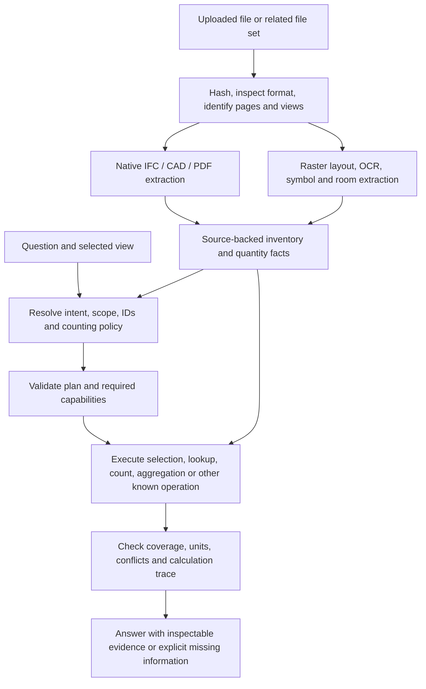

# Dataset question research and proposed answering pipeline

Investigated 14 November 2026. This report analyzes the **full 127,044-question list**, rather than extrapolating frequencies from the preview. Proposed capabilities and pipeline steps below are a design, not a claim that they are implemented or accurate.

## Findings that determine the design

**The questions are highly repetitive: 24 parameterized source/task templates cover 98.02% of all rows under the explicit taxonomy below.** This is close to the proposed “98% of questions repeat a small set of types” hypothesis, although five narrowly defined tasks do not suffice. Across CubiCasa, Swiss Dwellings, and the quantitative IFC-model questions, **45 such templates cover 99.30%**.

CubiCasa and Swiss Dwellings alone contain **123,098 rows, or 96.89% of all questions**. Every one of those rows fits **24 source-specific, language-neutral templates: 12 CubiCasa and 12 Swiss templates**. Those templates can be implemented through **seven reusable capabilities**, described below. Their underlying numerical operations are just selection followed by count, lookup, or sum; obtaining the correct objects and measurements is the harder part. The 24-template set reaching 98.02% substitutes an IFC room-area template for the least frequent of these 24, as detailed below.

There are **6,789 distinct literal question strings**, including translations and changes to room identifiers, labels, apartment letters, and model names. That is not 6,789 different capabilities. **121,417 rows (95.57%) use a question string that occurs more than once**, even before removing translations or substituting parameters.

The remaining **3,946 rows (3.11%)** contain BIM queries and drawing-schedule questions. They introduce properties, assemblies, quantities, grouping, arithmetic, topology, and information-availability decisions. These supplied families remain part of the project scope even though they are less frequent; see [project scope](PROJECT_SCOPE.md). Frequency determines implementation priority, not whether a known requirement disappears.

**Coverage in this report means the fraction of supplied question rows assigned to a family. It does not mean measured answer accuracy, extraction success, or the expected distribution of the organizers' final evaluation.** Repeated wording across thousands of different drawings can still require substantial perception work.

A later [generated question classification](QUESTION_CLASSIFICATION.md) assigns
every row to an explicit 234-family analysis taxonomy. Its finer semantic groups
serve a different purpose from the source/template concentration counts below;
neither report measures implemented answer coverage.

## What was actually inspected

The full archive's `junction-dataset/questions.jsonl` was retrieved using HTTP byte ranges: the ZIP64 directory and the compressed question member only. This transferred **3,075,232 bytes, about 3.08 MB**, including archive metadata, rather than downloading the **9,768,952,082-byte archive**. The decompressed question file is **26,233,461 bytes**. Its SHA-256 matches the existing [full dataset audit](../dataset/full_dataset_audit.json):

```text
0e6322c74561a63f42bac35f5c1be8a2c6a37516b14a81e66ab88b74950a6d1f
```

Thus all question frequencies below were counted directly from the full JSONL. **The full drawing/model collection was not downloaded for this investigation.** Asset inventories and previously investigated geometry/assembly examples come from the checked-in [full findings](../dataset/FULL_DATASET_FINDINGS.md) and [quality report](../dataset/full_dataset_quality.json); the local preview supplies inspectable drawing examples. The archive links are in the [challenge brief](../dataset/task.md).

The full audit records **16,891 assets totaling 12,225,645,628 bytes**, excluding license documents. Questions reference **5,939 paths**. A referenced PDF and its DXF/PNG siblings are representations of the same plan, not three independent question cases. Neither file counts nor filename-stem groups establish the number of independent buildings.

| Source | QA rows | Share of all rows | Distinct referenced paths | Distinct literal question strings |
|---|---:|---:|---:|---:|
| CubiCasa | 85,514 | 67.31% | 4,787 | 24 |
| Swiss Dwellings | 37,584 | 29.58% | 1,040 | 3,147 |
| IFC models | 3,062 | 2.41% | 84 | 2,853 |
| IFC-Bench | 820 | 0.65% | 25 | 701 |
| Opening Design | 64 | 0.05% | 3 | 64 |
| **Total** | **127,044** | **100%** | **5,939** | **6,789** |

Europeana, Finna, HABS, and Wikimedia contain assets but no supplied QA rows. They do not establish additional required question types. Likewise, the 500 ResBIM models have no associated QA in this snapshot; their absence of explicit `IfcSpace` records is not evidence that the labelled room questions are all impossible.

## What “different question types” means

There are several useful counting levels. They should not be mixed:

| Level | Example | What changes the type? |
|---|---|---|
| Literal question string | English versus Finnish wording; room `7.01` versus `7.02` | Any textual difference. Useful for describing repetition, poor as an implementation backlog. |
| Parameterized semantic template | Count rooms with literal label `{label}`; retrieve net area for room `{id}` | Operation, target, scope, inclusion/exclusion policy, or quantity meaning. Identifiers and languages are parameters. |
| Query operation | Select, count, lookup, sum, group/rank, arithmetic | The computation on established facts. One operation can serve many templates. |
| Extraction capability | Recover symbol instances, room regions, labels, table cells, or IFC facts | The evidence and algorithm needed to obtain those facts. The same count operation can need very different extractors. |

For the CubiCasa/Swiss classification, only `path` and `question` were used: no answer value, unit, or answer-type field determines the template. Fixed English prompts were matched explicitly; variable prompts were matched with room-label, room-ID, or apartment-ID slots. Their adjacent local-language rows were paired only when the source path and expected language prefix matched. **61,549 English/local-language task pairs** account for all 123,098 rows in these two sources. This is a structural verification of pairs, not a manual audit of every translation's accuracy.

The same 24 semantic templates cover the preview and full CubiCasa/Swiss question lists. The full set adds drawings and parameter values rather than new templates in these sources. This statement does not extend to IFC-Bench, whose full set adds task domains.

Do not merge these distinctions when normalizing:

- A toilet fixture is different from a separate WC room; a room labelled `Bad` is different from a room inferred to be a bathroom.
- A double-bowl sink counts as one logical sink in the CubiCasa prompt. Doorways without door leaves are excluded there. The counting policy belongs in the query.
- A floor shown in an image differs from every storey in the building. Model-wide questions retain model-wide scope even when their referenced file is one floor PDF.
- A room's stated net area, polygon-measured area, wall surface area, and gross floor area are different quantities. Shared units do not make them interchangeable.
- Literal labels/IDs stay unchanged. A canonical concept can accompany `Küche`, but the original string and identifiers such as `121.A` or `7.16` must remain available for exact matching and evidence.

### Why answer formats are insufficient

| JSONL answer type | Rows | Share |
|---|---:|---:|
| count | 111,763 | 87.97% |
| area | 14,243 | 11.21% |
| text | 836 | 0.66% |
| volume | 138 | 0.11% |
| length | 64 | 0.05% |

Count and area together are **126,006 rows, 99.18%**. This is a statement about answer representation. It does not imply that two models or two extraction functions solve the dataset. All 820 IFC-Bench answers are labelled `text`, including numeric, multi-part, ranking, estimated, and missing-information answers.

## The dominant repeated templates

The tables count **QA rows**, including both languages. “Paths” counts distinct files with that task, not the number of objects, buildings, or answers greater than zero. Shares use **all 127,044 questions** as denominator.

### CubiCasa: 12 templates, 85,514 rows

There are just **24 literal strings**: 12 fixed English questions and their Finnish counterparts. This is the clearest repeated-capability opportunity.

| Template, with important counting convention | QA rows | All rows | Paths |
|---|---:|---:|---:|
| Count depicted floors/storeys | 9,574 | 7.54% | 4,787 |
| Count windows | 9,574 | 7.54% | 4,787 |
| Count toilet bowls/WC seats | 9,564 | 7.53% | 4,782 |
| Count sinks/washbasins, including kitchens; double bowl counts once | 9,450 | 7.44% | 4,725 |
| Count showers and bathtubs together | 8,884 | 6.99% | 4,442 |
| Count door-fitted openings; exclude leafless openings | 7,038 | 5.54% | 3,519 |
| Count sauna rooms | 6,630 | 5.22% | 3,315 |
| Count kitchens, including kitchenettes/open/utility kitchens | 6,524 | 5.14% | 3,262 |
| Count bedrooms | 5,920 | 4.66% | 2,960 |
| Count bathrooms/washrooms, excluding separate WC rooms | 4,768 | 3.75% | 2,384 |
| Count separate WC rooms | 4,664 | 3.67% | 2,332 |
| Count balconies, including glazed balconies | 2,924 | 2.30% | 1,462 |

Question coverage is sparse: all 4,787 plans have window/storey questions, but only 3,519 have door questions and 1,462 have balcony questions. **An absent task label is unknown, not zero.** Explicit zero answers also exist. These PNGs do not come with the upstream instance masks/boxes in the supplied archive, so aggregate counts alone do not make them a ready-to-use supervised detector dataset.

### Swiss Dwellings: 12 templates, 37,584 rows

The **3,147 literal strings** collapse to 12 templates after language and parameters are separated. A plan has English questions plus questions in its local language. The 1,040 referenced plans comprise 698 German, 247 French, and 95 Italian cases; there are 12,620 English/German, 4,461 English/French, and 1,711 English/Italian task pairs.

| Template | QA rows | All rows | Paths |
|---|---:|---:|---:|
| Count rooms with literal label `{label}` | 12,730 | 10.02% | 1,040 |
| Retrieve net area of room `{id}` with label `{label}` | 4,152 | 3.27% | 1,040 |
| Sum apartment `{id}` room net areas, excluding outdoor spaces | 3,750 | 2.95% | 1,040 |
| Count apartments/residential units | 2,080 | 1.64% | 1,040 |
| Count interior and entrance doors | 2,080 | 1.64% | 1,040 |
| Count windows | 2,080 | 1.64% | 1,040 |
| Count toilets | 2,080 | 1.64% | 1,040 |
| Count washbasins | 2,080 | 1.64% | 1,040 |
| Sum numbered indoor-room net areas, excluding outdoor spaces, shafts, and voids | 2,080 | 1.64% | 1,040 |
| Sum net areas of rooms with literal label `{label}` | 2,034 | 1.60% | 1,017 |
| Count bathtubs | 1,794 | 1.41% | 897 |
| Count showers | 644 | 0.51% | 322 |

Examples of the variable English forms are:

```text
How many rooms labelled 'Schlafzimmer' are there on this floor?
What is the net floor area of room 7.01 ('Balkon') in m²?
What is the net floor area of apartment B in m², summing all its rooms
except balconies, loggias, terraces and other outdoor spaces?
```

The label-count questions contain **34 distinct literal label values**; individual-room area questions use **372 room-ID values and 48 labels**; apartment-area questions use **14 apartment IDs**. These are parameter vocabularies, not separate models to train. The same room ID can recur on unrelated drawings, so a room identity always includes its source and scope. An individual-area request may legitimately concern a balcony; the outdoor exclusion in apartment sums must not be applied to every area lookup.

### How concentrated are the tasks?

Ranking the 24 **source-specific semantic templates above**, rather than merging unlike counting conventions:

| Templates retained | QA rows covered | Share of all questions |
|---|---:|---:|
| Largest 1 | 12,730 | 10.02% |
| Largest 5 | 50,892 | 40.06% |
| Largest 10 | 85,888 | 67.60% |
| Largest 12 | 95,320 | 75.03% |
| Largest 20 | 116,546 | 91.74% |
| All 24 | 123,098 | 96.89% |

The largest five are Swiss literal-room-label counts, CubiCasa storeys, CubiCasa windows, CubiCasa toilet bowls, and CubiCasa sinks. Thus five narrowly specified templates do not approach 98%. Merging a Swiss window count with a CubiCasa window count increases reuse, but does not remove the need for other targets and counting policies. Even after conservatively merging compatible window and toilet-fixture templates across the two sources, the largest five cover only **55,052 rows, 43.33%**.

Adding the **21 quantitative IFC-model templates** defined below produces 45 identified source/task templates covering **126,160 rows, 99.30%** of the entire dataset. The largest **24 of these 45 cover 124,533 rows, 98.02%**. Concretely, take the 24 CubiCasa/Swiss templates, remove Swiss shower counting (644 rows), and add IFC individual-room net-area lookup (2,079 rows):

```text
123,098 - 644 + 2,079 = 124,533 = 98.0235% of 127,044
```

The remaining 820 IFC-Bench and 64 Opening Design rows cannot individually or collectively displace the 24th-ranked identified template (1,794 rows) if their source-specific families remain separate. This makes **about two dozen parameterized templates** a defensible description of 98% concentration. It is a declared taxonomy, not an intrinsic, uniquely correct number of question types: merging operations or splitting individual labels changes the number.

## Seven capabilities cover the dominant 96.89%

This is the most useful implementation grouping. Each row below has a disjoint set of the 24 templates, so counts can be added. A capability is a reusable result-producing function over source-backed facts; it need not be a separate neural network.

| Capability | Templates served / facts needed | QA rows | All rows |
|---|---|---:|---:|
| **C1. Count logical symbol/object instances** | Doors, windows, toilets, sinks, showers, bathtubs; detect/group/deduplicate instances with the requested convention | 55,268 | 43.50% |
| **C2. Count semantic room/space regions** | Bedrooms, kitchens, bathrooms, WC rooms, saunas, balconies; regions plus semantic labels and explicit exclusions | 31,430 | 24.74% |
| **C3. Count rooms with a literal printed label** | Associate text with distinct room regions; compare original labels | 12,730 | 10.02% |
| **C4. Count depicted floors/storeys** | Partition plan views and distinguish floor depictions from details/legends | 9,574 | 7.54% |
| **C5. Sum selected room net areas** | Area facts plus apartment membership, literal-label filtering, or indoor/outdoor/shaft/void exclusions | 7,864 | 6.19% |
| **C6. Retrieve one room's net area** | Resolve source-scoped room ID/label and obtain the correctly defined area | 4,152 | 3.27% |
| **C7. Count residential units** | Recover apartment groupings rather than count rooms or isolated apartment letters | 2,080 | 1.64% |
| **Total** | **All CubiCasa + Swiss templates** | **123,098** | **96.89%** |

C1+C2+C3 alone address **78.26%** of all question rows. Adding C4 brings this to **85.80%**. These are useful prioritization figures, not promised accuracy.

If a five-item description is desired, combine C2/C3/C7 into **count selected spaces**, then keep **count objects**, **count depicted storeys**, **retrieve room area**, and **sum selected room areas**. That grouping still describes the same **96.89%**, and its space-counting function still needs three different kinds of evidence. Seven entries are a more honest engineering backlog.

The computational reuse is even stronger: the dominant set comprises **111,082 count**, **4,152 lookup**, and **7,864 sum** requests. Implement selection/counting/lookup/summation once. Invest perception effort in acquiring a reliable object/room/unit inventory and quantity facts that those operators can query.

## The smaller, required families

The remaining questions must be inspected by operation and evidence requirements, rather than treated as one `text` fallback. The [capability inventory](COMPUTATIONAL_CAPABILITIES.md) describes current implementations and gaps in more detail.

### IFC models

These 3,062 questions parameterize model names, storeys, room names, and quantity types. Their high literal-string count does not imply thousands of novel procedures. Reuse native IFC class/type selection, containment and aggregation relations, property/quantity retrieval, and deterministic aggregation.

| Repeated operation | QA rows | All rows |
|---|---:|---:|
| Retrieve one room's net floor area | 2,079 | 1.64% |
| Count model/floor objects, with target and scope preserved | 642 | 0.51% |
| Sum room net areas on a floor | 75 | 0.06% |
| Sum slab net volumes on a floor | 72 | 0.06% |
| Sum wall net volumes on a floor | 66 | 0.05% |
| Sum wall lengths on a floor | 64 | 0.05% |
| Sum wall net side areas on a floor | 64 | 0.05% |
| **Total** | **3,062** | **2.41%** |

The count group expands to **15 target/scope templates**; the other six operations each contribute one template, giving **21**. This expansion preserves the difference between a whole-model count and a depicted-floor count:

| Count target | Model scope rows | Floor scope rows | Total |
|---|---:|---:|---:|
| Rooms/spaces | 36 | 100 | 136 |
| Doors | 32 | 91 | 123 |
| Walls | 36 | 62 | 98 |
| Stairs | 29 | 66 | 95 |
| Windows | 34 | 39 | 73 |
| Columns | 26 | 44 | 70 |
| Beams | 29 | 0 | 29 |
| Sanitary fixtures | 12 | 0 | 12 |
| Light fixtures | 6 | 0 | 6 |
| **Total** | **240** | **402** | **642** |

Zero in this frequency table means no question rows with that target/scope combination, not zero physical objects. Room-area lookup alone constitutes **67.90% of the IFC-model questions**. Its room names and storeys are parameters to one repeatable operation, rather than separate implementations.

The correct object grain is essential. The audited Molio model contains **579 `IfcStair` occurrences but 15 top-level stair assemblies**; its whole-model stair question expects 15. Likewise, the audited Esplanades questions distinguish **211 model-wide doors** from **42 fourth-storey doors**. A question pointing at one rendered PDF can still explicitly ask about the entire IFC model. Source resolution and hierarchy policy are part of the answer, not presentation details.

### Opening Design

Only three sheets are directly referenced. **61 of 64 questions concern two schedules**, and three concern fixtures in a local drawing view. This is predominantly a table-extraction problem, not a need for dozens of new visual classifiers.

- A-801 door-schedule questions count selected individual door-number rows or retrieve properties/finishes.
- A-700 door and window schedules require summing the declared `Count` column; counting rows would produce the wrong result. One question additionally multiplies quantities by the number of windows in an N-wide assembly.
- Room-finish questions retrieve/sum room areas, combine count and area, or rank rooms by area.
- Local-view fixture questions require locating the specified view and interpreting its symbols.

The exclusive research grouping is 36 schedule count/declared-quantity sums, 13 property/finish-definition lookups, four room-area lookups, five area sums, one count-plus-area question, one largest-room ranking, one weighted assembly sum, and three view-scoped fixture questions. These eight groups total 64. Preserve cells, headers, units, and row/column coordinates as evidence. A reusable table representation plus filter/lookup/sum/rank/arithmetic operators handles these variations.

### IFC-Bench

The 820 text-labelled rows include architecture, structure, electrical/lighting, mechanical/plumbing/ventilation, and town-scale models. Known questions require combinations of:

- Model metadata, native class/type/property retrieval, and multilingual entity resolution.
- Filtered counts and quantities by storey, type, material, or system; grouping, rankings, averages, and ratios.
- Material/layer quantities and derived arithmetic, including source-defined cost assumptions where requested.
- Geometry and spatial/topological relations, connected systems, and estimated traversable route distances.
- Source-grounded dimensional/rule checks, with explicit rule inputs and limits on the conclusion.
- Missing-information and approximation decisions when the requested property, rooms, interior geometry, material specification, or rule basis is unavailable.

These are compositions of reusable operators and extractors. A whole-model LLM description is not evidence that the necessary quantities or topology were extracted. Neither is a missing property proof that its physical value is zero. Rare tasks remain visible in the backlog and evaluation even if C1–C7 are implemented first.

Examples that make the tail concrete are below. Line numbers refer to the hash-matched **full** question file, not the preview; question descriptions are shortened.

| Full JSONL line | Supplied question / case | Required repeatable work |
|---|---|---|
| 85,570 | The two doors with greatest widths | Retrieve native door widths, rank, retain IDs/ties and evidence |
| 85,643 | Usable-to-gross floor-area ratio in a structural clinic model | Resolve quantity definitions and inputs; the reference acknowledges absent room/area information, so missing information is a valid outcome |
| 85,714 | Heating pipe length by level | Resolve length units and membership, sum and group; investigate the previously reported reference conversion discrepancy |
| 85,770 | Furthest point to nearest emergency exit | Source-identify exits, establish traversable geometry, find a route, or state missing inputs/qualified estimation |
| 85,789 | Embodied carbon | Material quantities and sourced factors/assumptions; distinguish model facts from external defaults |
| 85,838–85,839 | Closest gate to a hospital; area inside the town wall | Position/distance/rank and closed-boundary area, with source geometry and units |
| 86,261 / 86,292 | Plumbing/ventilation connectivity | Distribution-port connectivity graph and derived metrics; system membership alone is insufficient |
| 89,414 | Width of door `121.A` in a schedule | Exact row lookup plus fractional imperial-unit parsing |
| 89,447 / 89,459 | Window schedule total; N-wide assembly unit total | Sum declared quantities; multiply assembly widths/counts before summing |

This template-concentration investigation did not manually adjudicate an exhaustive semantic partition of all 820 multi-part IFC-Bench prompts. The later [classification report](QUESTION_CLASSIFICATION.md) supplies an explicit analysis taxonomy; it does not validate the answers or source geometry. Their source share is known exactly (0.65%); the capability list and source examples prevent that share from being mistaken for unneeded work. The 45-template concentration calculation does not depend on a speculative classification of this tail.

A required family does not require inventing absent inputs. Some supplied references explicitly use external defaults or estimates: window unit prices, carbon factors, and an estimated egress distance are examples. The accessibility reference also lacks a documented rule basis. The correct supported behavior is source-backed computation when inputs exist, an explicitly qualified estimate when justified, or a precise missing-information outcome. Reproducing an ungrounded reference number is not evidence of a working capability.

## Proposed pipeline after a viable file is supplied

Use **source extraction followed by a small, validated query plan**, with image interpretation where facts cannot be recovered natively. The question should select work from the file's available evidence and the runtime's actual capability manifest.



1. **Register and partition the source.** Record immutable hashes/revisions, file type, pages, units, and available representations. Identify the selected view and other depicted floor plans, schedules, details, legends, and title blocks. Keep crop/tile/page/model transforms. Link paired formats only with justified source identity; do not silently merge different revisions or buildings.
2. **Extract cheap native facts first, then fill required gaps.** IFC supplies entities, relationships, properties, and stored quantities. CAD can supply text, blocks, and room polygons. Vector PDF can supply text and table structure. Raster inputs need layout, OCR, high-resolution tiled symbol detection, and room segmentation/classification as appropriate. Native primitives still require interpretation: several door lines are not several doors. Deduplicate overlapping tiles and group assemblies/logical objects.
3. **Build a reusable inventory.** Store objects, rooms, apartment membership, literal IDs/labels, canonical concepts, source quantities, units, view/floor associations, and evidence anchors. Mark what is not extracted, ambiguous, or absent from the model. Cache by source hash and extractor/model version so follow-up questions reuse the inventory. Extraction can be incremental: layout/native indexing first, expensive specialists only when a query needs them.
4. **Compile the question into a typed plan.** Resolve operation, target, source/view/floor/model scope, filters, exclusions, counting grain, quantity definition, unit, grouping, and requested output. Fixed supplied templates can use rules; a language model can propose plans for known paraphrases and compositions. Resolve every identifier against the inventory and validate the proposal. Default to the selected drawing/view, while preserving explicit model-wide wording. If only one raster sheet is available for an explicitly model-wide task, identify the missing source rather than invent a global total.
5. **Dispatch only supported work.** For C1–C7, select the required inventory and run count/lookup/sum. Request a targeted crop or specialist extraction when facts are missing. For schedules, use the intended row grain or declared quantity column. For IFC, follow containment/aggregation and resolved quantity paths. Geometry, arithmetic, topology, and rule tasks require their own advertised executors; a schema field or a model's plausible explanation does not implement them.
6. **Compute deterministically and check completeness.** Retain included/excluded sets and source values. Convert compatible units; preserve net/gross and measurement basis. Use polygon shells minus holes and a valid view-specific calibration when measuring area; do not apply pixel measurements to uncalibrated/not-to-scale drawings. A source area lookup does not require calibration merely because its source is an image. Detect incomplete inputs and conflicting quantities before presenting an exact total. Distinguish a complete count of zero from an extraction failure.
7. **Return an inspectable result.** Show instance marks/room boundaries for counts, exact text/cells/property records for lookups, all contributing terms and exclusions for sums, and paths/rule inputs/assumptions for specialized tasks. Bind results to the same canonical IDs and coordinates used in computation. Keep exact, estimated, partial, unavailable, and ambiguous outcomes distinct. Return the result through the shared contract so the frontend displays the actual evidence.

A compact internal plan for the dominant set needs fields like:

```json
{
  "operation": "sum",
  "target": "room",
  "scope": {"view": "resolved-view-id"},
  "filters": {"apartment_id": "B"},
  "exclude": ["balcony", "loggia", "terrace", "other_outdoor_space"],
  "quantity": "net_floor_area",
  "unit": "m2"
}
```

This is an illustrative intermediate representation, **not an executable instance of the current shared QueryPlan schema**. A real plan must resolve IDs and compile exclusions to supported predicates. It must obtain values from the supplied source, never from reference QA or a filename-to-answer mapping.

### What should be separate components?

Use a few extraction components that feed common operators, rather than train a model for every question sentence:

| Component | Reused output | Why it is separate |
|---|---|---|
| Native source adapters | IFC facts, CAD structure, PDF text/vectors/tables | File structures and evidence selectors differ; native facts can avoid image inference. |
| View/layout and text extraction | View boundaries, original labels/IDs, table cells | Scope and exact identifiers are needed across counting, area, and schedule tasks. |
| Symbol-instance extraction and grouping | Logical doors/windows/fixtures with anchors | Shared by C1 targets; class conventions, resolution, and deduplication affect exact counts. |
| Space/unit reconstruction and semantics | Room regions, uses, literal-label links, apartment membership | Shared by C2/C3/C5/C6/C7; room labels alone do not establish boundaries or unit membership. |
| Quantity/geometry services | Source quantities or calibrated measurements | Shared by lookup/sum and the BIM tail; definition, units, holes, and assumptions must be explicit. |
| Query planning, execution, and evidence | Validated plans and reproducible answers | Shared across every format; count/sum/arithmetic should not be reimplemented per prompt. |

The number of neural models is an empirical decision. Repeated templates justify shared extraction and computation; they do not prove that a particular pretrained model is accurate enough or that every task needs a new trained model. Diagnose failures by instance recognition, room semantics, scope, calibration, grouping, or query execution before deciding what to train.

## Implementation and evaluation priorities

1. **Evaluate the connected real-source paths.** Since this research snapshot, the [common answer pipeline](NATURAL_LANGUAGE_ANSWERS.md) has connected question planning, source execution and frontend evidence. Check question interpretation, contributing objects, quantities and omissions on real sources. The [IFC engine](IFC_ENGINE.md) supplies structured execution and the drawing tools return native facts or qualified visual observations. Connecting these components does not establish their dataset-wide accuracy.
2. **Build and evaluate C1–C7 as named capabilities.** Prioritize C1–C3 because together they cover 78.26% of rows, and include view partitioning and area/unit grouping early so the rest of the dominant templates compose correctly. Use native Swiss DXF/PDF facts when available and raster experts for CubiCasa and image-only uploads. Demonstrate exact instance sets and area evidence, not just final scalars.
3. **Add the remaining known compositions deliberately.** Complete schedule extraction, source-defined quantity retrieval, grouping/ranking/arithmetic, and the supplied BIM geometry/topology/rule cases. Implement each known family's disposition: source-backed computation where inputs permit, or explicit missing information/qualified estimation otherwise. Keep unsupported known cases explicit until implemented; do not call a 96.89%-family baseline complete acceptance.
4. **Evaluate coverage, accuracy, evidence, and cost separately.** Report both QA-row-weighted performance and macro averages across template/source/capability groups. Also report one result per underlying bilingual task, and per-drawing/project summaries. Exact counts need exact-match accuracy and count error; areas/lengths/volumes need appropriate absolute/relative tolerances and quantity-basis checks. Inspect localization, source anchors, included/excluded sets, missing-information behavior, latency, and cost per new file versus cached follow-up query.

Use project/source groups for splits: keep translated pairs, every question on a drawing, Swiss PDF/DXF/PNG siblings, floors from one building, and duplicate IFCs together. The checked-in audit found **eight byte-identical IFC pairs across source folders**. All preview question/answer records also occur in the full collection when paths are ignored, with 866 changed paths, so preview and full are not independent train/test sets. Source-folder splitting alone is insufficient.

Build these groups before tuning, joining paired formats, rendered floors, source models, and duplicate files transitively. Swiss filenames expose site/building identities; CubiCasa's style prefixes do not establish independent buildings. Recover upstream identities and inspect pretrained checkpoints' training exposure where possible; otherwise state that project independence or prior exposure could not be verified. Freeze extraction/planning settings on a development partition, retain failures/unsupported/partial cases in reported denominators, and estimate uncertainty by resampling independent groups rather than translated rows or tiles.

Balance held-out evaluation across all 12 CubiCasa and 12 Swiss templates, languages, small/dense/multi-view drawings, and known tail families. This prevents success on frequent fixed prompts from concealing failures in apartments, area exclusions, assemblies, or rare required tasks. Reference QA can evaluate outputs and describe task distribution; it must not supply runtime answers or leak into a held-out extraction model.

## Limits and reproducibility

- This is a census of one supplied question-list snapshot, not a random sample of future user demand. QA generation and bilingual duplication strongly affect percentages. Questions per file differ by source.
- The source/template counts, 45-template partition of 126,160 rows, and seven-way dominant-set partition are deterministic and exhaustive for their stated scopes. The smaller-tail descriptions identify demonstrated capabilities; they are not a claim that one exclusive intent taxonomy captures every multi-part BIM question.
- The prior source audits, rather than a new full-asset download, support the assembly/geometry/reference-quality examples. This investigation did not visually verify every drawing or every answer. Known reference disputes should be adjudicated from source evidence; for example, the audited Ettenheim answer's IFC schema differs from the distributed file header.
- The local preview has 7,990 QA rows and 1,770 literal question strings. It was useful for source inspection, but all frequencies labelled “full” above come from the independently retrieved, hash-matched full question file.

To reproduce the basic census using an extracted full question file, run the following from any directory, replacing the input path:

```sh
python3 - /path/to/junction-dataset/questions.jsonl <<'PY'
from collections import Counter, defaultdict
from hashlib import sha256
from pathlib import Path
import json
import sys

path = Path(sys.argv[1])
raw = path.read_bytes()
assert sha256(raw).hexdigest() == (
    "0e6322c74561a63f42bac35f5c1be8a2c6a37516b14a81e66ab88b74950a6d1f"
)
rows = [json.loads(line) for line in raw.splitlines() if line.strip()]
strings = Counter(row["question"] for row in rows)
sources = Counter()
paths, questions = defaultdict(set), defaultdict(set)
for row in rows:
    source = row["path"].split("/")[1]
    sources[source] += 1
    paths[source].add(row["path"])
    questions[source].add(row["question"])
print("rows", len(rows), "literal strings", len(strings))
print("rows with repeated wording", sum(n for n in strings.values() if n > 1))
for source, count in sources.most_common():
    print(source, count, f"{100 * count / len(rows):.4f}%",
          "paths", len(paths[source]), "literal strings", len(questions[source]))
PY
```

For semantic reproduction, use the 12+12 template definitions in the tables: match fixed English forms, replace only the documented label/room/apartment slots, and pair the local-language row using the same path and language structure. Preserve scope, exclusions, logical object grain, and quantity basis. Require **123,098 classified rows**, **61,549 pairs**, the per-template totals above, and a seven-capability sum of **123,098**. Do not silently assign unmatched prompts to an “other count” bucket to meet a coverage target.

For the IFC-model extension, match the six lookup/quantity forms and 15 nonempty `(count target, model-or-floor scope)` combinations shown above. Replace quoted model/storey/room names with parameters, preserving requested quantity and scope. Require **3,062 classified rows** and the target/scope totals in the IFC tables. Combine these 21 families with the 24 CubiCasa/Swiss families, sort their counts, and sum the largest 24 to obtain **124,533**. The 820 IFC-Bench and 64 Opening Design rows stay outside this 45-family concentration calculation.
