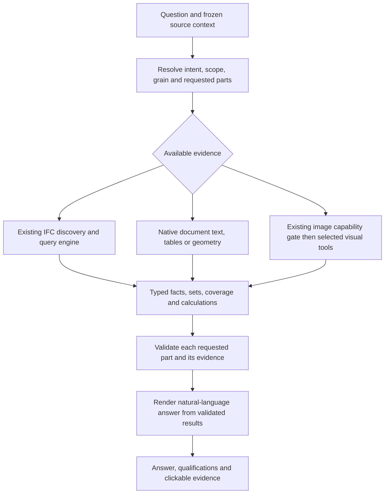

# From detections to source-backed natural-language answers

15 November 2026. **Implementation plan; no new runtime behavior is implemented
by this document.** Baseline: `main` at `833c5c8`. Acceptance follows the
[challenge brief](../dataset/task.md), [repository instructions](../AGENTS.md)
and [project scope](PROJECT_SCOPE.md).

Implementation update, 15 November: the [runtime guide](NATURAL_LANGUAGE_ANSWERS.md)
and [verification record](VERIFICATION.md) describe the delivered common answer
slice and remaining acceptance gaps. The full corpus is present under the ignored
dataset directory; the earlier availability observation below is historical.
Source audits are recorded in the [answer experiments](../experiments/answers/README.md).

## 1. Deliverable and completion boundary

An engineer imports a drawing or IFC model, asks a question in natural language,
and receives a direct natural-language answer with the requested unit, scope and
qualification. Clicking its evidence reveals the contributing objects, source
cells/properties, geometry and calculation inputs. Every requested part receives
an answer or a specific explanation of what prevents it.

The target is **all demonstrated question families in the supplied dataset**,
including difficult IFC-Bench families and paraphrases/translations of those
tasks. The [classification](QUESTION_CLASSIFICATION.md) reports 127,044 rows,
234 internal semantic families and 14 requested-operation buckets. Those are
analysis categories, not organizer-supplied labels or independent examples.
The full extraction was absent at the planning baseline. It is now available
locally under the ignored dataset directory, together with preview and
full-corpus audits. Full-family completion still requires evaluated answers
across the supplied families.

Four criteria have equal weight: accuracy, verifiability, creativity and inference
cost. The plan must improve all four rather than add fluent text around unchecked
boxes. Reliable source-backed abstention is necessary, but returning
`unsupported_operation` for an answerable known family remains an implementation
gap. No fixed plan or model can guarantee error-free answers; completion requires
measured results and source review, not a promise of perfection.

Current product decisions remain authoritative:

- Image/PDF/DXF answers concern the selected image, page, layout or explicitly
  named region within it. They never silently widen to other drawings.
- IFC questions use the entire imported model, independently of preview filters;
  explicit floor/room restrictions in the question still apply.
- Hydrogen is preferred. Image Carbon selection requires explicit `needs_strong`
  at the configured threshold, currently 0.8; uncertainty and router failures use
  Hydrogen. Preserve Carbon low/medium and the separate IFC planner settings.
- Use existing detections, detail tools and IFC execution. Keep the established
  image capability decision before optional visual cropping/preparation. Native
  source metadata can be inspected without another model call.
- Manual source, result and UI reviews use **one Astra-6 Max subagent per review
  task**, with no review panels or user labeling dependency. Record the outcome as
  `agent_reviewed`, not human ground truth or a completeness certificate.

The earlier master plan has been retired. Current typed tools, schedule
arithmetic, measurement methods and budgets are documented in the
[runtime guide](NATURAL_LANGUAGE_ANSWERS.md), [IFC guide](IFC_ENGINE.md) and
[evaluation guide](../experiments/answers/README.md). New training, general CAD
support and unasked task classes are optional extensions.

## 2. What exists, and what is actually missing

This table records the `833c5c8` planning baseline. Current behavior and remaining
gaps are described in [the runtime guide](NATURAL_LANGUAGE_ANSWERS.md).

| Area | Implemented baseline | Remaining answer work |
| --- | --- | --- |
| IFC | Bounded natural-language planning, source discovery, validated scalar/native-spatial execution, typed `QueryResult`, 3D/property evidence | Broader family coverage, derived arithmetic, independent compound failures, faithful multilingual prose |
| IFC prose | [`ifc_api/answers.py`](../ifc_api/answers.py) already summarizes executed results deterministically | Generalize its presentation; preserve quality/scope; its English summaries show only the first 12 rows, while full results remain available |
| Drawing analysis | Source-bound candidates, native crops/tiles, conservative reconciliation, membership checks and actual call ledger | Task-specific facts and inventories, coverage assessment, calculations and final claims |
| PDF/DXF | Local PDF preview; DXF backend preview; both feed displayed rasters to candidate analysis | Original-source answer sessions, native PDF spans/tables, optional native geometry and verified source-to-display mappings |
| Shared contracts | `QuestionRequest`, `QueryPlan`, `QueryResult`, facts, units, coverage, calculations and per-cell evidence | A common answer envelope, requested-part accounting and narrative bindings; adapter/executor implementations |
| UI | Candidate inspection, IFC answers/highlights, export, real model handoff and expandable decision trace | One coherent natural-language answer/evidence experience across formats |

Two boundaries must not disappear:

1. `ImageCandidateResponse.inventory_completeness` is always `unverified`.
   `status=ok`, a clean crop ledger, agreement between models and high confidence
   do not establish an exhaustive inventory. Membership checks examine detected
   objects; they do not discover every missed object.
2. The schema represents arithmetic and measurement, but the IFC executor does
   not execute arbitrary arithmetic, generic metric measurement, routes or
   compliance. Its supported containment/adjacency geometry does not fill those
   gaps. The [capability inventory](COMPUTATIONAL_CAPABILITIES.md) is a backlog
   with some dated status entries; verify every claimed capability against code.

The saved [full-image](../experiments/image_questions/GEMINI_100_RESULTS.md) and
[detailed-scan](../experiments/image_questions/GEMINI_DETAIL_100_RESULTS.md)
experiments report 79/100 and 72/100 candidate-count matches respectively. They
are development observations, not final-answer/localization accuracy. Detailed
scan must not become an unconditional extra pass or an assumed accuracy win.

## 3. Implement the answer pipeline

### 3.1 Register original sources and preserve the displayed snapshot

Add a bounded document session layer alongside existing IFC sessions. Proposed
`document_engine/` owns immutable source registration, page/layout metadata,
native extraction and display mappings; `answer_api/` owns question orchestration.
The browser already retains imported `File` objects. Upload original PDF/SVG/DXF
bytes when native source access is needed, rather than pretending a PNG contains
native PDF cells or physical CAD units. Reuse an existing IFC model handle.

Store original-asset hash and displayed-raster hash separately. Capture page,
rotation, viewport transform, layout name, source revision and source bounds at
submission. Bind every result and progress event to that context and question
hash. Reuse PDF.js viewport transforms, including rotated/cropped pages; do not
derive coordinates from an assumed page size. Worker cancellation completes
before source/session cleanup, following the existing image/IFC lifecycles.

For a floor PDF whose question explicitly requires a whole IFC model, use only
a registered, provenance-backed asset link to that imported model. Show the
source change in the answer. A matching filename, dataset folder or model name
alone does not prove identity or authorize an unseen source. If the linked model
is absent, report `missing_source`; do not substitute another building or a
single-floor count. The evaluator may provide explicit source relationships
derived from assets, independently of reference answers.

No persistent database is required for the first vertical slice. Use bounded
request/session storage and content-addressed caches; expose registered resource
IDs, never arbitrary backend paths. Preserve licenses and original assets.

### 3.2 Compile intent without compiling an answer

Introduce a typed `AnswerIntent` proposal containing requested output parts,
target concepts, literal identifiers, filters/exclusions, counting grain,
quantity basis/unit, evidence scope and ambiguity. Resolve it against available
catalogs and capabilities before execution. Dataset row IDs, expected answers
and the offline classifier never enter runtime prompts or routing.

Reuse IFC `PlanProposal`, discovery and `QueryPlan` where possible. Drawing plans
can select registered native or visual tools and reference their typed outputs.
Gemini Decisions continues to select image analyzer capability; it is not a
generative question planner or answer writer. Use one bounded planner call when
language interpretation is needed; direct validated requests need none. Ambiguous
IDs such as repeated room names require clarification, not a guessed match.
When a question refers to an earlier answer, resolve references from bounded
validated prior results tied to the same source revision; a source change cannot
reuse stale object IDs or silently carry over a broader scope.

### 3.3 Convert observations into evidence, then execute

Create drawing adapters that populate the existing `KnowledgeBundle` primitives:
source features, scoped logical entity hypotheses, original facts, representations,
anchors, units and coverage. Keep detection/OCR/inference methods distinct from
native extraction. Resolve grouping and membership before computation.

For quantitative operations, code owns count, sum, multiply, divide, ranking,
conversion and geometry. Use decimal arithmetic for scalar quantities; attach
every input and rule to a calculation node. Neither the detection model nor an
answer writer supplies an unchecked final number.

Coverage is specific to source scope, target, operation, grain and extraction
version. Never set it complete solely because a model says so. Complete native
source-record/table enumeration and validated visual inventory procedures need
different documented support. Rendering every tile is not semantic completeness.

The **automatic inventory procedure** must be implemented and evaluated, not left
as a label applied by the formatter:

1. Freeze the requested region/view set, target and inclusion/exclusion rule.
   Establish relevant panel boundaries and any room/label filter; unresolved
   scope cannot be treated as complete coverage.
2. Choose a family-tested whole-image or native-detail strategy after the image
   capability gate. Process all relevant source regions at usable resolution;
   retain failed, clipped, unexamined and capped regions in a coverage ledger.
   Do not run both strategies on every request merely to obtain agreement.
3. Build one logical inventory from source-bound observations, applying grain,
   panel membership, duplicate ownership and supported label/type associations.
   Keep unresolved matches and exclusions with reasons. Check ambiguous members
   using native evidence or the existing bounded membership tool.
4. Check for omissions using available independent source structure: native
   room/door identifiers, complete schedule rows, explicit source totals with
   matching grain, or validated geometry partitions. For visual gaps, permit a
   targeted remaining-budget inspection that returns additional anchored objects
   or unresolved regions. Agreement or a model's “nothing missing” is not an
   independent completeness check.
5. A host-owned family protocol decides whether coverage is supported, partial
   or unknown. A complete promotion requires resolved scope/membership, full
   relevant source coverage, no failed/capped/unresolved regions and independent
   source support for the inventory. A visual protocol must also have a source-reviewed
   held-out omission/false-positive evaluation with its sample size and observed
   failures recorded before it is enabled for automatic exact totals. That
   empirical qualification is not a guarantee for a new drawing.

No user review is required for this runtime procedure. If those prerequisites
cannot be established for a pure raster, the app still automatically gives a
qualified detection result with evidence, while withholding an exact total.
Persistently incomplete visual families remain perception/coverage work in the
release ledger; changing the wording to sound certain does not close them.

Use the following answer states:

| Evidence condition | Permitted natural-language behavior |
| --- | --- |
| Complete relevant native inventory and resolved membership | Exact scoped count/quantity with evidence; this is still a claim about the modeled/depicted/scheduled universe |
| Visual detections with unresolved omissions or membership | Useful qualified observation, e.g. “The scan detected N likely windows; the total is not confirmed,” with `partial` and appropriate estimated quality |
| Verified included subset, with unresolved additional objects | A lower bound only if every included member is supported; false-positive candidates cannot establish “at least” |
| Empty candidate list without complete coverage | Explain that no reliable total was established; do not answer physical zero |
| Quantity read from a source | Preserve original value/unit and specified/net/gross basis; qualify uncertain transcription |
| Calibrated geometry with inferred boundaries | Estimated measurement with geometry, calibration and assumptions; no invented precision |
| Missing source/property, missing calibration, conflicting evidence | State the precise missing input or conflict and any independently supported parts |
| Required executor absent | Mark an implementation gap, distinct from information absent in the source |

An exact count of returned boxes is not an exact answer about depicted objects.
Do not quietly change the claim's universe to `source_records` just to obtain a
complete count. The existing validators require complete matching coverage for
exact numeric claims and an explicit partial outcome for incomplete numeric ones;
preserve these checks.

The current candidate path caps a response at 100 objects and detail work at
bounded calls/regions. Build paged/materialized logical inventories for answer
tasks that exceed this; keep display pages bounded and every member inspectable.
A cap or exhausted budget produces an incomplete result, never a truncated exact
total. Keep the candidate API intact rather than weakening its existing limits.

### 3.4 Support compound answers explicitly

Record every requested part before planning. Reuse one plan with multiple outputs
when all dependencies are executable and share scope. The current IFC executor
aborts a plan on a failed step, and the planner can reject a compound question if
one required part is unavailable. A formatter alone cannot fix that behavior.

Add orchestration of independently validated subplans for independent outputs.
Each returns its own `QueryResult`, plan and evidence; dependent outputs are
blocked if an input fails. A common answer envelope collects these parts and
reports partial success without silently dropping the hard part. Share discovery,
source extraction and the question's total budget. Do not flatten different
scopes or contradictory facts into one apparently valid result.

### 3.5 Reuse the contracts and add a bound presentation envelope

Proposed additions in [`contracts/models.py`](../contracts/models.py):

- `AnswerResponse`: request/question binding, source/view bindings, interpretation,
  requested parts, narrative, source evidence resources and combined metrics.
- `AnswerPart`: stable requested-part key, typed outcome, its existing
  `QueryResult` and optional executable plan, plus references to its evidence
  context. Every requested part appears exactly once.
- `AnswerSentence` or equivalent narrative binding: localized sentence template
  or clause, claim/value-path references, evidence references and qualification.

Do not replace `Claim`, `QuantityValue`, `CountPolicy`, `Coverage`,
`CalculationNode` or per-cell `EvidenceBinding` with loose prose/JSON. Validate
bundle, plan and result semantically for each part. Validate narrative references
against those results. Regenerate schemas/TypeScript and deliberately version
any incompatible change; schemas alone do not prove source truth.

Proposed sibling routes: `POST /api/v1/sources` for document registration and
`POST /api/v1/answers` for source-bound questions. Use registered IFC handles
rather than uploading a model again. Preserve existing candidate, detail and
IFC endpoints and their clients during migration. A new answer stream can emit
preparation, real model handoff, extraction/calculation, and terminal answer/error
events. Do not overload the existing candidate stream's fixed handoff/result/error
contract without regeneration and compatibility handling.

### 3.6 Generate natural language from validated claims

Refactor/generalize `ifc_api/answers.py` into a shared result realizer. Start with
deterministic localized sentences for counts, lookups, quantities, ranked lists,
compound parts and non-answer reasons. All numbers, units, original identifiers,
scope labels and quality qualifiers are rendered from typed values. Use the
question's language unless the user requests another one; evaluate the actual
supplied language set rather than assuming English/Finnish covers it.

For descriptive/overview answers, compose factual clauses from executed source
properties, inventories and relations. Optional Hydrogen wording may select or
paraphrase those clauses, but it cannot add source facts or calculate values.
Prefer structured sentence plans with protected value/identifier slots; bind
each factual sentence to claims/evidence. Reject changed values, unsupported
“all/none” wording, missing qualifications and invented citations. Fall back to
the deterministic version on invalid output or deadline pressure. General prose
entailment is not solved by a JSON validator, so keep free-form rewriting off
until source-reviewed tests justify it. No routine Carbon writing pass.

Numeric IFC-Bench answers remain numeric even when the dataset calls them `text`.
Large inventories receive a concise summary and a complete expandable table;
display truncation must be explicit and cannot truncate computation or export.

## 4. Coverage work across all requested-operation buckets

The first implementation task expands this table into a **234-family ledger**,
with exact examples from the classification, source prerequisites, executable
capabilities, evidence type, implementation status and evaluated outcomes. The
counts below are from the full-corpus report, not a fresh run in this checkout.

| Operation | Rows | Answer path and required remaining work |
| --- | ---: | --- |
| Count | 111,789 | IFC occurrence/assembly policies; scoped visual inventories; distinct room/fixture/floor and schedule semantics; zero/coverage and >100-object handling |
| Area | 14,282 | Correct stored/printed area first; Swiss room/unit/floor facts and membership; calibrated polygons with holes/union when needed; requested net/gross exclusions |
| Inventory | 420 | Source-complete typed tables, IFC type/material/system inheritance and identifiers; no sampled top-k catalog presented as full inventory |
| Property | 188 | IFC/source cell lookup, literal IDs, type precedence, finish/keynote definitions, dimensions, missing-versus-unextracted facts |
| Volume | 159 | Reuse matching IFC quantities; add validated solid/layer calculations only for demonstrated unmet questions; preserve net/gross and material meaning |
| Length | 92 | Stored wall/pipe/duct quantities; supported native curves/centerlines; source-defined deductions and bounded geometric fallback |
| Ranking | 36 | Reuse IFC ranking; add drawing/table-derived values, stable ties, missing inputs and scope-qualified extrema |
| Overview | 32 | Source-grounded project/software/location/structure/layout descriptions from executed facts, with cited limitations |
| Spatial | 19 | Reuse native topology and bounded containment/adjacency; implement the remaining location/orientation/distance/egress prerequisites actually requested |
| Derived | 12 | Scalar and row-wise arithmetic, ratios, percentages, costs and source-backed factors; propagate missing inputs, dimensions and quality |
| Compound | 10 | All requested outputs, independent subplan composition, partial results and dependency failures |
| Sustainability | 2 | Recorded materials/recycled-content facts and sourced factors where required; no generic material inference presented as project data |
| Connectivity | 2 | Validate native MEP port connections, systems, direction and graph coverage; system membership alone does not establish service to a room |
| Compliance | 1 | Only the stated dimension/rule checks with explicit applicable criteria and source inputs; no unsourced regulatory verdict |

Known source-specific requirements:

1. **CubiCasa's 12 tasks:** windows, fitted doors, WC fixtures, sinks, combined
   showers/baths, kitchens, bedrooms, washrooms, separate WC rooms, saunas,
   balconies and floors shown. Preserve double-bowl fixture and assembly rules,
   multiple depicted storeys, and the distinction between a room and its fixture.
2. **Swiss:** literal room labels/IDs, unit membership, category/fixture counts,
   per-room and apartment areas, labelled-room sums and net indoor totals excluding
   outdoor spaces, shafts and voids. Generic `Zimmer/Pièce/Stanza` is not bedroom.
3. **Opening Design:** native schedule rows/cells/headers, source abbreviations
   and type diagrams, filters by room/type/note/finish, sums/ranking, printed
   counts, leaves and window-assembly multiplicities. In the documented A700
   example, six type rows require multiply-and-sum to obtain unit quantity;
   returning six boxes does not perform that calculation.
4. **IFC models:** floor/room/model scope, inherited properties, stored quantities
   and assembly grain. Retain the source-audited Esplanades model/floor distinction
   and Molio topmost-stair case as regressions, not runtime answer constants.
5. **IFC-Bench:** include every rare family. Audit route distance/width, nearest
   town gate, exterior orientation, materials/layers, structural quantities,
   MEP service/connectivity, derived ratios/cost/carbon, sustainability and the
   accessibility question. Missing inputs may justify an unavailable answer;
   an absent implementation cannot be relabeled as absent source information.

## 5. Concrete tool and executor additions

### A. Native PDF facts and schedules

Promote the existing PDF.js text-anchor experiment into a bounded reusable
document adapter. Its current script is a first-page experiment with approximate
text boxes, not a production parser. Use a server-owned Node/PDF.js subprocess
worker called by the Python adapter, with a typed JSON interface, execution and
output-size limits, and cancellation cleanup. It reads registered original
bytes, not model-provided paths. First spike that bridge on the supplied PDFs;
keep a different parser behind the same interface only if measured failures
justify it. Browser-provided spans are hints, never authoritative backend facts
just because the source hash matches. Preserve page rotation, span transforms,
table headers, merged/multiline cells, row identities and original strings. Use
the same registered source/raster transform for model crops and native anchors.

Reconstruct tables into typed rows/cells; associate values with row keys and
headers rather than a hardcoded column index. Scanned tables use the selected
visual analyzer or optional local OCR with anchored transcription. Invalid,
contradictory or ambiguous cells remain unresolved. Parse imperial fractions and
units without losing the original text. Join legends/type definitions only with
source evidence. Execute filters, count, row-wise multiply, sum, extrema and
compound outputs in code. Cache extraction once per source/page and version.

### B. Swiss areas and geometry

Prefer source-printed area labels when their definition and room identity match
the question. Otherwise derive room/void geometry from the submitted PDF or
registered native DXF; use a linked companion only after identity/registration
and scope are established. The experimental straight-polyline probe is not a
general DXF parser. Reuse ezdxf for native entities, placements and instance paths;
its preview pixels and `$INSUNITS` metadata alone do not calibrate a raster.

Implement validated shell/holes, union/difference, label-to-region and
room-to-unit membership. Native metric units or supported per-view dimensions
must establish calibration. A page-wide scale guess or box area is insufficient.
For raster-only geometry, return estimated boundaries/measurements with their
assumptions; do not invent exact precision. Include the known shell-minus-column
holes example and independent dimension cross-checks where available.

### C. Extend IFC without replacing its executor

Add shared decimal/unit-aware arithmetic and explicitly supported derived
columns/row operations to the existing executor/capability registry. Existing
`arithmetic`/`measure` schema variants must remain disabled until their executors
and evidence rules actually exist. Define compatible dimensions, percent versus
ratio, currencies, zero denominators, missing inputs and quality propagation.

Retain occurrence/type precedence and conflicting facts. Estimated source values
and partial numeric aggregates currently need deliberate executor changes; do
not force them through exact-value paths. Reuse the existing bounded geometry
worker, revision retention and cancellation. Add only measurements/topology
needed by known families, each with explicit prerequisites, method and evidence.

For rare questions, distinguish three cases before implementing a tool: available
source facts with missing executor; source genuinely lacks the prerequisite; or
reference uses an assumption/estimate. Routes require source-supported exits,
portals/traversability and path geometry. Straight-line or centroid distance is
not walking distance. Orientation requires a supported coordinate/north mapping.
Costs/carbon require source or explicitly supplied prices/factors. Rule checks
need their stated criteria; if external rules are required, resolve applicability
and cite authoritative material before implementation. No answer invented from
the reference's wording counts as a source-backed result.

## 6. UI behavior and source verification

Put the direct natural-language answer above the existing evidence interface,
followed immediately by scope, unit/basis and a material qualification if needed.
Retain candidate overlays, IFC source-property inspection, original-page context,
real loading handoffs, cancellation, detailed-scan controls and exports.

- Each factual sentence/number links to its claim and contributing evidence.
- Counts show included logical members, exclusions and unresolved proposals;
  lookups highlight exact cells/properties and their headers/identifiers.
- Measurements show polygons/holes or paths, calibrations and calculation inputs.
- Compound answers list every requested part; partial or missing parts are visible
  without opening diagnostics. Clarification presents meaningful choices.
- The expandable decision panel records actual model/tool/prepare/calculation
  steps and costs. It never presents a model's hidden reasoning as evidence.
- Source/page/layout/question changes cancel stale drawing work. IFC viewer
  filters remain presentation-only under the current whole-model preference.
- Export narrative, structured values, scopes, facts, calculations, included and
  excluded sets, source hashes and evidence locators together.

## 7. Build order with reviewable milestones

All new paths/modules below are **proposed**. Keep contracts, backend/parser and
frontend commits reviewable separately. Do not rewrite working components.

| Order | Concrete work and likely landing points | Exit evidence |
| --- | --- | --- |
| 0 | Create `experiments/answers/` family/source prerequisite ledger from the offline classifier and inspect the missing full corpus | Every one of 234 families mapped to known operations, source examples and a status; preview-only limitations explicit |
| 1 | Shared answer/part/narrative contracts; thin `answer_api/` coordinator; common formatter; wrap existing IFC results and qualified drawing observations | One real count and one IFC quantity produce natural-language answers with clickable evidence; missing/partial states work without a new answer-model call |
| 2 | Wire `frontend/src/lib/answerApi.ts` and an answer/evidence panel into current image/IFC flows; register original document sources | Browser upload -> question -> answer -> source evidence works; hashes, original-page transform, cancellation and export checked |
| 3 | Native PDF text/table adapter in `document_engine/`; schedule facts, literal lookups, arithmetic and compound output execution | All 64 Opening Design tasks exercised, including multiplicities, units and panel-specific fixture questions; failures classified by source versus implementation |
| 4 | Drawing inventory adapter, counting policies, coverage protocol and paged inventories using existing image tools | All 12 CubiCasa tasks and Swiss count/label families tested across grouped sources; missed/duplicate/ambiguous objects reviewed separately from count agreement |
| 5 | Printed/native Swiss quantities, membership, topology and calibrated measurement fallback | Room/unit/floor sums have source values or valid geometry, holes/exclusions, units and inspectable calculations |
| 6 | IFC arithmetic, richer inventories and independent compound composition; required remaining geometry/MEP/rule tools | Every IFC-model and IFC-Bench family has a source-grounded executed route or an audited genuine source limitation; required missing executors remain open until fixed |
| 7 | Full-language realization, mixed/partial answer polish, caching/cost comparison and final family regression | Frozen release candidate meets the completion checklist below and the five answer/evidence demonstrations work through the real UI |

Milestones 3–6 may overlap during implementation when authorized, but shared wire
changes land first. Deliver usable vertical slices at each stage. No time estimate
is a substitute for a completed exit check; rare required families must not be
left as an indefinite “later” list while claiming the challenge complete.
The absent full corpus blocks full-coverage verification, not a preview-safe
milestone 1/2 vertical slice. Restore and audit it during milestone 0 in parallel
with that slice; record unavailable material rather than inventing its contents.

## 8. Calls, latency and inference cost

The host owns one total deadline and one model-attempt/token/spend ledger per
question, including planning, Decisions, source selection, detection, verification,
repair and optional wording. Subplans cannot multiply the request budget.

Start from the existing 180-second deadline and ten-second routing budget.
Preserve actual model handoff during loading. Native cached facts and deterministic
realization make no model call. Ordinary visual answers reuse one selected
detector; detail tools keep their current default nine/max twelve provider
attempts plus at most one Decisions attempt. IFC retains its current bounded
three planner/discovery requests and six source inspections. A new common
coordinator must account for, rather than hide, those existing sub-budgets.

An initial proposed question-wide ceiling is **15 external attempts**: the maximum
detail path's 13, one intent planner and at most one optional wording call.
This is a ceiling, not a target. Default wording costs zero calls; multiple IFC
subplans share three planner/discovery calls rather than each receiving three.
Reserve finalization time, record failed attempts and unknown usage, and stop
before beginning work that cannot fit the remaining budget. Add explicit total
input-token and output-plus-thinking-token limits, as well as an estimated-spend
limit, after measuring the first vertical slice; retain unknown provider counters
as unknown. Do not describe provider per-call output caps as a total question
budget. Extend the new answer ledger for planning/wording roles and the common
ceiling; do not cram 15 calls into the candidate trace's existing 13-call bound.

Do not add automatic Carbon retries, an always-on critic or a second full scan.
When native extraction or a targeted tool can solve the task, reuse it. Cache by
source/revision/view, extraction/model/prompt version, scope, grain and relevant
question filters. Question-specific inventories cannot silently answer broader
questions. Report cold import, warm question and cache-hit latency/cost separately;
credits do not make inference intrinsically free.

## 9. Verification and definition of done

### Development and held-out evaluation

Use the existing offline classifier only to build evaluation manifests. Keep
reference answers in a separate scorer after saved outputs exist. Group duplicate
models, linked formats, buildings/floors and translated questions into the same
split. The historical 100-image experiments are development data, not fresh
held-out evidence. The answer service must also work with the QA file absent.

Begin with a small reviewed vertical-slice set covering a count, a property,
a schedule calculation, a quantity with exclusions, a partial compound response,
a source-missing case and a rare IFC operation. Then cover every family using
all available projects, not just its easiest example. Evaluate every available
supplied question after freezing the final implementation; reuse source extraction
and deterministic execution across translations, but score language interpretation
and realization rather than pretending reused outputs are independent inference.
Set a concrete live call/spend cap within the user's authorization before any
large paid run. Predeclare accuracy, evidence, latency and cost targets from the
development baseline before freezing the release or inspecting held-out results.

That final full-corpus regression includes development sources and is reported
separately from genuinely held-out results. Rare singleton families may have no
independent-project holdout: label their checks source-audited/in-sample and add
synthetic invariant/paraphrase tests without calling them held-out accuracy.
Once a source's failures guide a fix, that source is development data.

Score exact counts; area/length/volume against the dataset's stated 2% tolerance;
numeric values inside `text` responses as numeric claims too. Check dimensions,
basis, scope and rounding before comparing. Review descriptive answers against
source-supported factual clauses. Preserve raw reference agreement and separately
record source-backed reference disputes; never change the distributed answers
to make a score pass.

Report row-weighted **and** family/project-weighted results, plus answered,
partial, failed, missing-source, unsupported and disputed counts with denominators.
Measure evidence localization/membership, omission and duplicate rates, unit/scope
errors, language consistency, abstention quality, calls/tokens/cost and latency.
Correct answer text with incorrect evidence fails the evidence check. A different
supported estimate may be useful but must not be counted as exact agreement.

### Required automated checks

- Contract/source/hash invariants, executable-plan capability checks, narrative
  bindings and rejection of unsupported values or stripped qualifications.
- Real source-backed counting grain and zero-versus-missing regressions; >100
  objects and exhausted/truncated scans; partial coverage and false positives.
- Table row/cell identity, merged/repeated headers, imperial fractions, type
  multipliers, decimal arithmetic, units, rounding and division by zero.
- Shell/holes and overlap calculations, label/unit membership, calibration
  failures, rotated/cropped PDF frames and linked-source identity mismatches.
- IFC inheritance/assemblies, native versus physical scope, unknown quantities,
  rare operation prerequisites and compound dependency failure propagation.
- One total deadline/call ledger, no implicit Carbon retry, cleanup on disconnect,
  source/session eviction, stale-event rejection and stable evidence export.
- Browser count, lookup, measurement, compound and missing-information flows,
  with claim-to-source selection, narrow layout and preserved original labels.

Keep the existing regression suite, generated-contract check, frontend build and
documentation checks. Record actual platform and skipped tests. Component mocks,
schema validation and synthetic UI results never become model-accuracy claims.

### Completion checklist

1. Every known family has a catalog entry, source-prerequisite audit, executable
   answer path and measured outcome. An unresolved answerable family is an open
   blocker. A genuine unavailable-information answer has inspected source support.
2. Every UI answer is natural language tied to validated typed results. All
   requested parts, source scope, unit/basis and material uncertainty are present.
3. Exact numeric claims have matching coverage; visual observations remain
   qualified when an exact total cannot be established. Completeness is not
   manufactured by the prose layer.
4. The frozen evaluation report includes every failure and rare family. Development
   targets never relax exact-count/2% scoring or justify an invented “100%” result;
   returning a status message for every question is not all-question coverage.
   Known reproducible correctness/evidence failures remain tracked blockers to
   an unqualified claim that every supplied question is solved.
5. One Astra-6 Max reviewer per manual review task checks selected full sources,
   omissions, evidence and actual UI flows. Review effort is concentrated on
   failures, changed families, zero/missing cases and a random sample of successes.
   Record and freeze source observations before exposing QA/reference answers or
   router/model predictions; record any break in blinding instead of implying an
   independent label. Review of output evidence follows that source-first phase.
6. Five uncached demonstrations work through the app: visible-object count,
   exact source lookup, schedule multiplication/sum, net-area/IFC quantity with
   exclusions, and a compound answer including an honest missing-information part.
   A warm repeat shows reuse and its actual cost; a hard known IFC case is included.

The first implementation PR should land milestone 1's common answer contracts
and a real existing-IFC/qualified-drawing answer slice. That produces a usable
answering app early while the coverage ledger drives the remaining challenge work.

## 10. Planning verification

One Astra-6 Max subagent reviewed this document against the current contracts,
executor code, component guides and question-family report. Required corrections
were incorporated; final verdict **pass (`agent_reviewed`)**, with no blocking
plan findings. Pure-raster completeness and verification against the absent full
corpus remain explicit implementation risks, not solved capabilities.

The operation table's 14 buckets sum to 127,044 rows; local dataset availability
and Markdown links were checked. No runtime code changed, no model calls were
made, and no new answer accuracy or challenge-completion result is claimed.
