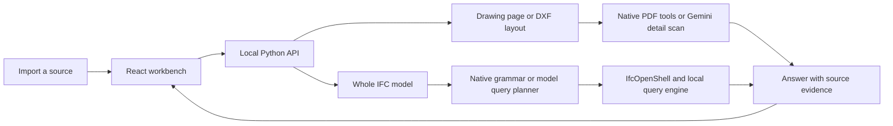

# How Ask the Plan works

Ask the Plan combines a drawing/BIM viewer, hosted model interpretation and local
source calculations. The browser shows the evidence beside each answer.

## The stack at a glance

| Part | Technology | What it does here |
| --- | --- | --- |
| Workbench | React 19, TypeScript 5.9, Vite 7 | Local imports, questions, answer details and exports |
| IFC viewer | Three.js 0.184, That Open Components 3.6, web-ifc 0.0.77 | Browser conversion, 3D viewing, source properties and answer highlights |
| PDF preview and text | PDF.js 5.5 | Browser page rendering and a bounded backend Node worker for native text |
| Local API | Python 3.10+, FastAPI, Uvicorn | Temporary source sessions, question orchestration and HTTP endpoints |
| IFC extraction and execution | IfcOpenShell, Python | Source objects, properties, quantities, topology, calculations and bounded geometry |
| DXF preview | ezdxf | Selected model/paper layout rendered for viewing and visual questions |
| Drawing preparation | Pillow, NumPy, optional OpenCV and Tesseract | Upright image preparation, crops, tiles and optional local inspection/OCR |
| Model access | Native Gemini Interactions HTTP transport; OpenAI-compatible Verda client | Drawing interpretation, IFC query planning and native PDF tool planning |
| Shared contracts | Pydantic 2, JSON Schema, generated TypeScript | Typed plans, units, source identity, result states and evidence references |

Frontend versions above describe the checked-in lockfile. Exact versions live in
[the frontend lockfile](../frontend/package-lock.json), while Python dependency
ranges and optional extras live in [pyproject.toml](../pyproject.toml).

## Two answer paths

**Drawings.** The selected image, PDF page or DXF layout defines the scope.
Native PDF tools extract source text and schedule cells locally. Resolving a
question to source spans or schedule operations can use the configured language
planner; direct literal lookups can finish without a model call. Visual questions use
Detailed scan, which proposes panels, inspects native-resolution crops/tiles,
and reconciles candidates. Counts and visual identifications retain their
estimate/partial qualifications and source boxes.

**IFC.** Questions use the entire imported model, including objects hidden in the
viewer. Explicit room or floor restrictions in the question still apply. A
conservative grammar can answer supported counts and stored quantities without a
model call. Other questions use bounded planning and discovery. The local engine
executes validated plans and returns the contributing objects, source properties,
units and calculation inputs.

The engine includes scalar/table arithmetic, selected geometry measurements,
recorded distribution-network metrics and modeled walking routes. Their methods,
work limits and qualifications are described in [the IFC guide](IFC_ENGINE.md).

## Model choices and local services

The drawing workbench requires `IMAGE_API_PROVIDER=gemini`. Its configured image
profile is Hydrogen-low or Carbon-low/medium. Optional capability routing can
select between Hydrogen and Carbon. The default routing setting is `off`.

`IFC_API_PROVIDER` selects the language planner shared by IFC questions and native
PDF tool proposals. It supports Gemini Hydrogen and Nemotron through Verda,
independently of the image analyzer setting. Native PDF proposals select source
spans, table headers and operations; local code reads the values and performs the
calculations. Credentials stay in backend environment variables or
the ignored `.env` file. Source sessions are temporary, and browser imports last
until refresh.

Local development uses two servers, Vite on port 5173 and the Python API on port
8000. The IFC engine runs inside that backend and also has a standalone CLI.
Vite proxies `/api` to the local backend. Follow [the setup guide](SETUP.md#start-the-app)
to run them.

## What to inspect next

- [Answer pipeline](NATURAL_LANGUAGE_ANSWERS.md) for runtime behavior and remaining gaps.
- [IFC engine](IFC_ENGINE.md) for executable operations and their precise meanings.
- [Verification record](VERIFICATION.md) for recorded checks and their limits.
- [Project scope](PROJECT_SCOPE.md) for the supplied question families and acceptance boundary.

The older [stack recommendation](TECH_STACK_RECOMMENDATION.md) and design notes
preserve the hackathon's research history. This page describes the implemented
stack as checked on 15 November 2026. Dataset results are reported separately from
component tests and structural validation.
