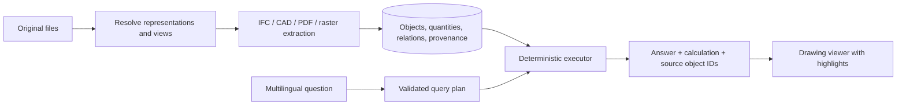

# Stack recommendation for Make Blueprints Talk

Prepared 13 November 2026. This is an architecture recommendation, not an implementation or a claim of benchmarked model performance.

**Build a multilingual quantity engine with inspectable evidence. Use a small language model to interpret questions, format-specific parsers and geometry to execute them, and small vision models to turn raster plans into reusable objects.** The durable contribution is the connection between an answer, its scope, its calculation, and the exact source objects.

## Why this fits the challenge

[The brief](../dataset/task.md) gives equal weight to accuracy, verifiability, creativity, and low inference cost. [The dataset README](../dataset/junction-dataset/README.md) additionally specifies exact counts and a 2% tolerance for areas, lengths, and volumes. Training a model is optional.

I delegated three source reviews: raster drawings; Swiss/CAD drawings and schedules; and BIM/IFC. We sampled actual images, geometry, and matching questions rather than examining every drawing. Existing dataset audits supplied collection-level context. I independently checked the question distribution and selected QA rows and visually inspected the reviewers' contact sheets.

The full question file contains 127,044 rows: CubiCasa 85,514 (67.31%), Swiss Dwellings 37,584 (29.58%), IFC models 3,062, IFC-Bench 820, and Opening Design 64. These are question rows, with translations and repeated drawings, not independent examples or published hidden-test weights. Raster support matters: an IFC-only product addresses only a small part of the supplied QA. Swiss and IFC are nevertheless the fastest path to reliable calculations and convincing evidence.

## Findings from the sample

Paths below are relative to `dataset/junction-dataset/`. QA references are one-based lines in its `questions.jsonl`.

| Source and example | Observed evidence | Design consequence |
|---|---|---|
| CubiCasa `data/cubicasa5k/colorful-10052.png`, QA 1-14 | Reference counts include 5 doors, 7 windows, 2 sinks, and 1 storey. A double-bowl sink and double-leaf door require instance grouping. The drawing states that it is not to scale. | Detect logical objects and retain their locations. Do not estimate metric area from arbitrary pixels. |
| CubiCasa `colorful-11397.png`, QA 441-450 | Two floor views, upside-down text, 475 x 650 pixels. Windows: 13; storeys: 2. Doors are visible but no door-count label is supplied. | Partition floors, handle rotation, and distinguish missing task labels from zero. |
| CubiCasa `high_quality_architectural-1.png`, QA 22027-22048 | Rotated Finnish abbreviations, multiple floors, cropped neighboring rooms, screenshot artifacts. | Scope extraction and crop context are as important as symbol detection. Some apparent count differences need manual scope review. |
| Swiss `data/swiss_dwellings/site3387_bldg5238_floor23498.{pdf,dxf,png}`, QA 89491/89493 | German room labels, separate room/unit layers, DXF metre units. Computed room areas 15.4725 and 5.6300 m2 match references 15.47 and 5.63. Reference 20 doors is not 24 arcs or 44 door-layer polylines. | Join text to room geometry; group door/window primitives. Mask the printed legend. |
| Swiss `site3506_bldg5388_floor23741`, QA 89525/89527 | Italian room labels. Computed areas 21.5571 and 8.3416 m2 match 21.56 and 8.34. | Normalize room concepts across languages while preserving original labels. |
| Swiss `site765_bldg1658_floor7457`, QA 89563 | French room 5.10 has shell area 48.070375 m2 and two column holes of 0.0611037 and 0.0641318 m2. Net 47.945139 rounds to reference 47.95. | Build ring containment and holes. A closed polyline is not automatically one complete room. |
| Opening Design `data/opening_design/Sports_Complex/Sheets - Current Set/A-801 - Door and Finish Schedules & Wall Types.pdf`, QA 89397/89398/89414 | Native PDF text supports 38 door rows, 14 type-A1 rows, and door 121.A width `5'-10 3/8"`. Visually checked the sheet and schedule crop. | Segment the door table from finish tables, type diagrams, and details; highlight the row and requested cell. No OCR or detector is needed for these examples. |
| Esplanades `data/ifc_models/bsc-esplanades_1807-ep-ar-v18_plan-01-1-korrus.{pdf,svg}`, QA 86667 | The referenced first-floor SVG has 46 door GUIDs; the question asks about the whole model, with reference 211. The IFC contains 211 door occurrences. | Resolve the model and explicit question scope. A file path does not restrict every question to the visible floor. |
| Molio, QA 87309, linked to the foundation PDF | 579 raw `IfcStair` occurrences include aggregated parts; the relevant top-level assemblies number 15, matching the reference. | Traverse aggregation and containment. Count at the requested assembly granularity. |
| `data/ifc_bench/digital_hub_heating.ifc`, QA 85714 | Stored pipe lengths are typed length measures, defaulting to project millimetres. Deduplicated per-pipe lengths sum to 1,207,377.098 mm, or 1,207.3771 m. The reference labels the raw sum as metres. | Retain quantity types, unit provenance, and conflicts with references. Never learn unit mistakes as desired behavior. |
| Finna `data/finna/hka.139877703731200_160449264635900.jpg`; HABS `data/habs/ak0015_sheet_00001.jpg` | No supplied QA for either. The first is a historical Swedish handwritten multi-floor drawing; the second is an English site map with an inset at another scale. | Treat archival handwriting and site maps as additional domains. Calibrate per view, not per page. |

See [the full dataset findings](../dataset/FULL_DATASET_FINDINGS.md) for broader structural observations, including missing `IfcSpace` records in ResBIM and duplicate IFC files across folders. The table above is a sample, not a source-wide accuracy assessment.

## Recommended stack

| Layer | Choice | Role and boundary |
|---|---|---|
| Product UI | React + TypeScript + Vite, PDF.js, SVG overlays | A focused drawing viewer with chat, scope controls, numbered objects, and calculation evidence. Use original SVGs when available. PDF.js supplies page rendering and viewport transforms. [Vite](https://vite.dev/guide/), [PDF.js](https://mozilla.github.io/pdf.js/examples/). |
| API and contracts | Python + FastAPI + Pydantic | Typed query plans, extractors, deterministic execution, and structured results. Use a tested Python environment and lock dependencies. [FastAPI](https://fastapi.tiangolo.com/), [Pydantic](https://docs.pydantic.dev/latest/concepts/models/). |
| Persistent evidence | SQLite + FTS5, files for tiles/geometry | Store documents, source objects, quantities, relations, text boxes, and provenance. Parameterized SQL handles structured queries; FTS5 retrieves IDs, labels, and schedule text. Normalize multilingual concepts before retrieval. [FTS5](https://www.sqlite.org/fts5.html). |
| BIM extraction | IfcOpenShell | Entity types, inherited types/properties, quantities, aggregation, spatial containers, and units. Generate geometry only when stored properties/quantities are insufficient. [Examples](https://docs.ifcopenshell.org/ifcopenshell-python/code_examples.html), [geometry](https://docs.ifcopenshell.org/ifcopenshell-python/geometry_processing.html). |
| CAD and 2D computation | ezdxf + Shapely + NumPy | Preserve layer/entity handles; expand blocks and transforms; associate labels; construct polygon topology; compute areas and exclusions. DXF is the supported CAD path. ezdxf is not a general DWG reader or full 3D renderer. Use a paired export where available. [ezdxf](https://ezdxf.readthedocs.io/en/stable/addons/drawing.html), [Shapely](https://shapely.readthedocs.io/en/stable/manual.html). |
| Native PDF and schedules | PyMuPDF first; table-specific extraction where needed | Read native words and vector paths with coordinates before invoking OCR. Reconstruct schedule rows/cells with their bounding boxes. Add Docling/TableFormer only if a schedule benchmark justifies it. [PyMuPDF](https://pymupdf.readthedocs.io/en/latest/page.html), [Docling models](https://docling-project.github.io/docling/usage/model_catalog/). |
| Raster text | PaddleOCR PP-OCRv6, initially medium | Cache text, polygons, and orientations. Current official docs describe tiny/small/medium tiers and a unified model for 50 languages; test actual abbreviations and scripts. Use script-specific models when needed. This does not establish handwriting accuracy on archival plans. [OCR pipeline](https://github.com/PaddlePaddle/PaddleOCR/blob/main/docs/version3.x/pipeline_usage/OCR.en.md). |
| Raster objects | Existing CubiCasa model as a timeboxed baseline; custom RT-DETRv2-R18 only where it improves held-out results | Recover instances/room regions, then apply semantic grouping rules. RT-DETRv2 weights are COCO pretrained, not blueprint capable out of the box; task fine-tuning needs boxes/masks. [CubiCasa](https://github.com/CubiCasa/CubiCasa5k), [RT-DETRv2-R18](https://huggingface.co/PekingU/rtdetr_v2_r18vd). |
| Multilingual question interpreter | Qwen3.5-4B via vLLM, constrained JSON, non-thinking mode | Convert free-form questions to a language-independent plan. Reuse the endpoint for selected ambiguous crops; keep the backend capable of swapping models. Evaluate 9B only if 4B makes material semantic errors. Official model support is a selection rationale, not a blueprint benchmark. [4B model card](https://huggingface.co/Qwen/Qwen3.5-4B), [structured output](https://docs.vllm.ai/en/latest/features/structured_outputs/). |
| Compute | CPU ingestion/query service; one GPU worker | Use the existing Verda credit for bounded batch extraction/training if suitable GPU capacity is available. Modal is convenient for burst jobs and a demonstration endpoint. Keep persistent evidence independent of GPU lifetime. [Modal GPU guide](https://modal.com/docs/guide/gpu). |

Start with one API process, a separate batch worker, one database, and one model endpoint. A vector database, graph database, multi-agent runtime, Kubernetes, and a large RAG framework add little to the first version. Add semantic retrieval later if measured failures concern finding the right sheet; retrieval alone cannot count every object reliably.

## Multilingual routing: useful, but a narrow responsibility

Multilingual understanding is needed; a separate LLM per language is not. Use deterministic routing for file formats and known, validated question templates. Send novel wording to one multilingual interpreter with a compact catalog of the available floors, room IDs, class names, and properties.

The interpreter emits a Pydantic-validated plan such as:

```json
{
  "operation": "sum",
  "target": "room",
  "quantity": "net_area",
  "scope": {"kind": "storey", "id": "resolved-storey-id"},
  "filters": {"use": "residential_indoor"},
  "exclude": ["balcony", "terrace", "shaft", "void"],
  "output_unit": "m2"
}
```

Allow only supported operations such as count, sum, lookup, min/max, group-by, and explicitly implemented spatial predicates. The application resolves IDs, validates coverage and unit dimensions, and executes the operation. JSON validity is not semantic correctness: a wrong floor or omitted exclusion must fail the evaluation even if the JSON parses.

The contract also needs explicit `needs_clarification`, `unsupported_operation`, `missing_source`, and `incomplete_coverage` outcomes. Unresolved floors must not turn into guessed IDs; incomplete detections must not turn into a confident zero. Ask one focused question only when the user's intended scope cannot be resolved from the provided context.

Preserve identifiers such as `121.A` and `7.16` exactly. Normalize Finnish, German, French, Italian, and other room terms into shared concepts, while retaining the original text. Keep toilet bowls separate from WC rooms, door leaves separate from open passages, and net room area separate from gross building area.

Use the documented `chat_template_kwargs.enable_thinking=false` for short routing responses. Limit output size and send only relevant schema/catalog entries. Render the final numeric answer directly from the executor; translate a short explanation only when necessary. Never ask the model to recalculate the result. The Qwen card documents multilingual capabilities, vision input, and this non-thinking switch; their performance on this dataset still needs measurement.

Before committing to GPU serving, compare 4B semantic plan accuracy and end-to-end latency against one compact hosted reference on development questions. Include unseen paraphrases, mixed-language questions with literal IDs, exclusions, and global-versus-floor scope. Keep 4B only if this task-level result is acceptable; otherwise use the stronger interpreter through the same adapter. There is no architectural dependence on one vendor or model generation.

## The central artifact: objects with evidence



Each object should retain source hash, representation, project/model, page/view/storey, original ID, canonical class, original label, geometry or box, units, and extraction method/version. Keep separate relations for contains, aggregates, typed-by, belongs-to-unit, and depicts. Store original-to-render and crop/rotation transforms so a tile prediction lands accurately on the full drawing.

Each result carries the matched objects, excluded objects, quantity values, arithmetic expression, unit conversion, source property path, and coverage status. A source object can be exact while its class interpretation remains uncertain. Show those distinctions instead of displaying an uncalibrated confidence percentage.

Prefer explicit quantities with known semantics; calculate from geometry when needed and label that method. A modeled room quantity and a calculated floor polygon can represent different definitions. Do not silently replace one with the other. IFC unit overrides and dimensions must be checked independently for length, area, and volume. [IfcOpenShell unit utilities](https://docs.ifcopenshell.org/autoapi/ifcopenshell/util/unit/index.html).

For the heating sample, the reviewer traced `#2179` (`IfcLengthMeasure`, no property unit), its property-set relation to pipe `#2146`, and project unit assignment `#109` containing millimetre unit `#43`. Repeated identical length properties are deduplicated per pipe. This supports the converted stored length, not an independent geometry measurement. Keep the discrepancy with QA 85714 in a review ledger rather than modifying the reference file.

Match zero to coverage: zero recorded `IfcSpace` entities means the room inventory is unavailable, not that the building has no rooms. A heating-only model cannot establish the building's architectural inventory. Split SVG class strings into tokens, and keep GUIDs intact. For an assembly without its own rendered shape, highlight descendant geometry and identify it as one assembly with multiple parts.

## What to train, and what to compute

**Spend custom-model effort on recovering raster instances.** That is where ordinary parsers stop and where reusable, localized predictions help both accuracy and verification.

1. Run an existing floor-plan model on a small held-out sample first. Timebox legacy CubiCasa integration: its original runtime is old. Record any known pretraining exposure to these public plans.
2. Obtain upstream instance annotations, map the original image identities, and split before training. The supplied PNGs plus aggregate count answers do not provide detector boxes or room masks. Missing questions are unknown labels, so mask their losses.
3. If the baseline fails on a tractable class, fine-tune one small detector on corrected instances. Start with only two or three classes that have available instance labels, chosen by development-set error frequency; doors/windows are plausible priorities. Timebox baseline integration to roughly 60-90 minutes and the first custom-training experiment to a few hours. Use rotation, scale, line-style, and scan-noise augmentation. CAD/BIM-rendered pseudo-labels can supplement real labels, but synthetic-to-scan transfer must be tested.
4. Process high-resolution overlapping tiles, map predictions to original coordinates, deduplicate across tiles, and group logical instances. Mask title blocks/legends and use view/floor membership. A double-bowl sink must follow the dataset's one-sink convention.
5. Add room segmentation only if room queries remain a major failure. Combine room boundaries, door closures, OCR labels, and adjacency; naive flood fill leaks through openings. Do not train a second large vision system just for novelty.

Traditional methods should do unit conversion, polygon area with holes, CAD block grouping, containment, label-to-room assignment, aggregation, instance deduplication, and calculation. OpenCV is useful for deskewing, line/arc proposals, morphology, and checks, but a universal template matcher will not cover all drawing styles.

A crop VLM can interpret an unfamiliar abbreviation, handwriting, or an ambiguous candidate. Its proposed object still needs a location and a coverage check. If it supplies only a textual count, the answer remains weakly evidenced. Measurements on uncalibrated drawings should return an explicit limitation.

## Product behavior that could distinguish the entry

Make verification the default interaction. Answer cards should show the number, unit, floor/model scope, and extraction method. Clicking the answer highlights numbered instances or shaded polygons. The user can inspect the included/excluded objects and the terms in an area sum. Schedule answers highlight both the requested row and the relevant column, rather than an entire sheet.

Demonstrate the same free-form question in Finnish and English producing the same plan and objects. Then change scope from one floor to the whole building and show the evidence update across floors. Demonstrate a net-area sum with balcony exclusions and a missing-property response. These directly exercise the judging criteria.

Use existing 2D SVG GUIDs for IFC evidence first. A polished 2D view with correct links is more valuable initially than building a new 3D viewer. Add a lightweight 3D selection view only after the query and evidence path works. If a whole-model answer has only one rendered floor, explicitly show the remaining object inventory or generate the missing floor evidence; do not highlight a partial sheet as proof of the total.

## Build order and decision gates

Assuming roughly a hackathon weekend, run these workstreams in parallel:

| Stage | Deliverable | Gate before expanding scope |
|---|---|---|
| Foundation | Asset/representation manifest; query/result schema; small evaluation set; viewer accepting evidence IDs | One real query can travel end to end with correct scope and coordinates. |
| Structured data | Swiss room-area/count operations; IFC types/properties/assemblies and floor scope | Selected real examples match, including room holes and model-versus-sheet scope. |
| Raster baseline | OCR + view partitioning + existing model, cached objects | Exact-count and localization scores are measured on held-out plans. |
| Targeted training | One model improvement for the dominant raster error | Keep it only if held-out exact answers improve; AP alone is insufficient. |
| Schedules and fallback | One real schedule lookup, ambiguous crop handling, missing-info responses | Evidence points to the correct row/cell or unresolved object. |
| Demo hardening | Multilingual walkthrough, cost/latency instrumentation, cold/warm tests | UI stays usable with unsupported data and honest partial coverage. |

Reserve substantial time for evidence alignment and evaluation. Do not spend the first day fine-tuning an LLM or importing all 12 GB before one sample works. Build extractors for samples first, then batch ingest using the same pipeline. Precomputation is valid when it derives reusable facts from sources; loading supplied QA as an answer lookup is not a transferable solution.

## Evaluation and inference cost

Create a small stratified development set immediately, with images/projects isolated from training. Include EN/FI pairs, new paraphrases, German/French/Italian labels, door grouping, multiple floors, room holes, whole-model scope, BIM assembly parts, missing information, and unit conversions. Keep translations, alternate formats, duplicate IFC hashes, and all floors of a project in the same partition. Report public-checkpoint exposure separately.

Maintain a separate frozen project-level test partition that does not guide model or threshold selection. Honor upstream CubiCasa train/test identities where known; an upstream checkpoint may already have seen a local image. If independent test examples are unavailable for a source, state that limitation rather than presenting a reused development score as generalization.

Track exact-count accuracy; numeric accuracy within the documented 2% tolerance; query-plan operation/scope/unit/exclusions; evidence object precision/recall or localization; multilingual consistency; abstention/coverage; and end-to-end latency. For text references, assess source-supported facts and limitations rather than exact string equality. Report both per-source/macro results and overall row-weighted results, since CubiCasa dominates the latter. Maintain a discrepancy ledger with source evidence for suspicious references.

Cache extraction by source hash and pipeline version. Cache canonical plans and evidence results; invalidate when sources or extraction change. The desired common path is one short language call plus a CPU query, or no language call for a validated template. OCR, vision, and geometry extraction should be reusable ingestion work rather than repeated on every question.

Use the existing EUR 200 Verda and EUR 100 Modal credits as ceilings, not spending targets. Start with a bounded GPU experiment and inspect useful examples/hour before scaling it. A 48 GB L40S is a convenient initial serving candidate; use a smaller GPU after measuring memory and latency. Do not keep both 4B and 9B warm by default.

Modal currently lists L4 GPU at USD 0.000222/s and L40S at USD 0.000542/s: about USD 0.80 and USD 1.95 per GPU-hour, respectively, excluding CPU, RAM, startup, idle windows, storage, and egress. Ten active L40S GPU-seconds would be USD 0.00542 in GPU charges only. Actual per-answer cost must include idle/startup allocation and amortized ingestion. Warm serving can cost more than a hosted API at low volume; self-hosting is not automatically cheaper. [Current pricing](https://modal.com/pricing), [scaling controls](https://modal.com/docs/guide/scale).

The strongest pitch is a system that answers from localized, reusable building facts, shows its calculations, and exposes gaps. Improved frontier models can then improve its language and vision components while preserving the geometry, provenance, validation, and user workflow.
