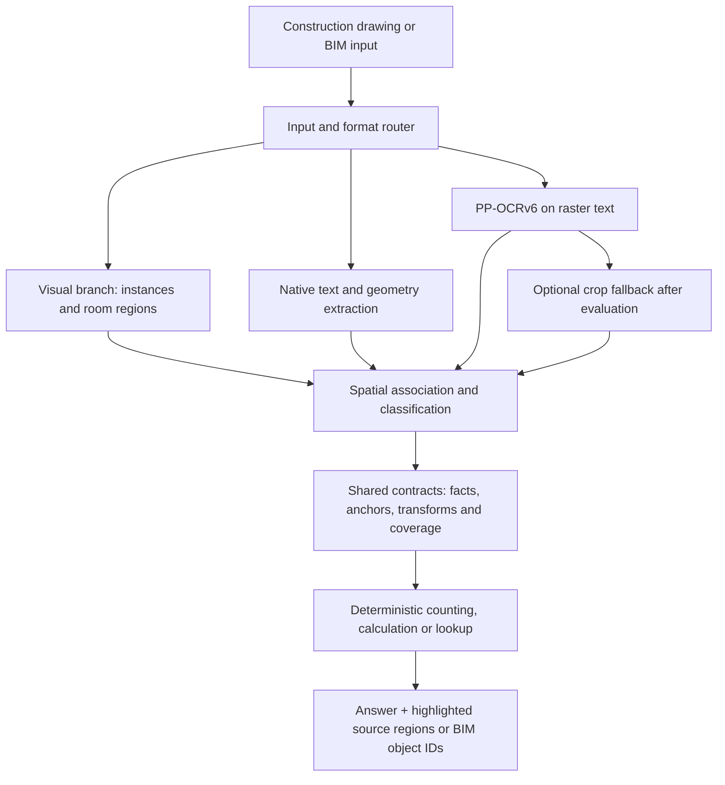

# OCR and Handwriting Recognition for the Stoa Construction-Drawing Dataset

**Analysis date:** 13 November 2026  
**Purpose:** Choose OCR and handwritten-text-recognition (HTR) components for the evidence-backed quantity engine described in [the stack recommendation](TECH_STACK_RECOMMENDATION.md), using [the shared contracts](SCHEMA.md).

**Implementation status, 14 November:** This is a dated research and evaluation
plan. No OCR, handwriting, raster detector, or model-routing pipeline is currently
integrated. The repo contains a standalone [IFC engine](IFC_ENGINE.md) and a
[mock frontend](../frontend/README.md). Model/version/benchmark statements below
describe the original review, not measurements on this dataset; verify exact
versions and checkpoint terms when implementing.

**Scope:** The [supplied dataset's question families](PROJECT_SCOPE.md) define
acceptance. Add OCR or a specialist only to answer those questions or to deliver
an explicitly optional demonstration. Unlabelled archival assets and unasked
categories do not imply surprise evaluation classes or require universal
handwriting recognition. The research candidates below are options, not a
mandatory model checklist.

## Executive recommendation

Use a **hybrid extraction system**, not one universal OCR model:

1. Extract text, properties, and geometry **natively** from IFC, DXF, and vector PDFs. Resolve DWG through a verified paired export or a separately validated converter; generic DWG reading is outside the initial supported path.
2. Use **PP-OCRv6 medium** as the initial raster text detector/recognizer. Compare small only when measured latency or cost warrants it.
3. Persist text regions, source anchors, coordinate transforms, and extraction provenance through the shared contracts. Associate them with visual instances, room geometry, and schedule cells before deterministic queries.
4. For selected ambiguous crops, first evaluate the supplied **Verda/Nemotron** endpoint configured in [nvidia_info.md](nvidia_info.md). **Qwen3.5-4B** remains a self-hosted comparison candidate if access, accuracy, or cost warrants it. Verify image handling and localization before depending on either crop path.
5. Benchmark **Kraken 7.1 medium** only when a relevant handwriting failure slice emerges or an archival demonstration is deliberately in scope. Keep **TrOCR small/base** as a later fine-tuning alternative.
6. If native schedule extraction fails on relevant examples, test **one** document parser: **Surya 2.5** or **PaddleOCR-VL 1.6**. Evaluate **Chandra OCR 2** only if unresolved cases justify another model and serving dependency.

**Initial prototype: native extraction + PP-OCRv6 medium + the existing raster instance/room baseline + deterministic queries and evidence overlays.** Historical HTR and generative OCR are optional upgrades with evaluation gates. Cache extraction by source hash and pipeline/model configuration so OCR is reusable ingestion work.

## 1. What the dataset tells us

The full-dataset audit reports:

| Property | Full dataset |
|---|---:|
| Asset files | 16,891 |
| Question-answer pairs | 127,044 |
| Distinct directly referenced assets | 5,939 |
| CubiCasa5K images | 4,787 |
| Swiss Dwellings plans | 1,040, with PDF/DXF/PNG versions |
| Europeana + Finna + HABS + Wikimedia assets | 6,701 |

The final group includes images without associated question-answer rows. Its contents are promising for historical and handwritten-text testing, but **not every file is necessarily historical or handwritten**, and some files are alternative formats.

**Priority:** CubiCasa and Swiss Dwellings supply **96.89% of the question rows**. First address modern room labels, literal room IDs, multilingual abbreviations, rotated text, and text-to-room association. Keep the remaining known task families in the coverage plan. Archival handwriting is an optional additional capability without demonstrated QA benefit. See [the full findings](../dataset/FULL_DATASET_FINDINGS.md).

### Distribution of question types

| Answer type | Questions | Share |
|---|---:|---:|
| Count | 111,763 | 87.97% |
| Area | 14,243 | 11.21% |
| Text | 836 | 0.66% |
| Volume | 138 | 0.11% |
| Length | 64 | 0.05% |
| **Total** | **127,044** | **100%** |

**Implication:** OCR is an important support component, especially for room labels, measurements, annotations, materials, and schedules; it is **not** the primary solution to counting windows, doors, sinks, and other graphical symbols.

Answer type is not OCR demand: a count may require reading a room label, and an area lookup may require an exact room identifier. Conversely, 820 of the 836 text rows are IFC-Bench questions with structured BIM inputs.

### Source-specific implications

| Source | What OCR can contribute | What should not rely on OCR alone |
|---|---|---|
| **CubiCasa5K** | Room labels such as `MH`, `WC`, `KPH`, and `SAUNA`; printed or handwritten area annotations | Counting doors, windows, fixtures, and rooms |
| **Swiss Dwellings** | Room labels and measurements in raster plans | Geometry and text available natively in DXF/PDF |
| **Opening Design** | Raster text or cells that fail native extraction | Native PDF words and schedule rows/cells; the stack review recovered the demonstrated door lookups without OCR |
| **Europeana / Finna / HABS / Wikimedia** | Historic handwriting, multilingual captions, degraded technical annotations | Graphical understanding and geometry |
| **IFC models / IFC-Bench** | OCR only for information not stored in a readable structured form | IFC entities, quantities, spatial hierarchy, and properties |

### Important dataset limitations

- The dataset audits **do not measure handwriting prevalence or handwriting quality**.
- The stack recommendation reports visual sampling of selected drawings, including archival handwriting. This OCR review has not benchmarked any model on those drawings; model selections remain hypotheses to test.
- The full dataset includes question-level answers, but that does **not** mean it has pixel-level boxes, masks, or handwriting transcripts.
- The local CubiCasa data lacks the upstream polygon SVG annotations, according to the dataset findings. If the object detector needs instance labels, obtain licensed upstream annotations or label data separately.
- **Missing question rows are unknown labels, not zeros.** Keep missing and explicit zero answers separate during training.
- Alternative formats, translated questions, all floors of a project, and duplicate asset hashes must remain together across evaluation partitions. Preserve known upstream CubiCasa split identities and report public-checkpoint exposure.

**Dataset evidence:** [full audit](../dataset/full_dataset_audit.json), [comparison](../dataset/full_dataset_comparison.json), [full findings](../dataset/FULL_DATASET_FINDINGS.md), [quality review](../dataset/full_dataset_quality.json), [preview findings](../dataset/DATASET_FINDINGS.md), and [challenge brief](../dataset/task.md).

## 2. OCR model shortlist

| Model | Best use in the project | Approximate scale | Main trade-off |
|---|---|---|---|
| [PP-OCRv6 medium](https://github.com/PaddlePaddle/PaddleOCR) | **Baseline:** raster labels, dimensions, and multilingual text | Small model family; detection and recognition variants | Validate short labels, technical symbols, and rotation; compare small only if needed |
| Planned Qwen crop path / [configured Nemotron endpoint](nvidia_info.md) | **First fallback experiment:** selected ambiguous crops | Qwen 4B; Nemotron serving footprint unverified | Configuration is not measured availability, OCR accuracy, cost, or localization support |
| [Kraken 7.1](https://github.com/mittagessen/kraken/releases/tag/7.1) | **Conditional:** historical text recognition and HTR adaptation | Tiny/small/medium recognizers based on PP-OCRv6 | Requires suitable line segmentation and evidence of benefit on the target slice |
| [TrOCR](https://huggingface.co/microsoft/trocr-base-handwritten) | **Later:** cropped-line recognition and fine-tuning alternative | ~62M small, ~334M base | Separate detection/cropping; English-heavy IAM starting point |
| [Surya 2.5](https://github.com/datalab-to/surya) | **Conditional parser:** layout, tables, and difficult document text | ~689M | Test source/cell localization, backend, and conditional weight license |
| [PaddleOCR-VL 1.6](https://github.com/PaddlePaddle/PaddleOCR) | **Alternative parser:** complex schedules and pages | ~960M | Structured output alone does not establish requested cell coordinates |
| [Chandra OCR 2](https://huggingface.co/datalab-to/chandra-ocr-2) | **Later reference/fallback:** unresolved hard crops or reviewed label proposals | ~4.5B | Additional serving cost, generative errors, and conditional weight license |

*Parameter counts are approximate and refer to different model architectures. A multi-component OCR pipeline should not be compared with a generative model on parameter count alone.*

### General document benchmark: OmniParseBench

A Datalab evaluation published 23 October 2026 compared open-weight document parsing systems. The broad overall scores discussed in the original analysis were:

| Model | Overall score (higher is better) |
|---|---:|
| Chandra OCR 2 | 90.1 |
| dots.mocr | 87.9 |
| MinerU2.5-Pro | 87.1 |
| Surya OCR 2 | 83.1 |
| LightOnOCR-3-0.8B | 81.6 |
| PaddleOCR-VL 1.6 | 78.7 |

Source: [Datalab — Open OCR models on OmniParseBench](https://www.datalab.to/blog/open-ocr-models-omniparsebench).

For the handwriting subset of that benchmark, reported scores were **66.8 for Chandra OCR 2**, **58.9 for dots.mocr**, and **52.0 for MinerU2.5-Pro**. These figures are **benchmark scores, not character recognition accuracy**, and they do not represent this construction-drawing dataset.

The newer Surya 2.5 was released after that comparison; its reported overall OmniParseBench score is **85.9**. Treat this as a separate model report rather than a strictly controlled same-run comparison.

**Use of these results:** This is a vendor-run document benchmark. Its headline combines text, table, and layout scores; it does not measure blueprint object counting, exact short dimension strings, or correct text-to-room association. It also does not compare the proposed PP-OCRv6 and Kraken baselines. Use it to choose a conditional experiment, not to require a model in the MVP.

## 3. Optional specialists and crop fallbacks

### 3.1 Kraken 7.1: historical-text specialist candidate

Kraken targets historical printed and handwritten documents. Its 7.1 release introduced pretrained tiny, small, and medium recognizers using a PP-OCRv6-based architecture with training adapted for historical material. The recognition checkpoints are distinct from PaddleOCR's general models; this relationship is not evidence that their errors will be independent.

| Evaluation language | Reported Kraken 7.1 medium CER (lower is better) |
|---|---:|
| Finnish | 0.63% |
| German | 1.62% |
| Swedish | 3.56% |
| English | 5.90% |

**CER** means *character error rate*. These are model-reported language aggregates for historical text evaluation, not handwriting-only construction-drawing results or evidence that Kraken is the best recognizer for this project.

**Why test it:**

- Explicit emphasis on historical handwriting.
- Support for fine-tuning with line transcriptions and structured annotations.
- Smaller deployable model variants.
- Potentially useful starting point for Finnish and other European technical annotations.

**Main risks:** Historic manuscripts and blueprints are different domains. Room labels, technical lettering, rotated dimensions, very short numeric strings, and annotations crossing wall lines may be much harder than continuous text lines.

**Entry gate:** First test PP-OCRv6 on the relevant crops. Add a Kraken comparison only if handwriting failures materially affect target answers or the team commits to an archival demo. Evaluate the same correct line crops and the full segmentation/recognition path before considering fine-tuning.

Sources: [Kraken 7.1 release and evaluation](https://github.com/mittagessen/kraken/releases), [medium checkpoint metadata](https://huggingface.co/small-models-for-glam/kraken-ppocrv6-medium/blob/main/README.md), [Kraken documentation](https://kraken.re/main/index.html).

### 3.2 TrOCR: later line-recognition and fine-tuning alternative

TrOCR uses a vision Transformer encoder with a text decoder. Its handwritten checkpoints are designed to recognize cropped handwritten lines, with training and evaluation centered on datasets such as IAM.

The original TrOCR report lists approximately **4.22%**, **3.42%**, and **2.89%** character error rates for small, base, and large variants on IAM, respectively. These are **not blueprint evaluation results**.

**Possible strategy after a specialist experiment is justified:**

1. Manually verify several hundred to a few thousand text-line crops from technical drawings.
2. Fine-tune `microsoft/trocr-small-handwritten` or `microsoft/trocr-base-handwritten`.
3. Test on drawings from buildings or archives excluded from training.
4. Compare against a similarly adapted Kraken model.

**Role:** An alternative to compare with Kraken if sufficient verified line crops exist. A narrow vocabulary of room labels and dimensions may make adaptation tractable, but superiority must be measured rather than assumed.

Source: [TrOCR handwritten checkpoint](https://huggingface.co/microsoft/trocr-base-handwritten).

### 3.3 Reuse a planned or configured image endpoint first

The updated stack recommendation prioritizes a bounded check of the supplied Verda endpoint for question interpretation and selected ambiguous crops. [nvidia_info.md](nvidia_info.md) records model ID `nemotron-3.5-super-vl` and supplied text/image settings. Qwen3.5-4B remains a self-hosted comparison candidate. Compare these paths before adding a dedicated generative OCR service.

Run a bounded crop experiment to check authentication, actual image support, image-resolution limits, literal identifier/dimension accuracy, timeouts, latency, and billed cost. Test localization rather than assuming the endpoint returns reliable boxes. For recognition on a known crop, retain its source anchor and transform; reject invented subregions. Crop recognition does not establish that all text on a sheet was detected.

Reuse the same adapter and evidence path. Keep only a fallback that improves the target development slice at an acceptable measured cost. Neither endpoint has been tested by this document, and the configured service is not assumed free or always available.

### 3.4 Chandra OCR 2: later fallback or reviewed transcription assistant

Chandra OCR 2 is a larger document-reading system that can address complex handwriting, multilingual material, tables, and forms.

Evaluate it only if unresolved cases justify the extra dependency after the baseline and existing endpoint comparison. Possible uses:

- Run on OCR regions that are difficult or contradictory.
- Propose transcriptions for ambiguous annotations.
- Support **human-reviewed** pseudo-labeling for future small-model fine-tuning.
- Cross-check extraction from complex schedules or pages.

**Caution:** A generative model can produce convincing words or numbers that are not justified by the pixels. Never treat a plausible transcription of an engineering dimension as certain without verification.

Source: [Chandra OCR 2](https://huggingface.co/datalab-to/chandra-ocr-2).

### 3.5 Surya 2.5 and PaddleOCR-VL 1.6: conditional document-layout challengers

The stack review's demonstrated Opening Design schedule lookups already work with native PDF text. Only if relevant schedules or layouts fail native extraction should the team select one challenger:

- **Surya 2.5:** OCR plus layout and reading-order parsing; potentially an integrated route for text localization and extraction.
- **PaddleOCR-VL 1.6:** Compact vision-language document parser, potentially useful for complex pages and structured tables.

Require accurate source locations for the requested row and cell as well as correct content. Structured HTML/Markdown is insufficient by itself. PaddleOCR's documentation notes that PP-StructureV3 provides finer coordinate information than its VL pipeline; compare a table-specific extractor if localization is the dominant failure.

Neither should be assumed to beat a tailored recognizer on tiny construction labels. Check the exact **model-weights license**, not just the code license; see section 8.

Sources: [Surya repository](https://github.com/datalab-to/surya), [PaddleOCR repository](https://github.com/PaddlePaddle/PaddleOCR).

## 4. How OCR should integrate with raster instances and geometry

**Visual branch:** Recover localized instances and room regions using the timeboxed existing floor-plan baseline in the stack recommendation. A whole-image classifier cannot supply object membership or complete counting evidence. Add a custom detector/segmenter only where annotations and held-out QA results justify it.

**Text branch:** Find text regions; recognize room labels, annotations, dimensions, and specifications; retain bounding boxes and uncertainty.

**Fusion stage:** Associate each text box with its containing or nearby room, symbol, dimension line, or schedule cell. Use both textual and visual evidence in classification.

Partition floors/views and mask legends before association and counting. A fallback transcription is an additional observation with its own provenance; retain disagreements rather than overwriting native or earlier OCR evidence. Validate coverage independently of recognition confidence.

### Example: room classification

A room label reads `MH 12.5 m²`:

- Visual model: room looks like a bedroom but is ambiguous.
- OCR: text contains `MH`, commonly the Finnish abbreviation for *makuuhuone* (bedroom).
- Fusion: classify as bedroom with supporting geometric and textual evidence.
- UI: highlight the room polygon and `MH` text region.

**Avoid blindly trusting OCR.** Misreading `MH`, `PH`, `KH`, or `KPH` could change the predicted room class. Preserve the original OCR string and location; check inferred classes against the surrounding layout.

## 5. Format-aware routing: when not to use OCR

| Input | Preferred extraction | OCR role |
|---|---|---|
| IFC | IfcOpenShell: entity types, GUIDs, relationships, quantities, geometry | Usually unnecessary |
| DXF | `ezdxf`: `TEXT`, `MTEXT`, dimensions, blocks, layers and geometry | Fallback for embedded raster annotations |
| DWG | Resolve a verified paired DXF/PDF export; separately validate a converter only if required | OCR can read an available rendering; report unsupported/missing source when no usable representation exists |
| Vector PDF | PyMuPDF native text and vector information | Fallback for scanned or unextractable regions |
| Scanned PDF | High-resolution rendering + OCR | Primary textual extraction |
| PNG/JPEG floor plan | OCR plus CV | Main way to obtain raster text, not to count all symbols |
| Historic scanned drawing | PP-OCRv6 baseline, then optional HTR comparison | Read annotations; add a specialist only after the entry gate |

For example, PyMuPDF `page.get_text("words")` provides word locations, and DXF `TEXT`/`MTEXT` entities often expose their contents directly. These routes preserve fidelity and usually cost less than OCR.

If a dimension or area exists reliably in CAD/IFC, prefer that structured value over attempting to read or infer it from pixels.

## 6. Construction-drawing OCR failure modes

| Failure mode | Recommended mitigation |
|---|---|
| Small text on very large sheets | Process overlapping high-resolution tiles; do not downsample an entire sheet excessively |
| Rotated labels or dimensions | Handle individual 0/90/180/270-degree crops explicitly; the listed PaddleOCR text-line classifiers handle 0/180 degrees, which alone does not cover vertical labels |
| Handwriting mixed with wall lines | Specialized text-line segmentation; selective line removal or enhancement |
| Faded and noisy ink | Compare original crops with controlled contrast/denoising variants |
| `0/O`, `1/I`, `5/S` and similar confusions | Constrained parsing with context, but preserve original candidates |
| `1.250` vs `1,250`, `Ø125`, units and fractions | Purpose-built numeric parsing and strict validation |
| Finnish/multilingual abbreviations | Domain vocabulary plus visual/geometric context |
| Duplicate text in overlapping image tiles | Geometric deduplication of text regions |
| Unreadable annotations | Return uncertain/unknown rather than fabricate a transcription |
| Text detached from an object or room | Spatial association with room polygons, object detections, and dimension lines |
| Text never detected | Measure recall on fully annotated views; a confidence threshold cannot route a region that produced no detection |
| Table transcription without cell coordinates | Require verifiable row/cell anchors or use a table-specific extractor; a page-level box is insufficient |

Sources for rotation and coordinate support: [OCR pipeline](https://github.com/PaddlePaddle/PaddleOCR/blob/main/docs/version3.x/pipeline_usage/OCR.en.md), [PaddleOCR parser overview](https://github.com/PaddlePaddle/PaddleOCR).

### Use the shared evidence contracts

Emit [the existing contract records](SCHEMA.md) from [contracts/models.py](../contracts/models.py), rather than defining a separate OCR wire format:

| Information | Contract mapping |
|---|---|
| Source revision and extraction | `Asset` SHA-256 and `ExtractionRun` with tool version, model revision, configuration hash, input assets, and offset-aware timestamp |
| Literal recognized text | `SourceFeature(kind="text_span")` with `LocalizedText`; preserve strings such as `7.16`, `121.A`, and `5'-10 3/8"` |
| Verifiable source location | `EvidenceAnchor` with asset/view IDs, `image_region` or native selector, quote, and `geometry_id` |
| Boxes/polygons and coordinate alignment | `Geometry` referencing a `CoordinateFrame`; explicit `Transform` records for rendering, scaling, tiling, deskewing, and crop rotation back to the original view |
| Recognition method and score | Feature `Provenance(method="ocr")`, run/anchor IDs, and a named recognition score when available; native text uses `method="native"` |
| Object association and interpretation | Link source features through `Representation` to canonical entities; keep a normalized room classification or parsed quantity as a separate provenanced assertion using the relevant catalogs |
| Schedules | Table/row/cell features, row/column indices and header links, with exact cell anchors and schedule-row counting semantics |
| Missing or conflicting evidence | Explicit fact status, scoped `Coverage`, and result issues such as `incomplete_coverage` or `conflicting_evidence` |

For `MH 12.5 m²`, the OCR observation remains the literal text. The inferred bedroom class and parsed area are separate assertions; neither changes the source transcription. Preserve competing fallback observations and abstain when association or numeric interpretation is unresolved.

Confidence values are not automatically calibrated probabilities or evidence of a complete inventory. Validate fallback thresholds on development data. Geometry remains in presentation space until a supported per-view calibration establishes physical units. A successful integration must map crop predictions back to the correct original drawing location and pass the existing contract validators.

## 7. Recommended evaluation plan

### Stage A: Create a representative evaluation sample

For a dedicated OCR comparison, approximately **250–400 manually verified text
regions** is suggested sampling guidance, not a hackathon acceptance requirement.
Start with the regions needed by known question failures and expand only when
useful. Prioritize CubiCasa/Swiss labels and relevant schedule failures. Keep an
archival slice separate and optional. Sample the relevant observed styles from
the list below; testing every style is not required:

- Clean modern machine print.
- Historic or cursive handwriting.
- Technical block handwriting.
- Rotated/vertical text.
- Short labels and abbreviations.
- Numeric dimensions and units.
- Faded or degraded text.
- Tables and schedules.

Label accurate transcriptions and text polygons/boxes. Fully annotate the relevant text on selected complete views so detector recall includes missed text, not only crops a detector already found. Treat this small sample as development evidence rather than a reliable estimate for every language/style combination.

Create a separate frozen test partition before model/threshold selection, with complete **drawings/projects/archives** held out. Group translated questions, alternate formats, all project floors, and duplicate hashes. Respect known upstream CubiCasa identities and record checkpoint exposure. Do not reuse development crops as a claimed independent test.

### Stage B: Run the baseline comparison

Use a staged comparison, keeping the visual detector/segmenter, query interpreter, grouping rules, and executor fixed while isolating OCR's contribution:

1. **Native-only:** IFC/CAD/PDF extraction with the same visual baseline; preserve missing text and incomplete outcomes honestly.
2. **Native + PP-OCRv6 medium:** Add raster text, orientation handling, coordinate mapping, and spatial association. Confirm exact identifiers/dimensions and evidence alignment first.
3. **Baseline + one fallback:** If unresolved text materially affects answers, compare the planned Qwen crop path or configured Nemotron endpoint on the same cases. Separately gate a Kraken handwriting experiment or a single schedule parser by the observed failure slice.
4. Add another specialist, smaller model, or training experiment only when it addresses a measured residual error or cost problem. Test it against the retained baseline; do not require a five-model bake-off before the first complete query works.

Run two kinds of tests:

1. **Recognition-only:** Use manually cropped correct text lines, isolating text-recognition quality.
2. **End-to-end:** Let each pipeline locate and recognize the text, measuring detector plus recognizer performance. For recognition-only checkpoints such as TrOCR, report the detector/segmenter used; use shared crops/segmentation where appropriate to isolate the recognizer's contribution.

Without this distinction, a bad text detector can make a strong recognizer appear weak.

### Stage C: Measure relevant metrics

| Metric | Why it matters |
|---|---|
| Character error rate (CER) | Fine-grained recognition quality |
| Word error rate (WER) | Quality on longer notes |
| Exact match on abbreviations | Whether room-type text is usable |
| Numeric field exactness / unit accuracy | Reliability for dimensions and quantities |
| Text-region detection precision/recall | Whether annotations were missed or spurious regions were accepted, measured on fully annotated views |
| Room classification with vs without OCR | Whether OCR improves the actual task |
| Final QA exact count / numeric tolerance | Exact counts; areas, lengths, and volumes within the dataset's documented 2% tolerance; assess text answers for source-supported facts |
| Evidence localization accuracy | Whether users can verify the answer |
| Latency, memory and cost | CPU/GPU time, p50/p95 query latency, peak memory, fallback frequency, and actual billed cost including startup/idle and amortized ingestion |

Use error slices by drawing source, language, era, degradation, and text type. For particularly consequential numeric text, measure false-confidence or unsupported-output rates.

Report per-source/macro results alongside row-weighted QA results. Track coverage and abstention so apparent accuracy cannot improve merely by hiding difficult cases. Before each experiment, state the target failure slice and acceptable runtime/cost budget; retain the change only if its development QA/evidence benefit or measured cost reduction justifies it. Freeze the selected configuration before the final test.

### Stage D: Fine-tune a specialist where the data supports it

Only after the retained baseline/fallback still fails on a relevant style, and enough verified labels are available, consider **hundreds to several thousand verified line crops** for Kraken or TrOCR adaptation. Choose one training experiment by development error frequency and available annotation time; this is not a prerequisite for the MVP.

Do not allow the large model's unverified synthetic or pseudo-transcriptions to
become ground truth. Where the supplied data permits, hold out projects within
the relevant known task families and compare against the non-fine-tuned baseline.
This checks reliability within scope, not recognition of new evaluation classes.

## 8. Deployment, resource budget, and licensing

The current [compute note](../dataset/compute.md) records **EUR 200 Verda and EUR 100 Modal credits**, unused when that note was written. [nvidia_info.md](nvidia_info.md) supplies a Nemotron endpoint configuration. No local GPU specification is established by these documents; do not make a 6 GB GPU a deployment constraint.

Start with CPU ingestion/query services, durable evidence storage, and at most one GPU worker/model endpoint as needed. Measure PP-OCRv6 medium on representative views before choosing CPU versus bounded GPU batches. Use small only if its accuracy/cost trade-off improves the measured workload. Start with samples before full-dataset ingestion, and treat the recorded credits as ceilings rather than spending targets.

Cache by source hash, extractor/model revision, and configuration, including rendering resolution and preprocessing. Persist original crops, transforms, extracted facts, and evidence independently of GPU lifetime. Record startup/idle costs, fallback frequency, and ingestion amortization separately from marginal query cost. Validate image support, authentication, availability, and current pricing for the configured endpoint before routing work to it; its configuration alone does not establish these properties.

| Model | License evidence and deployment implication |
|---|---|
| PP-OCRv6 | PaddleOCR code is Apache 2.0; record the exact detector/recognizer checkpoint terms and revisions used |
| Kraken 7.1 medium | The linked medium checkpoint metadata declares Apache 2.0; pin the selected artifact and retain its metadata |
| TrOCR base handwritten | The linked Microsoft checkpoint is marked MIT; verify any different small/base variant separately |
| Surya 2.5 | Code is Apache 2.0; weights have modified AI Pubs Open Rail-M terms, including a research/personal/startup allowance under a stated USD 5M funding/revenue threshold and broader commercial licensing terms |
| PaddleOCR-VL 1.6 | Record the exact model, dependency licenses, and runtime; the repository's code license alone is not the checkpoint record |
| Chandra OCR 2 | Code is Apache 2.0; the model card describes modified OpenRAIL-M terms, an allowance for research/personal use and startups under USD 2M funding/revenue, and a competitive-use restriction |

Sources: [Kraken medium metadata](https://huggingface.co/small-models-for-glam/kraken-ppocrv6-medium/blob/main/README.md), [TrOCR base card](https://huggingface.co/microsoft/trocr-base-handwritten), [Surya commercial terms](https://github.com/datalab-to/surya#commercial-usage), [Chandra commercial terms](https://huggingface.co/datalab-to/chandra-ocr-2#commercial-usage).

Record the exact weights, revision, runtime, and applicable license terms for any retained model. Prototype use does not establish permission for a later commercial handoff; check the actual intended deployment against the pinned terms before making a conditional-license model a product dependency.

## 9. Proposed implementation and priorities

### Minimal viable stack

| Component | Initial model/technology | Output |
|---|---|---|
| Input router | Asset/representation resolution; native IFC, DXF, and PDF parsers | Structured facts or raster views; verified paired export for DWG |
| Raster OCR | PP-OCRv6 medium with explicit crop orientation and tile deduplication | Literal text, polygons, named recognition scores, and transforms |
| Raster objects | Existing floor-plan instance/room baseline, timeboxed as in the stack plan | Localized objects and room regions with logical grouping |
| Fusion | Spatial association and multilingual concept/identifier handling | Separate text observations, entity associations, and inferred facts |
| QA engine | Validated plans and deterministic counts/measurements | Typed answers, units, scope, and explicit incomplete/missing outcomes |
| Evidence and cache | Shared contracts, source hashes, extraction runs, and durable storage | Correct original-view highlights and reusable facts |

### Implementation order and expansion gates

| Stage | Deliverable | Gate before expanding |
|---|---|---|
| Foundation | Representative development views, frozen project test split, contract adapter, source/crop transforms | One native query and one raster text region can be traced to the correct original view |
| Baseline | Native extraction + PP-OCRv6 medium, existing visual baseline, spatial associations, cached facts | Measure exact labels/dimensions, detector recall, final QA, and evidence alignment against native-only |
| Crop fallback, if needed | Bounded comparison using the planned Qwen path or configured Nemotron endpoint | Verify actual image support and cost; retain only a measured improvement on relevant unresolved crops |
| Handwriting, if needed | Kraken 7.1 medium comparison on the identified failure slice or scoped archival demo | Recognition and full-path results justify segmentation/runtime effort; fine-tune one model only if curated data and residual errors warrant it |
| Schedules, if needed | One parser or table extractor on relevant native-extraction failures | Requested row/cell content and locations improve; add Chandra only if residual failures justify it |
| Release/demo | Frozen configuration; final QA, localization, coverage, cold/warm latency, and cost report | Independent test results and explicit unsupported/incomplete behavior are recorded |

### Final decision

**Start with native extraction + PP-OCRv6 medium + the existing localized raster baseline.** Historical HTR, fine-tuning, and extra document VLMs remain optional until a measured task failure justifies them. Recognition uncertainty can trigger crop review; independently measured detection coverage must handle text that was missed entirely.

The durable contribution is the link between source text/geometry, canonical objects, deterministic calculations, and inspectable evidence. A construction-specific handwriting recognizer is a possible later optimization if held-out QA and cost results support it; improved frontier models can also be adopted through the same adapter.

## References and provenance

### Project and dataset documents

- [Stack recommendation](TECH_STACK_RECOMMENDATION.md) — architecture, sampled native-extraction examples, raster baseline, and evaluation policy.
- [Shared contracts](SCHEMA.md) and [source models](../contracts/models.py) — evidence, transforms, provenance, facts, and coverage.
- [Full audit](../dataset/full_dataset_audit.json) and [full findings](../dataset/FULL_DATASET_FINDINGS.md) — asset counts, source coverage, and implementation caveats.
- [Quality review](../dataset/full_dataset_quality.json) and [comparison](../dataset/full_dataset_comparison.json) — grouping, duplication, and preview/full differences.
- [Preview findings](../dataset/DATASET_FINDINGS.md) — initial assessment and documented numeric scoring rules.
- [Challenge brief](../dataset/task.md) — Stoa task and judging criteria.
- [Compute budget](../dataset/compute.md) and [Nemotron configuration](nvidia_info.md) — recorded credits and endpoint candidate.

### Model and benchmark resources

- [PaddleOCR — GitHub](https://github.com/PaddlePaddle/PaddleOCR)
- [PaddleOCR — OCR pipeline and orientation models](https://github.com/PaddlePaddle/PaddleOCR/blob/main/docs/version3.x/pipeline_usage/OCR.en.md)
- [Kraken OCR — official site](https://kraken.re/)
- [Kraken 7.1 release](https://github.com/mittagessen/kraken/releases/tag/7.1)
- [Kraken medium checkpoint metadata](https://huggingface.co/small-models-for-glam/kraken-ppocrv6-medium/blob/main/README.md)
- [Kraken documentation](https://kraken.re/main/index.html)
- [Microsoft TrOCR — handwritten base](https://huggingface.co/microsoft/trocr-base-handwritten)
- [Chandra OCR 2 — Hugging Face](https://huggingface.co/datalab-to/chandra-ocr-2)
- [Surya OCR — GitHub](https://github.com/datalab-to/surya)
- [Surya OCR 2 — Hugging Face](https://huggingface.co/datalab-to/surya-ocr-2)
- [Datalab — Open OCR models: OmniParseBench comparison](https://www.datalab.to/blog/open-ocr-models-omniparsebench)
- [CubiCasa5K upstream repository](https://github.com/CubiCasa/CubiCasa5k)

**Evidence boundary:** Dataset counts and structural observations come from the repository audits; sampled visual/native-extraction findings come from the stack recommendation. Model capabilities, benchmarks, and license summaries come from the linked publisher documentation checked during the assessment. Endpoint configuration establishes a candidate, not measured service behavior. **No OCR model was trained or benchmarked on the project's drawings for this plan, and no endpoint was exercised.**
