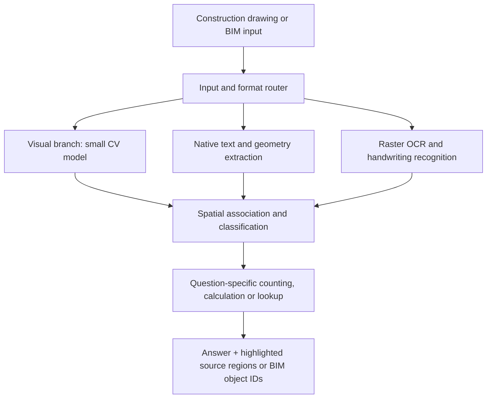

# OCR and Handwriting Recognition for the Stoa Construction-Drawing Dataset

**Analysis date:** 13 November 2026  
**Purpose:** Choose OCR and handwritten-text-recognition (HTR) models that complement a small computer-vision classifier for answering questions about construction drawings and BIM models.

## Executive recommendation

Use a **hybrid extraction system**, not one universal OCR model:

1. Extract text and properties **natively** from IFC, DXF, DWG, and vector PDFs wherever possible.
2. Use **PP-OCRv6 small or medium** to detect and recognize ordinary labels and dimensions in raster drawings.
3. Route difficult or historical handwriting to **Kraken 7.1 medium**; benchmark **TrOCR small/base** as a fine-tunable alternative.
4. For complex tables, schedules, or difficult layouts, test **Surya 2.5** and **PaddleOCR-VL 1.6**.
5. Use **Chandra OCR 2** selectively as an expensive fallback and to propose *human-verified* training transcriptions.
6. Combine extracted text, its coordinates, and confidence with a **small visual object/room classifier**; give users source regions or BIM object IDs as evidence.

**For an initial prototype, prioritize PP-OCRv6 + Kraken + the visual classifier.** OCR should help classify rooms and retrieve specifications, but most labeled questions are counting tasks and cannot be solved by OCR alone.

## 1. What the dataset tells us

The full-dataset audit reports:

| Property | Full dataset |
|---|---:|
| Asset files | 16,891 |
| Question-answer pairs | 127,044 |
| Distinct directly referenced assets | 5,939 |
| CubiCasa5K images | 4,787 |
| Swiss Dwellings plans | 1,040, with PDF/DXF/PNG versions |
| Europeana + Finna + HABS + Wikimedia assets | 6,701 |

The final group includes images without associated question-answer rows. Its contents are promising for historical and handwritten-text testing, but **not every file is necessarily historical or handwritten**, and some files are alternative formats.

### Distribution of question types

| Answer type | Questions | Share |
|---|---:|---:|
| Count | 111,763 | 87.97% |
| Area | 14,243 | 11.21% |
| Text | 836 | 0.66% |
| Volume | 138 | 0.11% |
| Length | 64 | 0.05% |
| **Total** | **127,044** | **100%** |

**Implication:** OCR is an important support component, especially for room labels, measurements, annotations, materials, and schedules; it is **not** the primary solution to counting windows, doors, sinks, and other graphical symbols.

### Source-specific implications

| Source | What OCR can contribute | What should not rely on OCR alone |
|---|---|---|
| **CubiCasa5K** | Room labels such as `MH`, `WC`, `KPH`, and `SAUNA`; printed or handwritten area annotations | Counting doors, windows, fixtures, and rooms |
| **Swiss Dwellings** | Room labels and measurements in raster plans | Geometry and text available natively in DXF/PDF |
| **Opening Design** | Door schedules, dimensions, notes, materials, finish specifications | Structured data and drawings available through CAD/IFC |
| **Europeana / Finna / HABS / Wikimedia** | Historic handwriting, multilingual captions, degraded technical annotations | Graphical understanding and geometry |
| **IFC models / IFC-Bench** | OCR only for information not stored in a readable structured form | IFC entities, quantities, spatial hierarchy, and properties |

### Important dataset limitations

- The uploaded audits **do not measure handwriting prevalence or handwriting quality**.
- The original drawing image collection was **not available for visual sampling in this analysis**; the model recommendations are therefore hypotheses to benchmark, not measured results on this dataset.
- The full dataset includes question-level answers, but that does **not** mean it has pixel-level boxes, masks, or handwriting transcripts.
- The local CubiCasa data lacks the upstream polygon SVG annotations, according to the uploaded findings. If the object detector needs instance labels, obtain licensed upstream annotations or label data separately.
- **Missing question rows are unknown labels, not zeros.** Keep missing and explicit zero answers separate during training.
- Alternative formats, translated questions, and drawings from the same project must remain together across train/test splits to avoid data leakage.

**Uploaded source files:** `full_dataset_audit.json`, `full_dataset_comparison.json`, `FULL_DATASET_FINDINGS.md`, `full_dataset_quality.json`, `DATASET_FINDINGS.md`, and `task.md`.

## 2. OCR model shortlist

| Model | Best use in the project | Approximate scale | Main trade-off |
|---|---|---|---|
| [PP-OCRv6](https://github.com/PaddlePaddle/PaddleOCR) | Cheap modern-text detection and recognition, labels, dimensions | Small model family; detection and recognition variants | Less specialized for highly irregular historical handwriting |
| [Kraken 7.1](https://kraken.re/) | Historical handwriting, multilingual lines, custom HTR fine-tuning | Tiny/small/medium HTR models | Needs careful line segmentation and domain testing |
| [TrOCR](https://huggingface.co/microsoft/trocr-base-handwritten) | Handwritten text-line recognition and fine-tuning | ~62M small, ~334M base | Typically requires separately cropped text lines; English-heavy starting point |
| [Chandra OCR 2](https://huggingface.co/datalab-to/chandra-ocr-2) | Hard handwriting, forms, tables, independent high-capability fallback | ~4.5B | High inference cost and risk of plausible but incorrect generations |
| [Surya OCR 2](https://huggingface.co/datalab-to/surya-ocr-2) | Multilingual document OCR, layout, text localization | ~670M | General document strength does not imply blueprint handwriting accuracy |
| [Surya 2.5](https://github.com/datalab-to/surya) | Newer compact OCR/layout alternative | ~689M | Validate backend, license, and actual blueprint performance |
| [PaddleOCR-VL 1.6](https://github.com/PaddlePaddle/PaddleOCR) | Tables, schedules, page parsing, compact document VLM | ~960M | More resource-intensive than lightweight recognition |

*Parameter counts are approximate and refer to different model architectures. A multi-component OCR pipeline should not be compared with a generative model on parameter count alone.*

### General document benchmark: OmniParseBench

A Datalab evaluation published 23 October 2026 compared open-weight document parsing systems. The broad overall scores discussed in the original analysis were:

| Model | Overall score (higher is better) |
|---|---:|
| Chandra OCR 2 | 90.1 |
| dots.mocr | 87.9 |
| MinerU2.5-Pro | 87.1 |
| Surya OCR 2 | 83.1 |
| LightOnOCR-3-0.8B | 81.6 |
| PaddleOCR-VL 1.6 | 78.7 |

Source: [Datalab — Open OCR models on OmniParseBench](https://www.datalab.to/blog/open-ocr-models-omniparsebench).

For the handwriting subset of that benchmark, reported scores were **66.8 for Chandra OCR 2**, **58.9 for dots.mocr**, and **52.0 for MinerU2.5-Pro**. These figures are **benchmark scores, not character recognition accuracy**, and they do not represent this construction-drawing dataset.

The newer Surya 2.5 was released after that comparison; its reported overall OmniParseBench score is **85.9**. Treat this as a separate model report rather than a strictly controlled same-run comparison.

**Takeaway:** The benchmark is useful for selecting models to test, but a project-specific evaluation should choose the winner.

## 3. The models for difficult handwriting

### 3.1 Kraken 7.1: strongest historical-HTR starting point

Kraken specifically targets historical printed and handwritten documents. Its 7.1 release introduced pretrained tiny, small, and medium recognition models, including evaluations on European languages relevant to the dataset.

| Evaluation language | Reported Kraken 7.1 medium CER (lower is better) |
|---|---:|
| Finnish | 0.63% |
| German | 1.62% |
| Swedish | 3.56% |
| English | 5.90% |

**CER** means *character error rate*. These are model-reported numbers on Kraken's evaluation material, **not test results on faded construction drawings**.

**Why test it:**

- Explicit emphasis on historical handwriting.
- Support for fine-tuning with line transcriptions and structured annotations.
- Smaller deployable model variants.
- Potentially useful starting point for Finnish and other European technical annotations.

**Main risks:** Historic manuscripts and blueprints are different domains. Room labels, technical lettering, rotated dimensions, very short numeric strings, and annotations crossing wall lines may be much harder than continuous text lines.

**Role:** The first HTR specialist to benchmark; a candidate for domain-specific fine-tuning.

Sources: [Kraken](https://kraken.re/), [Kraken documentation](https://kraken.re/main/index.html).

### 3.2 TrOCR: strongest targeted fine-tuning candidate

TrOCR uses a vision Transformer encoder with a text decoder. Its handwritten checkpoints are designed to recognize cropped handwritten lines, with training and evaluation centered on datasets such as IAM.

The original TrOCR report lists approximately **4.22%**, **3.42%**, and **2.89%** character error rates for small, base, and large variants on IAM, respectively. These are **not blueprint evaluation results**.

**Possible strategy:**

1. Manually verify several hundred to a few thousand text-line crops from technical drawings.
2. Fine-tune `microsoft/trocr-small-handwritten` or `microsoft/trocr-base-handwritten`.
3. Test on drawings from buildings or archives excluded from training.
4. Compare against a similarly adapted Kraken model.

**Role:** Particularly attractive if difficult writing mostly follows a narrow vocabulary of room types, numbers, dimensions, and construction abbreviations.

Source: [TrOCR handwritten checkpoint](https://huggingface.co/microsoft/trocr-base-handwritten).

### 3.3 Chandra OCR 2: expensive fallback and teacher

Chandra OCR 2 is a larger document-reading system that can address complex handwriting, multilingual material, tables, and forms.

Use it **selectively**, not across every drawing:

- Run on OCR regions that are difficult or contradictory.
- Propose transcriptions for ambiguous annotations.
- Support **human-reviewed** pseudo-labeling for future small-model fine-tuning.
- Cross-check extraction from complex schedules or pages.

**Caution:** A generative model can produce convincing words or numbers that are not justified by the pixels. Never treat a plausible transcription of an engineering dimension as certain without verification.

Source: [Chandra OCR 2](https://huggingface.co/datalab-to/chandra-ocr-2).

### 3.4 Surya 2.5 and PaddleOCR-VL 1.6: document-layout challengers

For tables, schedules, mixed-format labels, and scattered annotations, compare:

- **Surya 2.5:** OCR plus layout and reading-order parsing; potentially an integrated route for text localization and extraction.
- **PaddleOCR-VL 1.6:** Compact vision-language document parser, potentially useful for complex pages and structured tables.

Neither should be assumed to beat a tailored handwriting recognizer on tiny or ambiguous construction labels. Check the particular **model-weights license**, not just the code repository license, before any commercial deployment.

Sources: [Surya repository](https://github.com/datalab-to/surya), [PaddleOCR repository](https://github.com/PaddlePaddle/PaddleOCR).

## 4. How OCR should integrate with the classifier



**Visual branch:** Find rooms, walls, doors, windows, symbols, fixtures, and geometric relationships.

**Text branch:** Find text regions; recognize room labels, annotations, dimensions, and specifications; retain bounding boxes and uncertainty.

**Fusion stage:** Associate each text box with its containing or nearby room, symbol, dimension line, or schedule cell. Use both textual and visual evidence in classification.

### Example: room classification

A room label reads `MH 12.5 m²`:

- Visual model: room looks like a bedroom but is ambiguous.
- OCR: text contains `MH`, commonly the Finnish abbreviation for *makuuhuone* (bedroom).
- Fusion: classify as bedroom with supporting geometric and textual evidence.
- UI: highlight the room polygon and `MH` text region.

**Avoid blindly trusting OCR.** Misreading `MH`, `PH`, `KH`, or `KPH` could change the predicted room class. Preserve the original OCR string and location; check inferred classes against the surrounding layout.

## 5. Format-aware routing: when not to use OCR

| Input | Preferred extraction | OCR role |
|---|---|---|
| IFC | IfcOpenShell: entity types, GUIDs, relationships, quantities, geometry | Usually unnecessary |
| DXF | `ezdxf`: `TEXT`, `MTEXT`, dimensions, blocks, layers and geometry | Fallback for embedded raster annotations |
| DWG | CAD-native reader or conversion to DXF | Fallback for embedded images or unextractable text |
| Vector PDF | PyMuPDF native text and vector information | Fallback for scanned or unextractable regions |
| Scanned PDF | High-resolution rendering + OCR | Primary textual extraction |
| PNG/JPEG floor plan | OCR plus CV | Main way to obtain raster text, not to count all symbols |
| Historic scanned drawing | Specialized OCR/HTR | Main way to obtain handwritten annotations |

For example, PyMuPDF `page.get_text("words")` provides word locations, and DXF `TEXT`/`MTEXT` entities often expose their contents directly. These routes preserve fidelity and usually cost less than OCR.

If a dimension or area exists reliably in CAD/IFC, prefer that structured value over attempting to read or infer it from pixels.

## 6. Construction-drawing OCR failure modes

| Failure mode | Recommended mitigation |
|---|---|
| Small text on very large sheets | Process overlapping high-resolution tiles; do not downsample an entire sheet excessively |
| Rotated labels or dimensions | Detect orientation and recognize rotated crops |
| Handwriting mixed with wall lines | Specialized text-line segmentation; selective line removal or enhancement |
| Faded and noisy ink | Compare original crops with controlled contrast/denoising variants |
| `0/O`, `1/I`, `5/S` and similar confusions | Constrained parsing with context, but preserve original candidates |
| `1.250` vs `1,250`, `Ø125`, units and fractions | Purpose-built numeric parsing and strict validation |
| Finnish/multilingual abbreviations | Domain vocabulary plus visual/geometric context |
| Duplicate text in overlapping image tiles | Geometric deduplication of text regions |
| Unreadable annotations | Return uncertain/unknown rather than fabricate a transcription |
| Text detached from an object or room | Spatial association with room polygons, object detections, and dimension lines |

### Preserve evidence in the extraction records

Example schema (illustrative only):

```json
{
  "text": "MH 12.5 m²",
  "raw_text": "MH 12.5 m²",
  "bbox": [1024, 530, 1190, 570],
  "source": "raster_ocr",
  "model": "PP-OCRv6",
  "confidence": 0.93,
  "language": "fi",
  "normalized_label": "bedroom",
  "associated_room_id": "room_17"
}
```

The same record format can represent native CAD text, with a different `source` and an associated CAD object ID. Confidence values are not necessarily calibrated probabilities; validate them empirically if using thresholds for routing.

## 7. Recommended evaluation plan

### Stage A: Create a representative evaluation sample

Build approximately **250–400 manually verified text regions** across the labeled drawing sets and unlabelled historical collections. Stratify by:

- Clean modern machine print.
- Historic or cursive handwriting.
- Technical block handwriting.
- Rotated/vertical text.
- Short labels and abbreviations.
- Numeric dimensions and units.
- Faded or degraded text.
- Tables and schedules.

Label accurate transcriptions and text bounding boxes. Hold out complete **drawings/projects/archives**, not merely random crops from the same sheet.

### Stage B: Run the baseline comparison

Evaluate PP-OCRv6, Kraken 7.1 medium, TrOCR base, Surya 2.5, and Chandra OCR 2 on the same data, plus native PDF/CAD extraction where available.

Run two kinds of tests:

1. **Recognition-only:** Use manually cropped correct text lines, isolating text-recognition quality.
2. **End-to-end:** Let each pipeline locate and recognize the text, measuring detector plus recognizer performance.

Without this distinction, a bad text detector can make a strong recognizer appear weak.

### Stage C: Measure relevant metrics

| Metric | Why it matters |
|---|---|
| Character error rate (CER) | Fine-grained recognition quality |
| Word error rate (WER) | Quality on longer notes |
| Exact match on abbreviations | Whether room-type text is usable |
| Numeric field exactness / unit accuracy | Reliability for dimensions and quantities |
| Text-region detection recall | Whether important annotations were missed |
| Room classification with vs without OCR | Whether OCR improves the actual task |
| Final QA exact count / numeric tolerance | Whether the system answers correctly |
| Evidence localization accuracy | Whether users can verify the answer |
| Latency, memory and cost | Whether the approach is practical |

Use error slices by drawing source, language, era, degradation, and text type. For particularly consequential numeric text, measure false-confidence or unsupported-output rates.

### Stage D: Fine-tune a specialist where the data supports it

If Kraken or TrOCR repeatedly fails on one style (for example, Finnish technical block handwriting or hand-drawn dimensions), collect **hundreds to several thousand verified line crops** in that category and fine-tune a smaller model.

Do not allow the large model's unverified synthetic or pseudo-transcriptions to become ground truth. Keep a held-out set from unseen projects or archives and compare against the non-fine-tuned baseline.

## 8. Deployment, GPU memory, and licensing

The earlier hardware context is a local **GTX 1660 Super with 6 GB VRAM**. For this hardware, the most realistic options are small recognition and detection models, perhaps with CPU fallbacks. Model weight sizes, supported runtimes, batch sizes, and image resolutions should be tested rather than assumed from parameter count alone.

| Model | 6 GB local inference expectation | Licensing note |
|---|---|---|
| PP-OCRv6 small/medium | Good starting point; CPU also possible | PaddleOCR code is Apache 2.0; verify exact weights |
| Kraken 7.1 small/medium | Reasonable to investigate; benchmark actual footprint | Verify selected pretrained model licenses |
| TrOCR small/base | Practical for cropped lines with a suitable runtime | Microsoft checkpoint licenses should be checked individually |
| Surya 2.5 | May require memory/runtime optimizations | Examine model-weight terms; not equivalent to an unrestricted permissive license |
| PaddleOCR-VL 1.6 | Possible under constrained or optimized conditions | Verify actual model and dependency licenses |
| Chandra OCR 2 | Not a sensible unquantized default on 6 GB | Check OpenRAIL license and constraints |

A hybrid local/cloud architecture makes sense where GPU compute is available: serve small OCR and CV models cheaply, and reserve the expensive document model for selected hard cases and offline label generation. The Verda challenge resources described in `verda.md` include GPU compute and model-serving options, but availability and service terms need to be checked for the actual project.

## 9. Proposed implementation and priorities

### Minimal viable stack

| Component | Initial model/technology | Output |
|---|---|---|
| Input router | File-type detection, native PDF/CAD/IFC parsers | Structured objects/text or high-resolution raster |
| Modern OCR | PP-OCRv6 small/medium | Text, bounding boxes and recognition scores |
| Historical HTR | Kraken 7.1 medium | Difficult handwritten transcriptions |
| Visual classifier | Small task-specific CV model | Object/room predictions, boxes/polygons |
| Fusion | Spatial rules plus normalized text vocabulary | Text-to-room and text-to-object associations |
| QA engine | Deterministic counts/measurements where possible | Typed answer with scope and units |
| Evidence layer | Image overlays and IFC GUIDs | Human-verifiable support |

### Next upgrades

- Fine-tune Kraken or TrOCR using curated construction handwriting crops.
- Compare Surya 2.5 and PaddleOCR-VL 1.6 on technical schedules and irregular layouts.
- Use Chandra OCR 2 only as a difficult-region fallback or human-supervised transcription assistant.
- Track the incremental contribution of OCR in the overall QA benchmark, not merely its raw OCR scores.

### Final decision

**Start with PP-OCRv6 + Kraken 7.1 medium + a small computer-vision classifier.** The input router should use native IFC, DXF, DWG, and vector-PDF information wherever available. Keep larger generative OCR models behind an uncertainty-based escalation path.

The most differentiated future contribution would be a **small handwriting recognizer fine-tuned for multilingual construction annotations**, including short room labels, dimension strings, technical lettering, and degraded historical sheets. That could provide better domain accuracy and lower inference cost than routing every page through a large document VLM—but this advantage must be demonstrated on held-out blueprint data.

## References and provenance

### Uploaded dataset analysis

- `full_dataset_audit.json` — full asset counts, source breakdown, and QA types.
- `FULL_DATASET_FINDINGS.md` — full-dataset findings and implementation caveats.
- `full_dataset_quality.json` — checks on geometry, IFC grouping, and counting issues.
- `full_dataset_comparison.json` — comparison of preview/full datasets.
- `DATASET_FINDINGS.md` — preliminary dataset assessment.
- `task.md` — Stoa challenge and judging criteria.
- `verda.md` — optional compute infrastructure challenge.

### Model and benchmark resources

- [PaddleOCR — GitHub](https://github.com/PaddlePaddle/PaddleOCR)
- [Kraken OCR — official site](https://kraken.re/)
- [Kraken documentation](https://kraken.re/main/index.html)
- [Microsoft TrOCR — handwritten base](https://huggingface.co/microsoft/trocr-base-handwritten)
- [Chandra OCR 2 — Hugging Face](https://huggingface.co/datalab-to/chandra-ocr-2)
- [Surya OCR — GitHub](https://github.com/datalab-to/surya)
- [Surya OCR 2 — Hugging Face](https://huggingface.co/datalab-to/surya-ocr-2)
- [Datalab — Open OCR models: OmniParseBench comparison](https://www.datalab.to/blog/open-ocr-models-omniparsebench)
- [CubiCasa5K upstream repository](https://github.com/CubiCasa/CubiCasa5k)

**Evidence boundary:** Dataset counts and structural observations come from the user-provided audits. Model capabilities, published benchmarks, and licensing discussion come from external model documentation and evaluations described in the prior analysis. **No model was trained or benchmarked on the user's actual construction drawing images for this report.**
