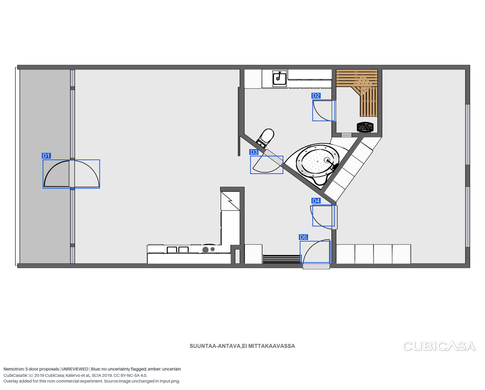

# Door-labeling run

| Measurement | Result |
|---|---|
| Returned door proposals | 5 |
| Inference elapsed | 1775 ms |
| Prompt / completion tokens | 4009 / 459 |
| Nominal API-equivalent cost | **USD 0.00083085** |
| Effective project cost | **USD 0.00000000** (owner-reported free access) |
| Reference provider | Together via OpenRouter |
| Price snapshot checked | 2026-11-14 |

The published reference rates are USD 0.15 per
million uncached input tokens and USD 0.50 per
million output tokens. [Published model/provider prices](https://openrouter.ai/nvidia/nemotron-3.5-super-vl).
This is a comparison tariff for the same named model, not a quote for the custom
Verda deployment or a measurement of GPU hardware cost. No billing account was
queried. All prompt tokens are priced as uncached; discounts, separate image
charges and taxes are excluded. Reasoning tokens are already part of completion
usage and are not counted twice.

The arithmetic, rate snapshot and assumptions are in [cost-estimate.json](cost-estimate.json).
The nominal estimate is computed from saved usage without another model request.

## Inspect the proposals

[Context crops](proposal-crops.jpg) · [Raw predictions](predictions.json) ·
[Request and source metadata](request.json) · [Model response and usage](response.json) · [Reference count comparison](reference-check.json)

Boxes are provisional model annotations. Count agreement does not validate their
extents or subtypes. See the separate review when available and the
[experiment findings](../../../door_labeling/RESULTS.md).

Source attribution: [ATTRIBUTION.txt](ATTRIBUTION.txt), [SOURCE_LICENSE.md](SOURCE_LICENSE.md).
The original source is retained as [input.png](input.png). The source and derived
overlay/crops retain CC BY-NC-SA 4.0 attribution for this non-commercial example.
The exact original runner, when present, is retained in `runner-source.py.txt` and
matches the hash recorded in `request.json`.

[Separate assistant visual review](review.json). Raw predictions were not modified.
