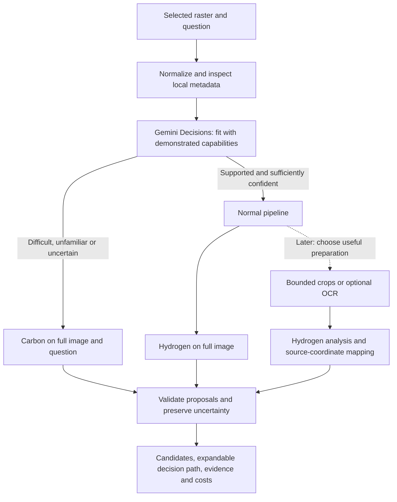

# Gemini Decisions: capability routing and optional preprocessing

Current routing correction: `capability-routing-v4` prefers Hydrogen. Carbon
requires an explicit `needs_strong` assessment with probability at least 0.8;
uncertainty, routing failures and timeouts use Hydrogen. The configurable setting
is `IMAGE_API_ROUTING_STRONG_THRESHOLD`. Earlier v1/v2/v3 proposals and evaluation
records below remain historical. Native detail tools from main are integrated; see [their guide](DETAIL_TOOLS.md).

Date: 14 November 2026. Branch: `feature/gemini-decisions-routing`.
Starting revision: `9db07ec` on `main`.
Updated with the teammate's research from `main` revision `89dbae1` (14 November).
Status: **capability routing and native detail tools implemented, experimental
and off by default**. Dataset calibration and paired evaluation remain planned.

## Implementation progress

The native Decisions client, allowlisted Hydrogen-low/Carbon-medium profiles,
capability gate, bounded session decision cache, `off`/`shadow`/`auto` modes,
one selected analyzer profile and expandable UI trace are implemented. The trace is
source/question bound and survives provider failures, unavailable routes and
deadlines. It records per-assessment probabilities, actual calls and unknown
cost components. A request cancelled before dispatch remains `pending` rather
than claiming a selected route. Routing preserves a five-second finalization
reserve. The full-image endpoint allows one Decisions attempt and one analysis
attempt. Detailed scans reuse the selected profile with up to 12 tool/provider
attempts plus routing; see [detail tools](DETAIL_TOOLS.md).

The capability criteria and default 0.8 strong-selection threshold are
**provisional**.
Automatic routing requires explicit opt-in; no dataset accuracy improvement or
calibrated false-easy rate is established. The fuller paired benchmark/review
workflow below is the next implementation stage. The approved live smoke
validated Decisions in 1.011 seconds. Carbon accepted the request but returned
`incomplete` at the 4,096-token cap under the initial high-thinking profile.
Following the user's correction, strong analysis now defaults to **medium**, with
**low** configurable; high is outside the application allowlist. A separate
user-directed medium check completed under the same cap in 55.994 seconds and
returned one source-supported window candidate. This verifies a single result,
not a general quality/speed benefit; low and paired routing quality remain untested.
Native region selection, crops, reconciliation and candidate membership checks
are implemented by the detail tools. Automatic OCR selection, additional native
source adapters and final-answer execution remain future work. See [runtime configuration](README.md#experimental-capability-routing).

Historical policy `capability-routing-v2` corrected the initial over-escalation: v1 required
90% certainty on all six independent classifications and admitted only a narrow
door/window/fixture floor-plan case. V2 uses **only overall capability fit** at a
default 60%; other labels remain diagnostics. Ordinary readable room/object,
label, schedule and printed-quantity candidate tasks can use Hydrogen, including
multiple readable panels and room filters. Explicit difficulty or genuinely
uncertain capability still selects Carbon directly. Both routes retain their
source boundary, missing-information distinctions and candidate-only outputs.
The prompt/capability version changes with the policy; existing route caches
cannot silently carry the previous criteria forward. Historical results remain
unchanged; replay of fixed old scores is not evaluation of the new prompt.

The sections below retain the target design and evaluation requirements; they
do not imply that every work package or planned validation has been completed.

## 1. Outcome and order of work

The first decision is whether the **selected image and question fit what our
normal pipeline can reliably handle**. Familiar, supported cases use Gemini
Hydrogen-low. Difficult, unfamiliar, or uncertain cases go directly to a powerful
multimodal model, initially Gemini 4 Carbon. Give that model the full source
snapshot and original question so it can handle the interpretation itself.

Only after this routing works should the normal route choose useful preparation,
including crops for large, detailed drawings. The first experiment compares
Hydrogen and Carbon on identical whole-image inputs. Cropping is the second
experiment, within the normal route. A clean-looking image is not automatically
easy, and an old drawing is not automatically beyond Hydrogen's capabilities.

Use the dataset to discover which cases each route actually handles, improve
the decision criteria, and choose thresholds. Target the supplied question
families in the [project scope](../docs/PROJECT_SCOPE.md). Archive images also
provide useful unfamiliar-style examples; they do not create new requirements
for unrelated question families.

Codex owns all review work. **Whenever a task needs manual or visual review,
spawn exactly ONE Astra-6 Max subagent for that task** using
`model="gpt-6-astra"`, `reasoning_effort="max"`, and `fork_turns="none"`.
The user has no annotation or review workload. Start with 12 representative
comparisons and add targeted reviews when needed; this replaces the earlier
human time ceiling. Agent review remains distinguishable from source checks.

The result UI must include an expandable **How this was analyzed** explanation
showing the actual routing decisions, any preprocessing and the analyzer used.
Build it from the recorded decision path and host rules, with plain-language
labels and optional scores, rather than adding an explanation-generation call.
The loading screen also receives the real analyzer handoff immediately after
routing, before output finishes: **Handing to [model name]…**. This is implemented
through opt-in streaming on the existing request, with source/request/question
binding, actual shadow/manual dispatch, and cancellation/stale-state handling.
It adds no model call and leaves the final expandable trace available.

## 2. Historical planning-time implementation snapshot

| Existing component | Reuse and required change |
| --- | --- |
| [Gemini client](../gemini/client.py) and [settings](../gemini/config.py) | Native Interactions requests, safe errors, structured candidates, image limits and token usage. Explicit Hydrogen-low/Carbon-medium profiles are implemented; The initial high-thinking smoke was incomplete at its cap; corrective medium completed with one source-supported candidate. |
| [Candidate service](service.py) | Existing Gemini/Nemotron adapters and strict proposal checks, with opt-in host-controlled capability routing and explicit analysis profiles. |
| [Image normalization](images.py) | EXIF orientation, white background, byte/pixel checks and canonical PNG. Always apply these before routing. |
| [Preprocessor](preprocessing.py) | Bounded session artifacts; current runtime sends either the canonical whole image or its whole-image overview. Crop transforms and optional OCR exist in the [standalone package](../docs/DRAWING_PREPROCESSOR.md), but automatic crop analysis does not. |
| [Shared contracts](../contracts/models.py) | Single-image responses now include an optional source/question-bound decision trace and per-call provenance. Multiple analysis images remain future work. |
| [Candidate panel](../frontend/src/components/CandidatePanel.tsx) and [metrics](../frontend/src/lib/responseMetrics.ts) | Show the expandable recorded path on success/errors and sum actual per-call costs, alongside model and elapsed time. Multi-pass crop UI remains future work. |

The user reports that cropping has improved current results. The saved
[2D experiment](../experiments/image_questions/RESULTS.md) also records selected
recognition improvements and remaining localization failures. Accept cropping
as a useful candidate action; measure when to select it and whether the combined
output preserves evidence. These observations are not a general accuracy score.

The current 2D endpoint receives one displayed raster and one question. A PDF
reaches it as the selected rendered page; native PDF text, original vector data,
and sibling files are unavailable there. The initial router uses that actual
input. IFC retains its separate source-based API and executor. Adding native
PDF/CAD routes later requires real ingestion adapters and explicit source links.
Image responses remain candidate proposals under the existing product contract;
choosing Carbon alone does not introduce a final-answer or measurement executor.

Local inventory at planning time: the preview dataset and Gemini smoke artifacts
are available; the full dataset and a completed preprocessing review gallery are
absent. Start from the preview. Accept a configurable dataset root and record its
hashes and actual sample size when a fuller collection becomes available.

### Ideas integrated from the new main-branch documents

The teammate's documents add useful source, semantic and evaluation findings.
This plan retains the user's capability-first order wherever the proposals differ:

| Upstream document | Integration into this plan |
| --- | --- |
| [Tooling and routing plan](../docs/TOOLING_AND_ROUTING_PLAN.md) | Adopt explicit operation/grain, evidence availability, coverage limitations and failure diagnosis. Native extraction and typed execution are separate future capabilities; they are not prerequisites before selecting Carbon. |
| [Decision question cards](../docs/routing/decision_questions.v1.json) | Adapt operation, scope, layout and counting-grain criteria to the first capability request. Detail/panel questions belong to the later preprocessing policy. Post-tool questions require actual tool results and are deferred. These cards are not a ready-to-send API payload. |
| [Planner prompt draft](../docs/prompts/drawing_planner.v1.md) | Reuse literal identifiers, explicit membership rules, honest coverage and untrusted-source handling. Keep final-answer planning/tool execution separate from the current candidate prompt and Decisions client. |
| [100-image Gemini report](../experiments/image_questions/GEMINI_100_RESULTS.md) and [benchmark runner](../experiments/image_questions/benchmark.py) | Reuse development cases and recording/scoring machinery; extend it for paired profiles, grouped splits, budgets and evidence review. Preserve the original baseline unchanged. |

The report records **79/100 candidate-count matches**, not verified answers or
localization accuracy. Of its 21 mismatches, 19 still returned `ok` and 16 had no
uncertain candidates. This supports evaluating capability independently of an
analyzer's confidence; it does not show which cases Carbon would repair. The
teammate's retrospective rule selected 25 cases and covered 16 mismatches, using
post-analysis flags and dataset metadata as well as task traits. Treat it as a
development hypothesis, not an evaluated first-stage router or accuracy gain.

Two teammate-reported source audits are particularly useful:

- **Q099:** six schedule rows describe multiplicities totaling 379 units. Counting
  candidate regions measures the wrong grain; typed row/cell evidence and
  multiplication/summation are needed. Some row anchors also reportedly drifted.
- **Q093:** stair geometry reportedly becomes subpixel detail in the submitted
  raster, while related native sources retain the objects. Stronger vision or
  larger crops cannot reconstruct evidence absent from the supplied pixels.

The cited run directory and audit artifacts are absent in this checkout, as is
the full dataset. These numbers and source findings remain teammate-reported,
not newly reproduced or independently source-verified here. Inspect matching
artifacts before using them as source-checked labels.

Do not adopt the other plan's tools-first sequence, repeated weaker-model passes,
or parallel-model reconciliation as requirements for this release. Difficult or
uncertain inputs still go directly to Carbon. Native PDF/CAD extraction, table
arithmetic, calibration and geometry can improve later releases when demonstrated
question families require them, with their own adapters, contracts and tests.
The composite room-ranking example is an extension, not a new acceptance task.

## 3. Gemini Decisions protocol

Use `gemini-decision-1` through `POST /v1beta/decisions` with the backend
`GEMINI_API_KEY`. This is a separate client from the Interactions analyzer.
Its typed questions return yes/no probabilities (`noul`), fixed choices
(`choice`), or ordered rubric scores (`score`). Put the image, original question,
trusted dimensions and concise capability descriptions in the shared input.
Questions are evaluated independently; combine their answers in host code.
Write complete instructions because question keys are not model-visible.
Validate answer keys, types, probability ranges/sums and nullable usage locally.
For binary `noul`, compare P(yes) with the rule's threshold; high certainty about
"no" must not activate a yes action. A rubric score is not a confidence score.
Include an explicit uncertain/other outcome and calibrate thresholds on local
examples. See the [official API guide](https://aistudio.google.com/docs/decisions-api).

The [model page](https://aistudio.google.com/docs/models/gemini-decision-1)
documents decision outputs, not generated explanations, boxes or tool execution.
It does not document a custom fine-tuning interface. The initial customization
is a versioned set of instructions, capability descriptions and thresholds
derived from development examples. Do not assume that uploading labels trains
or permanently teaches the hosted model. Test a few selected examples in the
input only if plain criteria underperform; measure their added cost and latency.

Google's [pricing](https://aistudio.google.com/docs/pricing#gemini-decision)
lists $0.10 per million input tokens and no generated output tokens. Shared input
is billed once per request; criteria add input tokens. Batch API and provider
context caching are unavailable. Ordinary application-side result caching is
still possible. Record dated tariffs and measured usage instead of promising
a fixed per-image price or latency.

The strong profile is `gemini-4-carbon` with medium thinking by default and low
as a configurable alternative. Its
[model documentation](https://aistudio.google.com/docs/models/gemini-4-carbon)
lists image/PDF input, structured output and low/medium/high thinking. Verify
request behavior through the saved live smoke and bounded follow-up evaluation.
Keep the profile configurable through an allowlist; no unvalidated model names,
endpoints or instructions can come from the router. Carbon's relative benefit
on these drawings is an experiment result to establish, not a release-note claim.

## 4. First routing policy: normal capability versus strong analysis



Maintain a versioned provisional capability description for Hydrogen's candidate
localization/reading on ordinary drawings, including known object/room families,
printed labels and schedule entries. Validate and refine it through paired
outcomes. Describing a candidate family is not a claim of measured completeness
or a final-answer executor. For example, schedule-row regions do not establish
installed-unit totals, and printed area lookup is different from measurement.
Layout, task, target, grain and scope classifications explain the request; they
are not independent confidence gates or category vetoes. Hide dataset names,
filename quality tags and reference answers from Decisions and both analyzers.

Build a cheap source/capability profile from facts the host actually has: selected
view, raster dimensions, supplied source identities, available adapters and their
supported operations. Native text, vector geometry, calibration and companion
files are `not_provided` or unavailable unless genuinely supplied and registered;
the router cannot infer their availability from a raster's appearance. A future
related-source adapter must validate revision/view correspondence and explicit
source authorization, never silently pair files by similar names or widen scope.
This metadata inspection adds no preliminary model or tool-recovery pass.

The first Decisions request asks a few focused questions:

| Decision | Proposed meaning |
| --- | --- |
| `normal_fit` (`choice`) | `supported`: an ordinary readable candidate task fits the provisional normal profile; `needs_strong`: actual difficult interpretation or unfamiliar conventions; `uncertain`: genuinely unclear capability fit, distinct from uncertainty over a diagnostic label. |
| `document_kind` (`choice`) | Floor plan, schedule/table, section/elevation, mixed panels, other technical drawing, other/unclear. Used for diagnostics and calibration slices. |
| `task_kind` (`choice`) | Known instance discovery, literal/property lookup, quantity value, aggregate/arithmetic, explicit geometry measurement, mixed, other/unclear. A quantity request does not itself establish a need for geometry. Unsupported operations do not become implemented because they can be classified. |
| `count_grain` (`choice`) | Logical occurrence, assembly, component unit/leaf, schedule row/type, room/unit, not counting/unclear. Preserve task/source conventions, qualifiers and original language. |
| `readability` (`score`) | Explicit linear levels: clear, difficult in places, substantially degraded, largely unreadable. Diagnostic feature rather than an automatic route by itself. |

Pass explicit selected-view scope as trusted context. Add an independent scope
question only when the user's wording needs interpretation; a classification
cannot authorize a different source. Keep initial questions compact and measure
their overhead. Borrow the upstream cards' criteria without importing their
tools-first ordering or asking about observations that have not happened yet.

Select normal only if `normal_fit=supported`, its probability clears the configured
threshold. Until calibration, v2 uses a configurable **0.6** starting threshold;
this supersedes v1's 0.9 threshold on every label and narrow registry vetoes.
Explicit `needs_strong`/`uncertain` or lower overall fit selects strong. Auxiliary
labels remain diagnostics even when their probabilities are lower than 0.6.
Do not confuse ambiguity over a layout/category name with difficulty interpreting
the source. Missing external facts or executors remain limitations on either
route; a different model cannot manufacture that capability. Explore thresholds
on validation data without treating these scores as answer-accuracy estimates.
An apparently random image can go to Carbon for interpretation; Carbon can still
return `unsupported` or `unreadable` when the question has no source evidence.

One selected analyzer handles the request. Difficult cases should not first pay
for a predictable Hydrogen failure. Preserve the selected image scope and exact
question on both paths. The strong path may use a different bounded reasoning
profile, but must return evidence in the same display frame and pass the same
proposal checks. Neither model's self-confidence proves completeness.
Record missing source detail, calibration or execution capability separately from
interpretation difficulty. Carbon can interpret the available image and return
proposals, but cannot claim a table calculation, measurement or native-source
query was executed when the corresponding capability does not exist.

Router failure or low certainty selects strong when configured and within budget.
If that route is unavailable, return an explicit configuration/provider/budget
failure; do not silently send a known hard case to a weaker profile. Existing
explicit manual-provider mode remains the rollback path. Evaluation and visual
verification use the Astra review workflow below. Application requests complete
through the configured analysis routes without waiting for user review.

## 5. Second policy: selective preprocessing within the normal route

After the first policy has been evaluated, add independent checks for likely
detail loss, dependence on whole-page context, useful printed text, and visual
degradation. They can share the first Decisions request; host code uses them
only after accepting the normal route. Do not ask one question to consume another
question's answer in that same call.

| Preparation | Activation and behavior |
| --- | --- |
| Canonical whole image | Default. Existing orientation/white-background normalization always applies. |
| Whole-image overview | Existing option; consider only when detail remains adequate for the task. Verify cost/quality tradeoffs against full input. |
| Full-coverage crops | Large/dense detail relevant to an eligible local discovery task; complete coverage, overlapping margins and bounded inference. First optional action to implement after model routing. |
| Local OCR | Printed-text tasks where installed OCR/language data provide useful anchors. Off for symbol-only tasks and uncertain handwriting. Source OCR stays provisional and gets explicit availability/status. |
| Contrast, denoising or arbitrary deskew | Later actions only after isolated comparisons show a benefit. Preserve faint lines, colors and hatching; each transform requires an inverse map. |

Initially enable crops only for reviewed task semantics such as visible fitted
doors, window assemblies and fixtures. Room-qualified requests, schedule row
association, cross-panel interpretation and measurement need their context kept
explicit; use whole-image normal or strong analysis until a crop policy is
demonstrated for that family. Crop decisions must understand the question, not
just match English keywords. A small low-resolution input cannot gain missing
source detail through cropping or enlargement.

Keep the first preprocessing comparison to one optional action at a time. Add
OCR-plus-crops only if their combination has been measured. Native PDF extraction
belongs to a later real PDF adapter, not an inferred property of a PNG.
Meaningful panel separation is a later option only with validated panel/view
registration and coordinate maps; heuristic layout boxes are not semantic views.
Preserve relevant legends, headers and context, and keep distinct panel scales
separate. A filled crop-coverage ledger does not prove an exhaustive inventory.

### Crop execution and reconciliation

1. Plan an aspect-aware grid of nonoverlapping core rectangles covering every
   source pixel. Start with a 1,280-pixel core target and at most four cores;
   these are experiment settings. Expand each core by 12.5% on available sides
   for context, clipping to the original. If four cores cannot meet the target,
   preserve coverage, record the detail limitation, and keep that case on strong
   unless the coarser crop profile has been validated. No silent page truncation.
2. For a selected crop route, run one whole-image context/baseline analysis and
   up to four detail calls. Reuse an identical whole-image crop. Each detail
   prompt explicitly describes its crop frame and preserves the original task;
   no reference counts or prior proposed answers enter discovery prompts.
   Whole-image `unsupported` stops detail calls. A technical failure stops fan-out.
3. Keep full-source and crop observations separately. Map Gemini's normalized
   Y-first boxes into each crop's pixel frame, then into original display pixels.
   For crop `(left, top, width, height)`, use `x=left+x1000*width/1000` and
   `y=top+y1000*height/1000`. Record every resize/rotation in an explicit transform.
   Crop identity must never replace source identity.
4. Match cross-pass duplicates conservatively using category, overlap, centers,
   literal labels and crop-edge status. Never merge adjacent doors solely by
   overlap or equate a double leaf with two openings. Retain unmatched margin
   observations; core ownership resolves duplicates, not omissions. A broad box
   conflicting with two distinct boxes remains ambiguous. Avoid transitive merges
   that swallow neighboring objects. Assign deterministic final IDs afterward.
5. Preserve useful whole-image-only observations. Record contributing/rejected
   observations and merge reasons. Inconsistent labels, unresolved duplicates,
   missing passes, clipped evidence or the 100-candidate cap produce `partial`
   with specific limitations. Successful empty extraction remains unverified,
   and failed extraction never becomes a successful zero.
6. Save the examined source extents and completed/failed passes as a coverage
   ledger, separate from semantic completeness. Version the membership/counting
   policy (for example door opening versus leaf, or window assembly versus unit).
   Keep unresolved membership and anchor conflicts inspectable rather than
   resolving them by matching a reference total or taking a model majority.

## 6. Dataset use with Astra-led review

### A. Small, reproducible sample and no answer leakage

Start with roughly **60 source groups**: 30 CubiCasa, 12 Swiss, six available
technical plan/schedule groups, and 12 archival examples balanced across the
available collections. Adjust quotas to local availability and publish actual
counts. Sample styles and sizes within collections, not just question frequency.
The [dataset audit](../dataset/FULL_DATASET_FINDINGS.md) shows strong CubiCasa/Swiss
dominance and no supplied archival QA; archive success cannot be scored as though
reference answers existed.

Group projects, byte/perceptual duplicates, alternative formats, generated
variants and translations before a roughly 60/20/20 development/validation/test
split. Use explicit manifest IDs and a fixed seed. Add a second known-family
question to about 12 images to test task-dependent routing; both stay in the same
partition. Development smoke cases never enter the final test partition.

Treat the teammate's 100 cases and their related source/project groups as
development data. All three Opening Design sheets cited there have been exposed;
new questions on those sheets are seen-source checks, not unseen-sheet holdouts.
Reconcile their manifest with our groups before assigning fresh validation/test
sources. If artifacts or enough independent sources are unavailable, report the
smaller sample and defer unseen-source performance claims rather than inventing
a holdout. Do not relabel an exposed source as unseen because its question changed.

Save analyzer predictions before loading reference answers into the scorer.
References are offline evaluation inputs, never routing examples containing
answers, model prompts or a runtime lookup. Use source-native IDs/text/geometry
as independent checks where their correspondence is established. Unasked targets
remain unlabeled; source/reference discrepancies enter a separate uncertainty
record instead of being corrected to match expectations.

### B. Automated labels and measured routing targets

First compare **Hydrogen whole image versus Carbon whole image** with identical
source pixels, original questions and declared output requirements. Freeze model,
prompt and token settings and record errors, usage and timing. Carbon outputs
can supply provisional descriptive labels; use a separate bounded labeling call
only where necessary. Its recommendation about its own suitability is not truth.

For each case, store `normal_sufficient`, `strong_helped`, `both_insufficient`,
`tie` or `undetermined`, together with the evidence supporting that label. Route
evaluation must measure whether strong analysis helps, not merely agreement with
a teacher's idea of an easy/hard picture. Allow ties and abstention.

Store a separate, possibly multi-valued failure diagnosis: perception/omission,
semantic membership or wrong grain, incorrect source anchor, missing visible
information/source, missing executor/calibration, or unresolved. Record the
required recovery separately from the model-route outcome. For example, the
reported Q099/Q093 failures do not automatically become `strong_helped`; an
unimplemented calculator or unavailable native source is not a model upgrade.

Automate contract and coordinate checks, source-ID membership, known label/field
association and applicable reference comparisons. Candidate-count agreement is
only a diagnostic: correct totals can contain missed objects and false positives.
Teacher labels, model agreement and consistency under harmless transforms are
useful weak signals, not verified detection completeness. Keep label provenance
as `source_checked`, `reference_only`, `teacher_only`, `agent_reviewed` or unknown.
Preserve `human_reviewed` only for genuinely pre-existing human judgments. Record
reviewer model/effort, source and output identities, verdict, evidence anchors
and unresolved issues. Report results separately by these evidence levels.

For comparisons requiring judgment, the single Astra-6 Max reviewer inspects
paired outputs against the original image, with provider identity hidden and
randomized output order. It is independent of the Hydrogen/Carbon analyzers.
Keep the review focused on source-supported findings; model agreement alone
does not establish truth. Retain unresolved pseudo-labels as uncertain rather
than accepting them because another model agrees. Do not spawn a judge panel.

Derive capability descriptions and route criteria on development examples only;
choose thresholds on validation. Keep test examples and their judgments out of
prompt selection. If needed later, train a small local selector on the scored
Decisions features and development outcomes; that is a separate classifier, not
fine-tuning Gemini Decision 1, and is unnecessary for the first delivery.

### C. Exactly one Astra-6 Max subagent for each review task

This applies to drawing interpretation, paired analyzer comparisons, ambiguous
labels, crop/overlay inspection, UI verification and other work that would
otherwise require Codex or the user to review manually. Deterministic checks and
test runs remain ordinary automated work. For each bounded review task:

1. Prepare a self-contained packet: task/rubric, original source paths and hashes,
   selected page and question, anonymized outputs, overlays, machine checks and
   split membership. Keep credentials and unrelated conversation out of it.
   Ask the reviewer to inspect the actual source images at sufficient resolution;
   thumbnails, counts and analyzer summaries alone do not establish correctness.
2. Spawn exactly one agent with `model="gpt-6-astra"`,
   `reasoning_effort="max"`, `fork_turns="none"`. Assign the bounded packet and
   prohibit further delegation. That agent may review a small batch; do not
   multiply reviewers or run a voting/consensus panel. Run review tasks
   sequentially, with at most one review subagent active at a time.
3. Request a structured verdict for each case: normal sufficient / strong better /
   neither / cannot tell, plus concise source-based justification, specific
   IDs/regions, missed or incorrect evidence, and remaining uncertainty. For UI
   work, compare the visible path with the saved backend trace and record the
   mismatch or pass. Keep reference answers out of initial visual interpretation;
   reveal them only for subsequent discrepancy adjudication when necessary.
4. Codex saves the returned review as `agent_reviewed`, checks its referenced
   identities against the packet and applies actionable findings. Follow up with
   the same reviewer when evidence is missing; do not create a second reviewer
   for that task. Unresolved or failed reviews remain unknown. If the requested
   model/effort cannot be selected, record that limitation and continue unaffected
   work without substituting a different reviewer or handing review to the user.

Start with eight development/validation comparisons and four frozen test
comparisons, mixing random examples with consequential disagreements and
false-easy risks. Include apparently correct totals as well as failures, because
count agreement can hide incorrect boxes, omissions and compensating false
positives. Expand with targeted tasks for unresolved issues instead of
asking the user for annotations. Small batches bound context and review cost;
12 is an initial sample, not a reason to skip a required review. Reuse judgments
only when source, task, output and rubric versions match. Frozen test judgments
stay out of prompt/threshold tuning. Log review effort separately from runtime
inference cost and keep findings inspectable in the experiment artifacts.

This subagent workflow belongs to Codex's development/evaluation process. The
deployed application does not need a Codex session to handle normal requests.

In the second experiment, compare whole-image normal analysis with its crop
variant on suitable cases using the same controls. Report preprocessing gains
separately from gains due to a stronger analyzer. The first routing experiment
and review budget must not be consumed by crop tuning.

## 7. Host control, budgets, lifecycle and caching

Implement three modes: `off` uses the configured provider; `shadow` records
Decisions' recommendation while executing the baseline once; `auto` executes the
selected registered profile. Shadow experiments require their own accounting.
It is not permission to run every analyzer on every production request.

Proposed initial limits, to validate and version with experiment settings:

- One Decisions request, with a ten-second timeout inside the existing
  180-second request deadline. A timeout uses Hydrogen within the remaining
  budget under policy v4. Avoid a deliberately tiny thumbnail that hides fine-detail difficulty;
  compare supported media resolutions and use original dimensions as metadata.
- First release: one selected analysis call, so two external calls at most.
  Crop release: one whole-image plus up to four detail calls, so six including
  Decisions. No automatic retries, repair calls or recursive crop plans.
- Preserve the whole-image profile's explicit output cap. For the crop profile,
  start with 8,192 output tokens per analysis call and a 40,960 total allocation;
  thinking shares Gemini's allocation. Track budget-induced truncation separately
  from model quality and reserve five seconds for finalization.
- At most two simultaneous provider calls process-wide, including requests that
  fan out. Every attempt consumes the request budget. Check remaining deadline,
  token allocation and configured estimated spend before scheduling work.
- Offline runner requires explicit maximum calls and estimated USD spend,
  supports dry-run cost estimates and resume, and stops at the first exhausted
  cap. Missing tariffs/usage remain unknown; call/token caps still apply. Never
  label an estimate a provider-enforced billing cap. Only the pilot is scheduled.

Reuse the canonical source and bounded session artifacts. Cache decisions by
source hash, exact question/scope, model/profile, rubric/policy version and
relevant settings. Include the capability registry and preprocessing version;
an image-only key must not reuse a route for a different question. Record cache
hits without charging cached token usage as a new call. Expire session data at
shutdown; persistent experiment artifacts stay in ignored run directories.
If later adapters cache extracted source facts across questions/translations,
key them by source revision/view, extractor version, parameters and membership
policy. Keep fact caches, route caches and answer caches distinct; today's
preprocessing cache does not establish a reusable semantic inventory.

Propagate cancellation to owned work, await preparation workers before cleanup,
and respect existing byte/pixel/serialized-request limits. Do not relax upload
limits merely because inference is tiled. After a partial crop failure, stop new
calls and return usable proposals as partial; without usable proposals return a
safe error. Redact credentials, source bytes and raw provider error bodies.

Treat drawing text, OCR and future tool-result text as untrusted source data.
They cannot override the question, host instructions, model/tool allowlist,
budgets, scope or output schema. Borrow this constraint from the planner draft
without enabling its tool loop or accepting model-generated Python/SQL/formulas.
Future arithmetic belongs in a typed, supported executor with source-bound
inputs, units and net/gross basis; unsupported operations remain explicit.

## 8. Contracts, provenance and frontend integration

Extend [Python contracts](../contracts/models.py) deliberately, then regenerate
schemas and frontend types. Before auto mode, define:

- A routing record: mode, Decisions model/version, policy version, inputs'
  identities, source/capability profile version, typed decisions, task/grain,
  selected profile, fixed reason codes, cache state,
  fallback reason and routing duration. A route confidence is not candidate
  confidence or a verified answer score.
- A decision trace: ordered nodes with stable IDs/parent links, criterion,
  observed value and probability where available, applied rule/threshold,
  selected branch, reason code and execution state. Distinguish evaluated,
  selected, skipped, reused, failed and unavailable steps. Record the actual
  host decision alongside model recommendations so shadow mode and fallback are
  explainable. Trace nodes reference their source/request and call records.
- A call record: ID, purpose, requested/returned model, prompt version, actual
  input image hashes/dimensions, source-frame extent/transform, outcome, duration
  and nullable token usage. Include failed calls and costs when known.
- Candidate observation references and reconciliation outcomes so an exported
  box can be traced back to the responsible pass and source region. Include the
  membership policy and examined-scope ledger when crop reconciliation is added;
  geometric coverage and semantic completeness remain separate fields.
- An optional sanitized decision trace in `ImageCandidateError`, bound to the
  failed request and its source identity when known. Preserve it in the frontend
  API error object and response/error state instead of reducing the error to a
  message. Terminal errors such as unavailable Carbon, a failed first analysis,
  or timeout must retain the decisions already made even with no candidates.
  Early validation failures can report that routing did not start. Include only
  bounded public trace fields, never internal exception bodies or source paths.

Preserve submitted source hash, display dimensions, scope and display-pixel box
coordinates. Keep legacy single-call `inference_sha256` truthful. For multiple
inputs, add a discriminated multi-input representation with per-call hashes;
never pretend that a crop collection or its manifest is one inference image.
Update consumers and compatibility tests together rather than overloading a
field. Legacy model/usage fields describe analysis only; explicit routing usage
and per-call records provide total accounting.

### Expandable decision path

Add a collapsed-by-default **How this was analyzed** disclosure to each candidate
response and to failed-request results with a recorded trace, next to the
existing model/time/cost summary or error message. A native `details` /
`summary` control or equivalent accessible accordion is sufficient. It opens
in place without covering the drawing. Show a short route summary when closed,
such as "Standard analysis: Gemini Hydrogen" or "Advanced analysis: Gemini Carbon".

When expanded, show a compact ordered path through the actual decisions:

1. **Image and task:** what the router classified, with original question/page
   identity available. Show uncertain or unavailable assessments explicitly.
2. **Analysis route:** whether the normal capability criteria passed, the chosen
   branch, and the concrete reason. Optional score/threshold detail explains a
   threshold decision without claiming an answer-accuracy percentage.
3. **Image preparation:** whole image, overview, crops or OCR actually used, with
   crop count and the recorded reason. Mark an unvisited preparation branch as
   skipped when a hard/uncertain input went directly to the strong analyzer.
4. **Execution:** actual analyzer, completed/failed calls, any fallback and the
   resulting partial/unsupported state, alongside total time and estimated cost.
5. **Evidence limits, when recorded:** missing source detail, unavailable native
   data or an unsupported calculation/measurement. Explain which limitation
   remains after analysis. A list of detected schedule rows must not be presented
   as an executed installed-unit calculation. Show only actual metadata, checks
   or recorded outcomes, not a guessed failure diagnosis.

Synthetic presentation example, not a model observation:

```text
How this was analyzed                         Gemini Hydrogen
  Image/task: Floor plan; window discovery
  Normal pipeline fit: 72% — route requires at least 60%
  Other classification scores: descriptive, not routing gates
  Decision: Standard analysis selected
  Preparation: Whole image; additional preparation deferred
  Analysis: Gemini Hydrogen completed
```

Use deterministic English/Finnish templates over recorded fields. Explain only
criteria and actions actually evaluated; do not invent why a model internally
formed a judgment or present hidden reasoning as the decision tree. Additional
preprocessing checks may have been scored in the shared Decisions call while
their execution branch was skipped; the display must preserve that distinction.
The UI explanation itself adds no model call.

Bind the disclosure to the same request/source/page as the answer or failure.
Render it from error state even when no candidate response exists. Handle router
timeout, cached decisions, manually selected provider, shadow recommendations,
missing legacy traces and partial crop execution truthfully. For example, shadow
mode says which model was recommended and which actually ran. When no trace was
recorded, say so instead of reconstructing one. Keep it readable on narrow
screens, keyboard operable, screen-reader labeled and usable without color cues.

Compute mixed-model cost from each call's model and timestamp; the existing
single-model rate calculation cannot price Decisions tokens as Hydrogen or
Carbon tokens. Missing usage or rates yield a partial estimate with an explicit
unknown component. Include the structured decision trace in the evidence export;
keep internal paths, credentials and raw provider bodies out. Preserve source
overlay alignment and keep the disclosure separate from candidate completeness.

## 9. Implementation work packages and checks

Original work sequence; some files below now exist as recorded in implementation
progress above. Remaining packages and their completion evidence are still required.

| Order | Files and deliverable | Completion evidence |
| --- | --- | --- |
| 1 | `gemini/decisions.py`, `gemini/decisions_config.py`: bounded async Decisions client using existing httpx/env conventions. | Mock request/response, errors, cancellation and redaction tests; small live protocol check. |
| 2 | `gemini/config.py`, `gemini/client.py`, `image_api/service.py`: explicit Hydrogen-low and Carbon-medium profiles. | Existing Hydrogen regressions plus Carbon payload/usage/output checks; live whole-image smoke. |
| 3 | Extend/reuse `experiments/image_questions/benchmark.py` through `experiments/decision_routing/`: grouped manifest, isolated scorer, paired analyzer runs, failure labels, Astra review packets/records and report. | Reproducible whole-image comparison; exclude exposed development sources from holdouts; exactly one Astra-6 Max agent per review task; budget/resume and per-profile cost checks. |
| 4 | `image_api/routing.py`, `image_api/decision_questions.json`: capability criteria and pure host policy. | Threshold/unknown/unavailable-route tests; replay Decisions on saved cases, then shadow evaluation. Package the criteria file in `pyproject.toml`. |
| 5 | `contracts/models.py`, exports, `image_api/app.py`, config; proposed `frontend/src/components/DecisionTrace.tsx` and trace presentation helper, candidate panel, `App.tsx` response/error state, `candidateApi.ts`, metrics/validation. | Auto mode selects one analyzer; expandable path matches backend decisions on success and terminal failure; normal/strong/timeout/shadow/cache paths and source identity verified. |
| 6 | `image_api/cropping.py`, `image_api/passes.py`, `image_api/reconcile.py`, preprocessor/service changes. | Deterministic crop coverage/transforms and bounded fan-out; separate crop comparison after the routing result. |
| 7 | OCR decision/adapter, optional later transformations. | Add only where measured task benefit justifies the extra work. |
| 8 | `.env.example`, API/preprocessor/frontend guides and verification record. | Document actual modes, model access, results, limits and rollback; preserve the developer's local `.env`. |

Reuse the benchmark's answer-free manifests, seeded family sampling, source
preparation/PDF rendering, recorded prompt/image/provider identities, HTTP
execution and scoring after predictions are saved. Its current allocation is
fixed at 100 count cases, source selection is path-based rather than project
grouped, pricing is Hydrogen-specific, and started runs deliberately cannot
resume. Paired profiles, split/duplicate controls, evidence labels, call/spend
caps and safe resume are new work. Resume only verified completed records with
matching configurations; retain interrupted/unknown attempts in cost accounting
instead of silently repeating them. Never overwrite the historical run, its
outputs or its 79/100 headline with later adjudications or repaired cases.

Coordinate later source/tool work through explicit capability IDs and typed
results carrying source revision/view, coordinate frame, extraction version,
status, anchors and limitations. Table arithmetic needs row/cell inputs and
units; measurement needs suitable geometry and verified view-local calibration.
Prefer a correct stored/printed quantity when available instead of inventing a
measurement. Source/tool adapters own extraction and execution; the router
consumes their real capabilities and outcomes without duplicating that work.
Do not advertise the upstream tool catalog as implemented by this routing plan.

Contract and runtime tests must cover question-dependent routing, low-confidence
strong selection, unavailable strong profile, router timeout, one-call budgets,
mixed-model accounting, stale cache invalidation and unchanged IFC dispatch.
Cover assembly/unit and door-opening/leaf distinctions, lookup versus
measurement, missing native data/executors, binary P(yes) versus certainty,
untrusted instructions in source text, and validation/test group leakage.
Keep real response semantics: missing/unreadable/unsupported/partial/empty.
Check trace references, finite scores/valid thresholds, chosen branch versus
actual calls, and evaluated-versus-executed states. Review packets must preserve
source/output identity and holdout isolation; record agent review as agent review.

Frontend checks must cover open/close and keyboard access, plain-language branch
labels, skipped preparation, timeout/fallback, shadow mode, cache reuse, missing
legacy trace, partial execution and source/page changes. Verify trace delivery
and display for terminal errors with no candidate response, including unavailable
Carbon and a failed first analysis. Check that recorded source/executor limits
are distinguishable from model uncertainty and that the UI does not invent a
calculation or evidence source. Test that opening the
disclosure makes no network inference request. Assign visual/browser review to
one Astra-6 Max subagent with real screenshots and the corresponding saved trace;
record both the UI evidence and its review verdict.

Crop tests must cover odd dimensions/extreme aspect ratios, exact full coverage,
EXIF handling, transform round trips, crop-edge objects, adjacent doors,
double-leaf grain, one broad box versus two separate objects, duplicate clusters,
deterministic IDs, failed passes, deadline/concurrency limits and cache cleanup.
Use mocked providers for regression tests; they do not establish model accuracy.

Run relevant Python tests, contract export checks and Markdown checks. Run
frontend tests/build and a browser overlay/export check when touching frontend
or wire contracts. Use the configured Linux/Windows interpreter and commands in
the [README](../README.md#checks-and-generated-contracts). This planning-only
change requires the Markdown and whitespace checks, not live model calls.

## 10. Evaluation and promotion decision

Compare always-Hydrogen, always-Carbon, a simple metadata rule, and Decisions
routing on the same frozen cases. Count router overhead, fallback attempts,
model failures and unknown outcomes. Report per-family/style results, actual
denominators and source-group uncertainty; a small pilot cannot certify a broad
accuracy percentage.

Report both case/row-weighted and family/project-balanced results. CubiCasa and
Swiss dominate the supplied rows, including repeated/translated questions; no
single weighting establishes the unknown judging distribution. Keep seen-source
checks separate from genuinely unseen-source tests. Score proposal localization,
membership/grain and source anchors independently of candidate-count agreement;
final-answer/arithmetic accuracy requires a real executor and its own evaluation.
Use the reported door/window failures as diagnostic development slices without
assuming their categories, dataset names or analyzer flags form a validated
initial router. Separate each gain from model choice, prompt changes, new source
tools or preprocessing with matched inputs and one changed factor at a time.

Prioritize the **false-easy rate**: cases sent to normal where credible evidence
shows it failed and strong succeeded. Also report unnecessary strong selections,
answer/evidence quality, abstention, p50/p95 total time, total tokens and estimated
spend. A classifier's agreement with teacher labels alone is insufficient.
Within the pilot, enable a normal-route slice only when its source-supported
checks show no unresolved harmful routing regressions. Otherwise route that
slice to strong or retain shadow mode; avoid tuning on frozen test failures.

The first usable delivery is a functioning capability gate and powerful fallback,
an expandable explanation of its actual decisions, and a reproducible report
with Astra review records and bounded calls. Preprocessing selection follows
as an independently measured improvement. If Carbon also fails, preserve that
outcome; stronger reasoning cannot create missing scale, absent objects or facts
outside the submitted view. Keep candidate evidence inspectable whichever route
was selected.

Planning completion: branch created and this plan written. The first routing/UI
slice is implemented as recorded above; dataset labeling, live comparisons,
calibration and runtime promotion remain future work.
The `89dbae1` research is incorporated above; its historical results retain their
original provenance. No new inference, source audit or accuracy result is claimed
by this documentation update.
